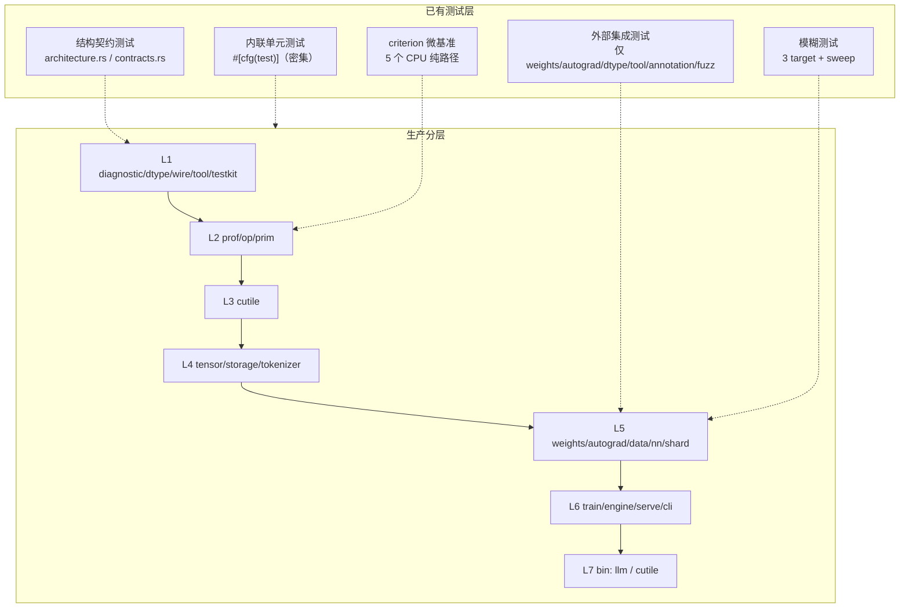

# 架构与测试体系评审（系统 / 单元 / 集成 / 性能）

- 版本：v1.0
- 日期：2026-11-15
- 范围：workspace 24 个 `crates/*` + 根包 `llm`；分层架构、测试金字塔、单测、集成测试、基准/性能测试、CI 门禁
- 取证口径：结论回链源码路径；与既有审计重复的条目沿用 `docs/audit.md` 的 P 编号，不重复展开修复细节
- 配套文档：[`ARCHITECTURE.md`](ARCHITECTURE.md)（分层与所有权）、[`audit.md`](audit.md)（逐模块静态审计）、[`engine-benchmark-roadmap.md`](engine-benchmark-roadmap.md)（对标与里程碑）

---

## 0. 总体判断

架构纪律是本仓的长板：7 层单向依赖、类型唯一主人、闭集单一事实源、25 条 ADR，且这些契约由 `tests/architecture.rs` / `tests/contracts.rs` 可执行地守门。测试体系的**静态结构质量高**（约 970 个 libtest 用例、nextest 隔离并行、doc-test、fuzz、依赖卫生、重复率硬门齐备），但测试**行为覆盖与回归能力存在结构性缺口**：

1. 测试金字塔中间薄：内联单测密集，面向公共 API 的外部集成层与进程级端到端层几乎为空；
2. 性能回归闭环未接通：基准只产数字，判定库 `tools::regress` 无消费者，CI 只编译不测量；
3. 真机/真权重/真后端类测试的门控夹具已建好但基本未接入，CI 环境下这些路径默认永不执行；
4. 覆盖率门禁只守 `cutile` 一个成员，其余成员无下限、无趋势；
5. 当前运行时本就是契约/簿记原型（无后端、无可写缓冲、无 socket、无通信后端），部分缺口是阶段未到；但门禁绿灯容易被误读为"行为可用"，需要在报告口径上把**结构正确**与**行为可用**分开。

## 1. 现状基线（取证事实）

| 项 | 现状 | 证据 |
|---|---|---|
| 成员 | 24 个 crate + 根包 `llm`；工具成员 `annotation` / `fuzz` / `benchmarks` 不参与运行时方向判定 | `Cargo.toml`、`ARCHITECTURE.md §一` |
| 分层 | L1 基础 → L2 数据 → L3 内核 → L4 运行时 → L5 模型训练 → L6 调度服务 → L7 入口；依赖只能向下或同层向左 | `ARCHITECTURE.md §二` |
| 契约测试 | `tests/architecture.rs`（成员/边/方向/所有权对 `cargo metadata` + 文档双向校验）、`tests/contracts.rs`（闭集/位集/注册表-注解镜像） | `tests/` |
| 单元测试 | 以源码旁 `#[cfg(test)] mod tests` 为主；外部 `tests/` 目录仅 6 个 crate、13 个文件 | `crates/*/tests/` |
| 测试夹具 | 内部 `testkit`（对拍、门控、临时目录、确定性 PRNG、CRC 参考）；生产零外部测试框架 | `crates/testkit/src/lib.rs` |
| 模糊测试 | 3 个 libFuzzer target（cli / weights json / safetensors）+ 1 个确定性扰动 sweep（512 例 × 3 目标） | `crates/fuzz/`、CI `fuzz` job |
| 基准 | 5 个 criterion 微基准：elementwise、span_parse、negotiate、wire_codec、weights_container | `crates/benchmarks/src/` |
| CI 门禁 | fmt、clippy `-D warnings`、nextest 三平台矩阵、MSRV、doc-test/文档、jscpd、cargo-deny、cargo-machete、覆盖率（仅 cutile 下限）、bench 编译、fuzz 有界运行 | `.github/workflows/ci.yml`、`scripts/ci.sh` |
| 运行时成熟度 | 执行/张量/KV/服务/训练/分布式均为契约或簿记，无真实流、设备队列、可写缓冲、socket、通信后端 | `engine/src/exec.rs`、`engine/src/kv.rs`、`serve/src/lib.rs`；roadmap §3 |

### 1.1 测试挂载点现状图

缺口层（图中未画）：公共 API 外部集成测试、CLI/进程级 e2e、后端可替换 mock 测试、内核/服务吞吐与并发基准、真机真权重回归集。

---

## 2. 系统架构层面的问题

### 2.1 运行时为契约原型，测试对象多为纯数据结构（阶段事实，需防误读）

- **事实**：`engine::exec` 只有图/流/节点/启动几何契约，没有真实流与 kernel launch；`tensor` 是只读 `&[u8]` 视图，无可写缓冲；`engine::kv` 只管页表与存活位图，页里不持有数据；`serve` 只有路由/响应/线格式，无 socket；`shard` 只有拓扑簿记，无通信后端。
- **影响**：当前绝大多数测试验证的是"簿记与契约自洽"，不是"在真实数据上算得对、跑得快"。架构门禁绿灯不能推出端到端可用性；对外引用时必须区分结构正确与行为可用（roadmap §2.1 已有同口径约束）。
- **等级**：P1（口径与预期管理）。
- **建议**：在 `ARCHITECTURE.md` 与测试报告中按维度标注成熟度（契约 / 簿记 / 片段 / 实现，口径沿用 roadmap §4 矩阵）；端到端能力未落地前，不把结构测试结果表述为功能验证。

### 2.2 `weights` 是跨领域 god crate，测试边界随之内聚在内部（沿用 audit P1-1）

- **事实**：容器/线格式、外部格式适配、rANS 压缩、哈希、ML-DSA 后量子实现混在一个 crate；解析侧多个文件本地测试为 0（见 §3.3）。
- **影响**：单测只能访问 crate 内部，外部集成视角看不到分领域边界；未来拆分时测试边界要随领域一起重划。
- **等级**：P1。
- **建议**：拆分前先把解析/编解码的外部往返测试从内联移到 `tests/`，让测试先锁住公共行为，再按领域拆 crate。

### 2.3 `cutile` 双模板渲染路径，等价性靠单个测试兜底（沿用 audit P1-4）

- **事实**：生产走 `ast::build` + `ast::render`；`substitute::render` 仅余对拍检查与测试调用。
- **影响**：替换规则改动要同步两处，等价性护栏薄。
- **等级**：P1。
- **建议**：在迁移收尾前补一条双路径逐用例对拍的表驱动测试；迁移完成后删除字符串路径。

### 2.4 同名类型跨域，测试与报告易串（沿用 audit P3-2）

- **事实**：`train::Schedule`（学习率）与 `autograd::Schedule`（反传顺序）、`autograd::Plan` 与 `cutile::Plan` 靠散文注释区分。
- **影响**：测试命名、基准条目、错误报告引用时可能指向错误同名类型。
- **等级**：P2。
- **建议**：中期改名加域前缀；短期在测试与报告输出里全路径引用类型。

### 2.5 根入口层存在职责违约（沿用 audit P3-3 / P3-4）

- **事实**：`src/main.rs` 定义了层类型；`src/bin/cutile.rs` 约 760 行是人可读排版，属于 `tools` 报告职责域。
- **影响**：L7"不定义新类型、只组装"的架构约定被入口代码突破；排版逻辑无公共层测试可挂。
- **等级**：P2。
- **建议**：排版下沉 `tools` 后，由 `tools` 的测试守护；入口层只留分派。

### 2.6 静态质量门的扫描面小于全仓（沿用 audit P1-7）

- **事实**：`tools` 门禁只扫 `crates/*/src`，`build.rs`、`crates/*/tests/`、根 `src/`、`docs/adr/**`、各 crate README 不在扫描内；宏体、UFCS 形式、`assert!`/`unreachable!` 有漏匹配。
- **影响**："零 unwrap / 零 panic 入口"之类结论不能从门禁绿灯直接推出；生产边界外的代码处于盲区。
- **等级**：P1（门禁可绕过）。
- **建议**：把扫描集扩展到 build.rs 与根入口；补 UFCS 与宏体识别；每条漏扫路径在审计报告中显式登记。

### 2.7 工具成员的依赖定性与编译事实有缝隙（沿用 audit P3-1）

- **事实**：`annotation` 不参与方向判定，但它是 `nn`/`cutile` 的硬编译依赖。
- **影响**：架构文档措辞与 `cargo metadata` 形状不完全一致，评审时易误判工具边无约束。
- **等级**：P3。
- **建议**：在架构契约中把"不参与方向判定"与"参与编译依赖"两件事分栏写清。

---

## 3. 单元测试架构的问题

### 3.1 内联测试可达私有项，公共 API 边界覆盖不足

- **事实**：测试绝大多数是源码旁的 `#[cfg(test)]` 模块；外部 `tests/` 目录只覆盖 `annotation`、`autograd`、`dtype`、`fuzz`、`tools`、`weights`。`cli`、`engine`、`serve`、`train`、`nn`、`prof`、`shard`、`storage`、`tensor`、`tokenizer`、`wire`、`diagnostic`、`cutile` 没有外部集成测试。
- **影响**：单测与内部实现强耦合——重构私有结构时测试被迫一起改；公共 API 的签名、错误码、跨 crate 行为没有黑盒验证。
- **等级**：P1。
- **建议**：对外暴露稳定 API 的 crate（尤其 `engine`、`serve`、`weights`、`wire`、`tokenizer`）补 `tests/` 黑盒用例；内联测试保留给私有算法与不变量。

### 3.2 空转 / 静默跳过测试："绿但没测"（沿用 audit P2-9）

- **事实**：
  - `weights/src/bin.rs`、`zip.rs`：真实样本路径不存在时直接 `return`，而这是 ZIP+pickle 路径唯一的练习；
  - `cutile/src/witness.rs`：无后端时直接返回，与 testkit 的显式门控是两种风格；
  - `tool/tests/ccn.rs`：旧二进制不存在时打印 skip 并 return。
- **影响**：这些用例在多数环境恒绿，实际未执行关键路径；失败被环境条件掩盖。
- **等级**：P1（假绿）。
- **建议**：统一为 testkit 的"默认跳过、显式开门"约定；跳过必须计数并在 CI 报告中可见，禁止用裸 `return` 表达跳过；缺少夹具的路径要在测试名或日志里标明 skipped 原因。

### 3.3 解析侧文件本地测试为零，截断/位翻转覆盖集中在少量往返测试

- **事实**：`weights` 的 `reader.rs`、`seg.rs`、`codec.rs` 无本地测试，畸形输入覆盖全靠 `tests/round_trip.rs`。
- **影响**：单个解析分支的截断、越界长度、对齐错误路径不易定位到具体用例。
- **等级**：P2。
- **建议**：按解析入口补截断/坏长度/位翻转的表驱动负例；负例断言错误类别与退出码，不只断言返回 `Err`。

### 3.4 无属性测试，边界输入靠手写枚举

- **事实**：dev-dependencies 中没有 `proptest` / `quickcheck`；关键纯函数（张量几何、布局、LEB128、闭集解析、einsum 表达式、快照编解码）的输入形状手写。
- **影响**：退化情形（空、长度 0、极大值、对齐边界、跨字节边界）依赖逐条想到；roadmap P0 自己也把"关键纯函数补属性测试"列为待办。
- **等级**：P1。
- **建议**：先在 `wire`（编解码往返）、`tensor`/`storage`（几何与步幅）、`dtype`（名称往返）、`weights`（容器往返）四类纯函数引入属性测试；不变量用"往返一致 / 解码不 panic / 错误可归类"表达。

### 3.5 浮点判据分散，集中对拍夹具闲置

- **事实**：`testkit::approx_eq` 在 testkit 之外 0 处调用；`cosine_similarity` / `COSINE_GUARD` 仅少量使用；`Rng`、`crc32_bitwise` 采用较多。
- **影响**：容差口径不统一，各用例可能自写阈值；集中提供的逐元素对拍函数闲置，说明夹具 API 与真实需求脱节。
- **等级**：P2。
- **建议**：梳理现有对拍口径，按 dtype 建立统一误差预算（逐元素 `max_rel_err` / 余弦方向一致性两档）；闲置夹具要么接入要么删除，避免第二份约定漂移。

### 3.6 crate 本地夹具与 testkit 职责重叠

- **事实**：`weights/src/testutil.rs` 自建 f32 段构造与归档写盘夹具；testkit 刻意不依赖被测 crate，部分夹具只能在 crate 内复制。
- **影响**：同类构造约定多处维护；新增权重格式时夹具跟着复制。
- **等级**：P3。
- **建议**：把不依赖领域类型的纯字节夹具上移 testkit；领域相关构造留在 crate 内并写明边界。

### 3.7 装饰性闭集变体没有构造点，测试不会暴露死变体（沿用 audit P1-6）

- **事实**：`prof::decl::Skeleton` 的 `Attention` / `Scan` 全仓无构造点；`Skeleton::Gemm` 仅测试里构造。
- **影响**：一个"闭集"事实上是装饰性的，违反本仓自己的单一事实源契约。
- **等级**：P2。
- **建议**：删除无构造变体，或补构造点与对应测试；闭集成员必须被测试或生产路径至少引用一次。

---

## 4. 集成测试架构的问题

### 4.1 根 `tests/` 只有结构契约，没有行为集成测试

- **事实**：`tests/architecture.rs`、`tests/contracts.rs` 扫描 `cargo metadata` 与源码，校验成员/边/方向/所有权/闭集/注册表镜像；不执行业务链路。
- **影响**：跨 crate 的真实协作（权重加载 → 层绑定 → 算子参考 → 训练缓冲 / 调度提交）没有集成级对拍；结构一致不代表链路接通。
- **等级**：P1。
- **建议**：按链路补少量跨 crate 集成用例：weights 条目 → nn 栈下界 → train 缓冲装载；cli 解析 → 各层最小实例构造（对齐 `main.rs::status` 已有手工链路，但需固化成测试）。

### 4.2 无进程级 / CLI 端到端测试

- **事实**：测试中没有 `Command::new` 派生二进制、没有 `assert_cmd`；`llm` / `cutile` 二进制只有内联排版与助手函数测试。
- **影响**：命令解析 → 分派 → 执行 → 退出码 → 人可读输出这条链没有端到端护栏；错误退出码契约（`Code::exit_code`）只在库层测到。
- **等级**：P1。
- **建议**：引入 `assert_cmd`（dev-dependency），覆盖 help、status、坏参数、缺权重文件、未知设备等退出码路径；二进制不读真实模型，用合成 fixture。

### 4.3 L6 调度 / 服务 / 训练 / 拓扑接缝缺可替换后端驱动

- **事实**：`engine` 测试在进程内直构 `Scheduler` + `Cache`；`serve` 测试直调 `Scheduler`；没有执行器/后端 trait 的 mock 替身；无传输层、无并发测试；`train` 快照往返与缓冲测试为内联；`shard` 拓扑测试为内联簿记。
- **影响**：未来接真实后端/传输时，现有测试不能通过替换实现来复用；并发与失败路径（池满、序列结束、页回收、准入拒绝）只能在簿记层验证。
- **等级**：P1（与 roadmap §5 的后端 trait 预留同步）。
- **建议**：在后端/执行器 trait 定型时配套 `MockExecutor` / `MockBackend` 夹具放 testkit；serve 层预留传输无关的端点契约测试，传输实现落地后再加 HTTP 层测试。

### 4.4 没有 examples，公共 API 无可执行样例验证

- **事实**：各 crate 无 `examples/` 目录。
- **影响**：API 易用性没有样例级验证；新接入方只能从测试反推用法；样例本身也是一种集成测试。
- **等级**：P2。
- **建议**：为 `weights` 加载、`nn` 层栈、`engine` 序列各留一个最小可编译 example，纳入 CI 编译校验。

### 4.5 跨层数值对拍覆盖偏科

- **事实**：数值一致性对拍集中在 `autograd` gradcheck、`dtype` interop、weights 往返；nn 层栈上下界、op 注册表与层绑定、train 缓冲两条 lane 之间没有跨层对拍用例。
- **影响**：层与算子之间的形状/类型错位可能在单测各自通过后，到组装点才暴露。
- **等级**：P2。
- **建议**：补"注册算子 → 层声明 → 样本形状 → 参考输出"的链路对拍；与 `#[model]` 镜像契约互补（契约查注册，对拍查数值）。

### 4.6 Fuzz 目标覆盖窄，且为确定性扰动而非覆盖引导

- **事实**：sweep 只驱动 cli 参数文法、weights JSON、safetensors 头部；op 模板正文、train 快照字节流、wire 编解码、serve 帧协议没有 fuzz 目标；libFuzzer target 在 CI 每次 30 秒有界运行。
- **影响**：不可信字节入口的畸形覆盖面有限；快照/线格式这类二进制协议最需要解码期 fuzz，目前缺失。
- **等级**：P2。
- **建议**：把 `train::snapshot` 编解码、`serve::proto` 帧解码、`wire` Sink 密封纳入 fuzz 驱动；不变量沿用现有三条契约（不 panic / 结论稳定 / 拒绝有话说）。

### 4.7 环境门控测试在 CI 恒跳过，且无跳过登记机制

- **事实**：`LLM_TEST_DEVICE` / `LLM_TEST_WEIGHTS` 在 CI 未设置；`real_weights_dir` 外部 0 处调用，`device_enabled` 仅 1 处（cpu 见证）。
- **影响**：真机、真权重路径在 CI 永不执行；没有汇总 skipped 原因与数量的门禁，跳过会随时间累积成隐性空转。
- **等级**：P1。
- **建议**：CI 报告 skipped 计数与原因清单；真机/真权重用例集中登记到一张清单，环境具备时在固定 runner 上补跑。

---

## 5. 性能测试架构的问题

### 5.1 基准只覆盖 CPU 纯结构 / 编解码路径，无内核与服务指标

- **事实**：5 个 criterion 基准分别是逐元素加法、span 解析、能力协商、wire 编解码、weights 容器；roadmap §1.1 的指标族（TTFT、TPOT、tokens/s、批吞吐、峰值内存、能效、P50/P99）尚无对应 harness。
- **影响**：无法度量 decode 主路径的任何性能结论；当前数字不能对照 llama.cpp / burn / candle。
- **等级**：P1（阶段相关，roadmap M1/M2 才落地）。
- **建议**：按 roadmap §5 先把基准 harness 接口形状定死（后端、形状、批次、精度、硬件标识作为元数据入参）；M1 起补算子与整模型基准。

### 5.2 回归判定库已实现但未接线，性能闭环为空

- **事实**：`tools::regress` 提供 `Case` / `Baseline` / `Judgement`（方向、预算百分比、通过/回退/改善判定）；但 `benches/` 与 CI 中没有任何代码构造基线或调用 `judge`，基准文件只在文档注释里说明"是否回退由 regress 负责"。
- **影响**：性能退化不会被门禁发现；库是死代码式预留，基线格式与阈值从未在真实基准上验证过。
- **等级**：P1。
- **建议**：M1 第一个真实算子基准落地时，同步接入 regress：基线随仓登记（条目、方向、预算、硬件前提），CI 在固定环境跑测量并判 `regressed`；无固定硬件的环境只编译、不判定。

### 5.3 无固定硬件基线环境与元数据归档

- **事实**：CI bench job 仅 `cargo bench --no-run`；基准用固定合成向量，未记录机型/驱动/形状/批次/后端；无基线产物归档。
- **影响**：跨机器绝对值不可比（文档已承认），但当前连"同环境前后对比"的基线都没有；改善/退化无法区分。
- **等级**：P1。
- **建议**：定义基准结果元数据格式（机型、CPU/GPU、驱动、形状、批次、精度、后端、采样数）；基线存仓内独立目录或 artifact；判定只在同环境内做。

### 5.4 基准形状单一，无形状矩阵与采样策略约定

- **事实**：elementwise 固定 `1<<16` f32；其余基准为单次构造；预热轮数/采样数/测量时长沿用 criterion 默认值。
- **影响**：宽度、批长、精度、对齐边界上的性能拐点测不到；默认采样在噪声机器上可能不稳定。
- **等级**：P2。
- **建议**：decode 主路径基准至少给 batch × seq × hidden 一组形状；明确 warm-up / sample-size / measurement-time 配置；关键基准配 `Throughput` 口径（已有先例）。

### 5.5 无并发 / 负载 / 长稳测试

- **事实**：无异步运行时依赖，无并发压测 harness；serve 无 socket。
- **影响**：P50/P99、并发度、长尾、内存泄漏类指标在服务化阶段前无法预检。
- **等级**：P2（阶段未到，接口应预留）。
- **建议**：P4 服务实现前，先在 roadmap 基准 harness 里预留并发负载维度；当前阶段不引入异步依赖。

### 5.6 基准运行 profile 与发布行为不一致

- **事实**：dev profile `opt-level = 2`，release `lto = thin` + `codegen-units = 1`；CI 基准不指定 profile 口径。
- **影响**：在 dev 优化级下测得的开销与发布产物行为不可比；编译器优化带来的回归可能被错误归因到代码。
- **等级**：P2。
- **建议**：基准统一在 release（或专门 bench profile）下采集；报告记录 profile 与 codegen 配置。

### 5.7 报告结论强度高估的既有问题（沿用 audit P2-10）

- **事实**：缺 p50 时用最小值顶替且不留标记；设备不在本机时 `Err` 被丢弃，"runner 坏了"与"没有这台设备"不可区分；负例表为空时按已测处理。
- **影响**：bench/verify 报告可能把无效测量读成有效结论。
- **等级**：P2。
- **建议**：无效测量显式标记 `is_measured = false`（`cutile::bench::Performance` 已有此概念，应贯穿报告）；设备缺失与执行失败分两类记录。

---

## 6. CI / 工程化跨维度问题

### 6.1 覆盖率门禁只守一个成员

- **事实**：coverage job 采集全 workspace lcov，但 `fail-under` 只对 `cutile`（行 75% / 函数 70%）；其余成员无下限、无趋势对比。
- **影响**：核心算子、解析器、调度/服务代码的覆盖下滑不会被门禁发现。
- **等级**：P1。
- **建议**：先对 `wire`、`dtype`、`weights`、`nn` 加保守下限；覆盖率趋势随 artifact 留存，防单次波动。

### 6.2 两套测试运行器，行为可能分叉

- **事实**：主门禁与覆盖率走 nextest；MSRV job 用裸 `cargo test`；doc-test 由 doc job 单独跑。
- **影响**：nextest 的隔离/超时/过滤行为与 libtest 不同，少数用例可能只在一种运行器下暴露问题。
- **等级**：P3。
- **建议**：MSRV job 也走 nextest（若工具链可用），或在文档中说明两运行器分工与已知差异。

### 6.3 Fuzz 语料不持久化，覆盖引导收益不累积

- **事实**：仓内无 corpus 目录；CI 只在失败时上传 crash artifact，成功运行的语料不回存。
- **影响**：每次 fuzz 从种子重新开始，已探索到的边角路径不积累；回归时无法重放历史语料。
- **等级**：P2。
- **建议**：把最小种子语料随仓提交；CI 产出的新 corpus 作为 artifact 留存，定期回流主干。

### 6.4 Feature 组合没有分目标矩阵

- **事实**：测试统一 `--all-features`；`mmap`、`serde`/`bytemuck`、`device-image`、fuzz `engine` 等 feature 没有按目标平台分别验证。
- **影响**：非 Unix 上的 `mmap` 类可移植性问题历史上漏过（audit P1-2，已修）；feature 关闭时的编译/行为未单独守护。
- **等级**：P2。
- **建议**：CI 增加默认 feature 与关键 feature 子集的 check/test 矩阵；非 Unix 目标至少做 `cargo check`。

### 6.5 恶意输入回归集未独立持久化

- **事实**：畸形样本散落在各测试用例里，没有独立 corpus/负例清单。
- **影响**：修复一个 panic 后，对应的畸形输入没有固化成永久回归用例的约定。
- **等级**：P3。
- **建议**：fuzz crash 复现输入归档为仓内负例；解析器负例表驱动化。

### 6.6 非架构文档不参与一致性门禁（沿用 audit P3-6）

- **事实**：`lld.md`、`10k-analysis.md` 的规模数字已落后当前代码；只有 `ARCHITECTURE.md` 由 architecture.rs 守门。
- **影响**：报告引用过时基线数字，评审依据失真。
- **等级**：P3。
- **建议**：规模/覆盖率/算子数这类可机读数字由测试或脚本生成，文档引用生成物；过期文档降级为历史归档。

---

## 7. 风险与缓解对照

| 风险 | 触发条件 | 缓解 |
|---|---|---|
| 结构门禁绿灯被误读为功能可用 | 原型期对外汇报、接后端前 | 报告按 契约/簿记/片段/实现 标注成熟度；端到端用例未落地前不下行为结论 |
| 性能退化无门禁 | 算子/调度优化合入 | M1 起接通 regress + 基线登记；固定环境判定，其余环境只编译 |
| 假绿空转测试累积 | 依赖外部夹具/设备的用例增多 | 跳过必须显式、计数可见；禁止裸 `return` 跳过；清单登记 |
| 接后端时测试不可复用 | 后端 trait 定型晚于测试编写 | trait 形状在 P0 定死（roadmap §5），配套 mock 夹具进 testkit |
| 解析器负例覆盖盲区 | 新权重格式/线格式加入 | 解析入口表驱动负例 + fuzz 目标；crash 样本固化回归集 |
| 可移植性问题漏网 | 平台/feature 组合增多 | feature × 目标 check 矩阵；mmap 类平台分支有编译守护 |

## 8. 优先级建议（与 roadmap P0–P4 对齐）

### P0：低成本补门禁盲区（不引入后端/新依赖框架的大改动）

1. 修静默跳过/空转测试，统一 testkit 门控约定，skipped 计数入报告（§3.2、§4.7）。
2. 覆盖率下限从 `cutile` 扩到 `wire`/`dtype`/`weights`（§6.1）。
3. 梳理浮点对拍口径，接入或删除闲置的 `approx_eq`（§3.5）。
4. 扩展静态门扫描面到 build.rs、根入口、tests 目录（§2.6）。
5. 关键纯函数（wire 往返、张量几何、dtype 名称往返）补属性测试骨架（§3.4）。

### P1：补集成层与性能闭环

1. 对外稳定 crate 补 `tests/` 黑盒集成测试；CLI 进程级 e2e（assert_cmd）（§3.1、§4.2）。
2. 后端/执行器 trait 定型时配套 mock 夹具；serve/engine/train 接缝用 mock 驱动（§4.3）。
3. 第一个真实算子基准同步接通 `tools::regress` 基线判定与元数据归档（§5.2、§5.3）。
4. 跨层数值对拍链路：weights → nn 栈 → train 缓冲（§4.5）。
5. fuzz 目标补快照编解码、serve 帧解码、wire 密封（§4.6）。

### P2：随运行时落地逐步补齐

1. 基准形状矩阵、采样策略、release profile 口径（§5.4、§5.6）。
2. examples 可编译样例（§4.4）。
3. fuzz 语料持久化与回流（§6.3）。
4. feature × 平台 check 矩阵（§6.4）。
5. weights 拆分后按领域重划测试边界（§2.2）。

### P3：长期摩擦

- 同名类型改名、工具成员定性措辞、本地夹具收口、非架构文档数字生成化（§2.4、§2.7、§3.6、§6.6）。

## 9. 不在本轮建议范围内

- 不新增通用 IR、不引入模型动物园与服务化广度（沿用 roadmap §2.2）。
- P3 之前不把 GPU/异步/通信后端的测试设施提前造出来；当前只预留接口形状与 mock 接缝。
- 性能绝对领先结论只在同硬件对照下给出；原型期不预填吞吐数字（roadmap §2.1）。
