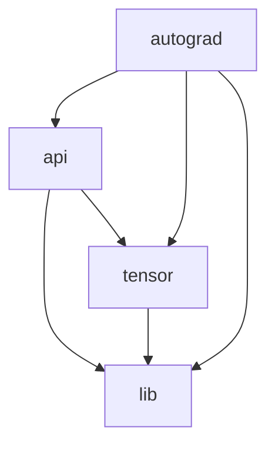

# ADR: Autograd (`autograd` crate)

Status: Accepted
Scope: Layer 1 — define-by-run reverse-mode differentiation on top of the
frozen `api::compute` operator set
Date: 2026-10-10

## Context

Layer 1 compute ([layer1compute.md](layer1compute.md)) gave the workspace a
backend-agnostic operator set behind `api::compute`. The training and model
layers (`nn`, `models`, `train`) need gradients of those operators. Without a
differentiation crate each upper layer would either hand-write backward passes
or bind to one backend, both of which break the dependency direction in
[../architecture.md](../architecture.md) and the static-composition rule in
AGENTS.md §3.3.

`autograd` therefore owns differentiation mechanics only. It depends on
`lib`, `tensor`, and `api` — never on `cpu` — so the same graph code runs on any
backend that implements `api::compute`.

Dependency edges this decision adds (no cycle):

## Decision

1. **One owner, one tape.** `graph<T: element>` is the sole owner of every
   `variable<T>`; it stores them in creation order in a `Vec`. Holding nodes in
   the vector makes ownership explicit: no aliasing, no interior mutability, no
   reference cycle, no `unsafe`. Operators append one node per call; the reverse
   pass walks the vector once in reverse order.

2. **Copyable handles, not borrows.** `variableid(usize)` is a graph-local index
   that is `Copy` and owns nothing. Operators take values out with
   `getvalue`/`valueof` and install gradients with `setgrad`, so the graph is
   never simultaneously borrowed immutably and mutably across a call.

3. **Static operator enum, not boxed closures.** `op` is an enum whose variants
   name the input handles (`matmul { lhs, rhs }`, `rmsnorm { input, weight, eps }`,
   `softmax { input }`, `relu|silu|gelutanh { input }`). The tape therefore holds
   no `Box<dyn Fn>`, no captured heap state, and no dynamic dispatch. `getinputs`
   returns exactly the handles the reverse pass consumes.

4. **Forward operators are inherent methods on the graph.** `graph::matmul`,
   `graph::add`, `graph::mul`, `graph::rmsnorm`, `graph::softmax`, `graph::relu`,
   `graph::silu`, and `graph::gelutanh` forward to the provider, append the node,
   and return the handle. A node is recorded only when recording is enabled and
   at least one input requires a gradient (`graph::record`), so a pure inference
   path allocates no gradient bookkeeping.

5. **Reverse pass is a single reverse sweep.** `graph::backward(id)` seeds the
   output cotangent with ones and walks the tape from the seed down to index 0,
   dispatching each node's vector-Jacobian product through `backward`
   (`backward.rs`). Gradients accumulate into every consumer
   (`ops::accumulate`), so a value used more than once receives the sum of its
   contributions.

6. **RAII recording control.** `graph::nograd` returns `nogradscope<'_, T>`,
   a scope that clears the recording flag and restores it on drop (including on
   unwind). Outputs produced inside keep their value but carry `op::leaf`, so a
   later reverse pass ignores them. `graph::detach` is the non-scoped form.

7. **f32 only, no `unsafe`, no panics.** The crate declares
   `#![forbid(unsafe_code)]`; every fallible path returns
   `autoggraderror`, which wraps `backenderror` and `tensorerror` and adds
   `unknownvariable`, `unsupportedshape`, and `sizeoverflow`. Production paths
   contain no `panic`, `unwrap`, or `expect`.

8. **Per-crate error ownership.** `autoggraderror` is the crate's own enum. It
   re-exports the abstraction's distinctions (`backend`, `tensor`) losslessly and
   never leaks a backend implementation error into an upper-layer contract
   (ER2).

## Design gate (DS0/DS5)

- **Boundary and interface (DS1).** `autograd`'s crate root re-exports six
  public types — `graph`, `variable`, `variableid`, `op`, `autoggraderror`, and
  `nogradscope` — and no free functions; `arena`, `node`, `variables`,
  `gradient`, `nograd`, `backward`, and `ops` stay private modules. The reverse
  pass is reached only through the inherent methods `graph::backward` and
  `graph::backwardwith`, so the per-operator VJP helpers are never caller-facing.
  Public type/trait/enum/variant/function names are lowercase concatenated;
  constants uppercase concatenated. Module file names (`arena`, `node`,
  `variables`, `gradient`, `nograd`) differ from the public types they export
  (`graph`, `op`/`variableid`, `variable`) because a module and a re-exported
  type share one namespace at the crate root (E0255 guard).
- **Invariants (DS2).**
  - Algorithmic: after `backward(root)`, for every recorded node the accumulated
    gradient equals the vector-Jacobian product summed over all consumers; a
    leaf's gradient is left materialized for the caller to read.
  - Implementation: every `variableid` in a recorded `op` is `< vars.len()`
    (ids are handed out by `push` in creation order); a node's gradient tensor,
    when present, has the same shape as its value; the tape only grows.
  - Error branch enumeration: unknown handle (`unknownvariable`), operator
    shape rejected by the backend or the op layer (`unsupportedshape`), size
    arithmetic overflow (`sizeoverflow`), and any backend/tensor failure
    propagated transparently. Resource rollback: a rejected operator returns
    before `push`, so a failed forward leaves no partial node on the tape; the
    graph owns every node and drops them with the graph.
- **Complexity (DS3).** Every function is below cyclomatic 10 and 80 effective
  lines; the largest are the reverse-pass loop in `backward` and the
  `gelutanh` VJP, both short straight-line bodies. (Reviewed by reading,
  evidence level T.)
- **Rejected alternatives (DS5).**
  - *Boxed closures per node* (`Vec<Box<dyn Fn(...)>>`). Rejected: dynamic
    dispatch and captured heap state where a static enum carries the same
    information; violates AGENTS.md §3.3.
  - *Reference-counted `Rc<RefCell<Node>>` graph.* Rejected: interior
    mutability and reference cycles; a single owning vector is both simpler and
    `unsafe`-free.
  - *Global mutable tape or thread-local arena.* Rejected: A6/OW2 forbid global
    mutable state and request-scoped state must have an explicit owner, so the
    tape is a value the caller owns.
  - *Recording in a separate pass or a graph-rewrite IR.* Rejected: no measured
    need; define-by-run is the baseline an optimizing graph IR would have to
    beat.
  - *Depend on `cpu` directly for the backward math.* Rejected: keeps the
    dependency direction `autograd -> api` and preserves backend
    replaceability.

## Consequences

- `nn` and `models` build on `autograd` without touching a backend, and reuse
  the exact `api::compute` operators the inference path uses.
- The tape is append-only for the lifetime of a `graph`; long training loops
  should build a fresh graph per step (the natural request/step boundary) rather
  than retain one indefinitely. This is a documented usage contract, not a
  hidden default.
- Gradients are actual `f32` tensors, so `backward` allocates one tensor per
  node that needs a gradient. That is the owned-output cost of the
  `api::compute` contract, not a hidden buffer pool.
- `nograd` suppresses both recording and gradient storage, so an evaluation
  pass over a graph is allocation-lighter than the same pass with recording on.

## Alternatives Considered

- **Forward-mode (Jacobian-vector) differentiation.** Rejected: reverse mode is
  the fit for a scalar-loss training objective with many parameters.
- **Numerical differentiation as the production backward path.** Rejected:
  central differences are O(parameters) per step and are used here only as an
  independent test oracle.
- **An operator-trait (`backwardop`) with one impl per op.** Rejected: a
  static `op` enum plus a `match` keeps the reverse pass in one auditable place
  and avoids a trait object per node.

## Validation

Executed 2026-10-10 (scoped commands only, because sibling crates were mid-build
during this stage):

- `cargo test -p autograd` — 26 unit tests passed, 0 failed; 1 doctest ignored
  (the `nograd` example is illustrative), exit 0.
- `cargo test -p llm --test autograd` — 13 passed, 0 failed, exit 0. Each test
  compares the analytical VJP against a central finite difference
  `(f(x+h) - f(x-h)) / (2h)` within a documented tolerance, and additional tests
  cover multi-consumer accumulation, `detach`, and `nograd` scoping.
- `cargo clippy -p autograd -p llm --all-targets -- -D warnings` — clean,
  exit 0.
- `cargo check -p llm --all-targets` — passes, exit 0 (the crate is a root
  dev-dependency and the bench target compiles).

Baseline, `cargo bench -p llm --bench autograd`, release profile
(`lto = "thin"`, `codegen-units = 1`, `debug = 1`), criterion 0.7.0, warm-up
1.0 s, measurement 2.0 s, 20 samples, no SIMD, no threading. Environment:
`rustc 1.99.0 (b940084d7 2026-09-28)`, macOS 27.0.1, arm64 (Apple Silicon); the
exact CPU model was not recorded, so this is a same-machine baseline, not a
portable result.

| Benchmark | Workload | Time (median) | Throughput |
| --- | --- | --- | --- |
| autograd/backward/matmul_rmsnorm_softmax | 64x128 @ 128x128, rmsnorm, softmax; forward + reverse | 763.53 µs | 10.73 Melem/s |

The measured interval was 759.30–769.40 µs; 3 of 20 samples were high-severe
outliers. These figures are baselines; no improvement is claimed (VF5), and no
comparison against a prior implementation exists because there is none.

## Revisit Conditions

Reconsider when: a profile shows the tape itself (not the operators) dominating a
training step (then consider a graph IR or operator fusion with a correctness
plan); a model needs a backward operator not yet in `op` (then extend the enum
and the reverse `match` additively); batched matmul or a reduction is required
(then extend `api::compute` and the tape together); or request-isolation
requirements make a per-step graph ownership rule insufficient (then revisit
tape lifetime with an explicit owner).
