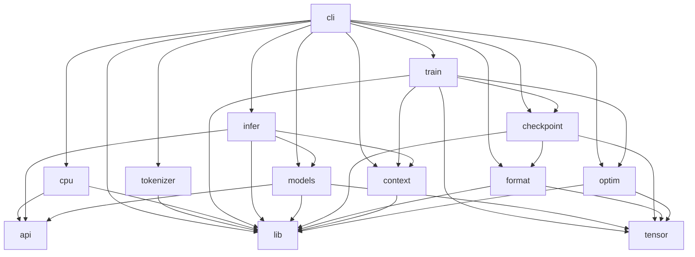

# ADR: Command-line application (`cli` crate)

Status: Accepted
Scope: Layer 4 — the command-line application boundary: argument parsing,
subcommand dispatch, human-readable output, and process-exit mapping over the
library workflows
Date: 2026-10-10

## Context

Layer 0–3 already own the reusable workflows `cli` needs. `format` parses and
structurally validates a `config.json` (`modelconfig`) and a safetensors header
(`safetensorfile`); `checkpoint` owns the checkpoint container, its manifest,
and `decode`; `models` owns the Llama configuration/weights and the
`architecture` registry; `infer` owns `generationengine`, `generationrequest`,
`generationparams`, `samplingparams`, `stopcondition`, `collectingsink`, and
`infererror`; `train` owns `trainconfig` and the `trainer` orchestration loop;
`optim` owns the optimizer configurations and the learning-rate schedule;
`tokenizer` owns HuggingFace BPE loading and encoding; `context` owns
`executionconfig`/`executioncontext`; `cpu` is the concrete `api::compute`
provider; and `lib` owns `limits`, `seed`, `requestid`, and `tokenid`.

`cli` is the thin Layer 4 application that turns `argv` into a call on those
workflows and maps the outcome to stdout/stderr and a process exit code. It
adds no tensor math, no model internals, no training loop, and no inference
engine (crate-boundaries 5.16; AGENTS.md §3).

### Declared limitation: no backward path through `nn`/`models`

The workspace was re-verified before writing this crate. `nn`/`models` are
forward-only and `autograd` has no Llama or cross-entropy backward path
(`crates/train/src/lib.rs` §"Declared limitation", `docs/decision-records/training.md`).
Therefore an end-to-end `cli train` that fine-tunes a Llama is **not
achievable**. `cli` does not fabricate it: `train` loads and validates a
`trainconfig` (delegating to `train::trainconfig` and `optim`), and any request
to actually update model weights returns a distinct, non-zero
`clierror::notsupported` error (rule.md M4/VF5). `train --check-only` exposes the
part that genuinely runs today (configuration load + validation) and succeeds.

Likewise, inference requires a real model and weights. Rather than requiring an
absent artifact, `generate` builds a deterministic tiny Llama from a fixed
configuration and an explicit `seed`, then drives the **real** `infer` engine
over the **real** `cpu` provider. A `--text` prompt is encoded by the real
`tokenizer`; an absent or invalid tokenizer file is reported precisely.

### Dependency edges this decision adds (no cycle)

`cli` is a Layer 4 application: it may depend on the workflow crates and on the
concrete `cpu` backend. It is not a dependency of any Layer 0–3 crate.

## Decision

1. **`cli` is a thin adapter, not an engine.** Every command parses arguments,
   selects configuration, calls one real library workflow, and renders a report.
   The crate contains no tensor arithmetic, no forward/backward pass, no
   training loop, and no sampling algorithm (crate-boundaries 5.16). Where a
   workflow cannot run (end-to-end Llama training), the command returns a typed
   error instead of a synthesized success.

2. **The command tree is testable in-process.** The package is a library plus a
   one-line binary. `src/lib.rs` exposes `parse` (a `clap` `try_parse_from`
   wrapper), `run` (dispatch returning a crate-owned `commandoutput` or
   `clierror`), `exitcode` (the single error-to-code mapping), and `runcli`
   (the full `argv`-to-exit-code adapter writing into caller-supplied
   `Write` sinks). `src/main.rs` only locks `stdout`/`stderr` and calls
   `runcli`, so argument parsing, dispatch, output, and exit codes are all
   covered without spawning a process.

3. **Exit codes are explicit and centrally defined.** One function,
   `clierror::exitcode`, maps every error variant to a code, and the usage code
   is the named constant `USAGEEXITCODE`. The table:

   | Code | Constant | Meaning |
   | ---- | -------- | ------- |
   | 0 | (success) | Command completed; report written to stdout. |
   | 1 | `OPERATIONALEXITCODE` | Operational failure: I/O, an invalid path, an oversized artifact, an unrecognized artifact, a model/inference/training/tokenizer/optimizer/context failure. |
   | 2 | `USAGEEXITCODE` | Usage: `clap` parse diagnostics, a semantically invalid argument value (`invalidarguments`), or a malformed training-configuration document (`invalidconfigjson`). |
   | 3 | `VALIDATIONEXITCODE` | The target artifact is structurally invalid (`formaterror`, `checkpointerror`), as reported by `inspect`/`validate`. |
   | 4 | `UNSUPPORTEDEXITCODE` | A declared, structural limitation (`notsupported`): end-to-end Llama training has no backward path yet. |

   `--help`/`--version` are not errors: `runcli` writes them to stdout and exits
   `0`, matching `clap`'s own convention.

4. **Every external input is validated before use (IN1/IN2/IN4).** A path is
   checked with `std::fs::metadata` to be an existing regular file and its length
   is checked against `DEFAULTMAXARTIFACTBYTES` before the file is read, and the
   read length is re-checked (copy-validate-use, IN3). Token lists are bounded by
   `MAXPROMPTTOKENS` and parsed with checked conversion; `--maxnewtokens` is
   bounded by `MAXNEWTOKENSLIMIT`; `--vocab` must be non-zero; a prompt or
   end-of-sequence token outside the model vocabulary is rejected as a usage
   error before the model runs. The safetensors/CPU element, byte, sequence, and
   batch budgets are the explicit constant `DEFAULTLIMITS`, and the execution
   step budget is derived from `--maxnewtokens` (never unbounded).

5. **`inspect` and `validate` delegate artifact parsing.** The first non-space
   byte selects the parser: `{` → `modelconfig::parse`; the exact checkpoint
   magic `LLMCKPT1` → `checkpoint::decode`; otherwise `safetensorfile::parse`.
   `inspect` prints a human-readable summary; `validate` prints a success summary
   or returns the structured `formaterror`/`checkpointerror` unchanged, so the
   underlying distinction is not collapsed (ER2).

6. **`generate` runs the real engine over a deterministic tiny model.** The
   configuration is built through `llamaconfig::new`, weights through
   `llamaweights::random(&config, seed)`, and the model through
   `getarchitecture("llama")?.newmodel(...)`; the request uses
   `stopcondition`/`samplingparams`/`generationparams::formodel`, a request-scoped
   `generationrequest`, a caller-owned `executioncontext`, a `collectingsink`, and
   `cpuexecutor` as the `api::compute` provider. All mutable state is
   request-scoped and released on drop (OW2/OW3).

7. **`train` delegates configuration and refuses to fake a training run.** The
   CLI-owned `trainconfigfile` JSON is parsed with `serde`, then validated
   through `trainconfig::new` and a real optimizer value (`sgd::new`/`adamw::new`
   over a validated `sgdconfig`/`adamwconfig`). With `--check-only` the validated
   plan is reported and the process exits `0`; without it the command returns
   `clierror::notsupported` and exits `4`.

8. **One owned error enum; no panics in production code.**
   `#![forbid(unsafe_code)]`; `clierror` carries each workflow error
   transparently (`#[from]`) and owns the adapter-only variants (`io`,
   `invalidpath`, `sizeexceeded`, `unrecognizedartifact`, `invalidarguments`,
   `invalidconfigjson`, `notsupported`). Production code contains no `panic`,
   `unwrap`, `expect`, `todo`, or `unimplemented`; test modules may allow
   `unwrap`/`expect`. A deliberate discarded write (a best-effort diagnostic to
   stderr) is marked with `let _ = ...` and a reason comment (ER5).

## Design gate (DS0/DS5)

- **Boundary and interface (DS1).** The crate root exports the re-exported clap
  types (`cli`, `command`, `inspectargs`, `validateargs`, `generateargs`,
  `trainargs`), `clierror`, `commandoutput`, and the four functions `parse`,
  `run`, `exitcode`, `runcli`, plus the five exit-code constants — well under the
  A4 bound of 20. Public type/function names are lowercase concatenated;
  constants are uppercase concatenated. Module file names differ from the types
  they export because a module and a re-exported type share one name namespace
  (E0255 guard): `args` exports `cli`/`command`, `error` exports `clierror`, and
  the plural module `commands` exports no type, so `command` (a type in `args`)
  never collides with a module.
- **Invariants (DS2).**
  - Algorithmic: `inspect`/`validate` classify an artifact by its bytes only, so
    the same bytes always reach the same parser; `validate` returns success
    exactly when the underlying parser accepts the bytes; `generate` with a fixed
    `--seed` and fixed arguments returns identical tokens across runs; `train`
    never reports success without `--check-only`; and `exitcode` is total over
    `clierror`.
  - Implementation: a `commandoutput` holds only rendered text; a `clierror`
    value always carries enough context to be printed; every `clierror` variant
    is reachable from at least one command path or the argument parser.
  - Error branches: usage (clap, bad token list, out-of-range token, bad config
    JSON), artifact validation (`formaterror`, `checkpointerror`), path/read
    (`io`, `invalidpath`, `sizeexceeded`, `unrecognizedartifact`), model and
    generation (`modelerror`, `infererror`, `contexterror`), tokenization, and
    the declared `notsupported` limitation. Resource rollback: files are read
    into a bounded buffer and dropped; a file larger than the bound is rejected
    before it is read; generation state lives in the request and context and is
    released on drop.
- **Complexity (DS3).** Every function is below cyclomatic 10 and 80 effective
  lines; the largest are the per-command `run` functions (a short linear
  sequence of validated calls) and `runcli` (a single `match` with two arms).
  (Reviewed by reading, evidence level T.)
- **Rejected alternatives (DS5).**
  - *`cli` depends on a backend-agnostic provider only and cannot run.*
    Rejected: a binary must select a concrete `api::compute` provider to execute
    `generate`; the workspace's own `cpu` crate is the minimal concrete choice and
    adds no external dependency. `serve` is generic because it is a library that
    is handed a provider; `cli` is the composition root that chooses one.
  - *Dynamic dispatch or a plugin/provider registry to select a backend.*
    Rejected: there is exactly one supported backend and no runtime-extensibility
    requirement, so a `match`/direct construction is used (A3, AGENTS.md §3.3).
  - *Reimplement a training loop so `train` can "succeed".* Rejected: that would
    duplicate the training engine in the application layer (crate-boundaries
    5.16) and would fabricate a result; the missing backward path is reported.
  - *Require the user to supply a real model + safetensors for `generate`.*
    Rejected as the default: it would make the command unusable without an
    artifact. A deterministic tiny model drives the identical real engine; the
    `--tokenizer`/`--text` path still exercises real tokenization.
  - *Return `0` for `validate` and print a boolean result.* Rejected: a failed
    validation is a distinct, machine-observable outcome; the process exits `3`
    and the structured error is printed.
  - *Collapse all failures into exit code 1.* Rejected: callers must distinguish
    a usage mistake (`2`) from an invalid artifact (`3`) from a declared
    limitation (`4`), and the mapping is centralized so it cannot drift per
    command.

## Consequences

- The command tree, reports, and exit codes are exercised in-process; the binary
  itself is one call to `runcli`.
- `inspect`/`validate` cannot drift from the library parsers because they call
  them directly and surface their errors unchanged.
- `generate` is limited to the tiny deterministic model; pointing it at a real
  checkpoint/weights is future work that reuses the same engine seam.
- `train` is honest about the missing backward path: the configuration workflow
  runs, the weight-update workflow does not, and the process exit code says so.

## Deviations from the plan

- **The plan's `src/command/` directory is `src/commands/`.** The subcommand
  enum is a type named `command`; naming the module `command` as well would put
  a module and a re-exported type in one namespace (E0255). Clause: NM2 / E0255
  guard. Impact: none on the public interface.
- **`src/main.rs` is one expression over `cli::runcli`.** The plan lists
  `main.rs`; this stage keeps all logic in the library so exit-code mapping and
  output are unit-testable, and `main.rs` only acquires the standard streams.
  Clause: explicit task instruction (thin `main`). Impact: none.
- **Integration tests are crate-local under `crates/cli/tests/`.** A later
  consolidation pass owns the root `tests/` and `benches/`, so this stage does
  not touch them. Clause: explicit task instruction / `docs/testing.md`. Impact:
  the integration tests are not yet in the root suite. Superseded: the later
  consolidation pass moved them to the root `tests/cli.rs` (see
  `testconsolidation.md`).
- **No benchmark and no performance claim.** `cli` performs no hot-path work of
  its own; all compute is delegated, and no speedup is claimed (VF5). Clause:
  `rule.md` PF1/PF5. Impact: none.
- **`train` supports no learning-rate schedule file field yet.** `trainconfig`
  accepts an optional `lrschedule`, but the CLI schema omits it to keep the
  configuration surface minimal; the plan does not require it. Clause: explicit
  task instruction / A4. Impact: a schedule cannot be selected from the CLI yet.

## Validation

Executed 2026-10-10 against the workspace root with `-p cli`:

- `cargo fmt --all` — clean, exit 0.
- `cargo check -p cli --all-targets` — clean, exit 0.
- `cargo clippy -p cli --all-targets -- -D warnings` — clean, exit 0.
- `cargo test -p cli` — 19 library unit tests + 20 `tests/cli.rs` integration
  tests passed, 0 failed, exit 0 (doc-tests: 0).
- `RUSTDOCFLAGS='-D warnings' cargo doc -p cli --no-deps` — clean, exit 0.
- Binary smoke via `cargo run -q -p cli -- ...`: `--help` exit 0;
  `generate --tokens 1,2 --maxnewtokens 2` exit 0 and byte-identical output on
  two runs (`shasum d789e15910d58b271348fb070c0e77c3d5d79354`), printing
  `generated: [3, 5]`, `stopreason: maxlength`, `steps: 2`; `train --config
  /nonexistent.json` exit 1 with an `i/o error` diagnostic (E1).

The central integration test, `generate_runs_the_real_engine_deterministically`,
runs the command twice through `runcli` and asserts identical output, proving
the tiny model and the engine are deterministic. The remaining tests pin
artifact classification and reporting (`inspect`/`validate` over a real
`config.json` and over a real encoded checkpoint built with the `tensor`
dev-dependency), the exit-code constants, token parsing bounds, the
`--text`-requires-`--tokenizer` rule, the `train --check-only` success path, and
the declared `notsupported` limitation (exit 4). No speedup is claimed (VF5).

Environment: `rustc 1.99.0 (b940084d7 2026-09-28)`, macOS 27.0.0, arm64 (Apple
Silicon).

## Revisit Conditions

Reconsider when: a backward path through `nn`/`models` lands (then `train` grows
a real weight-update path behind the same command and this ADR's limitation is
removed); a real artifact loader for `generate` lands (then add
`--checkpoint`/`--weights` and re-measure); the root `tests/`/`benches/`
consolidation pass runs (then move the integration tests into place); or a
second concrete backend is added (then revisit the backend-selection decision).
