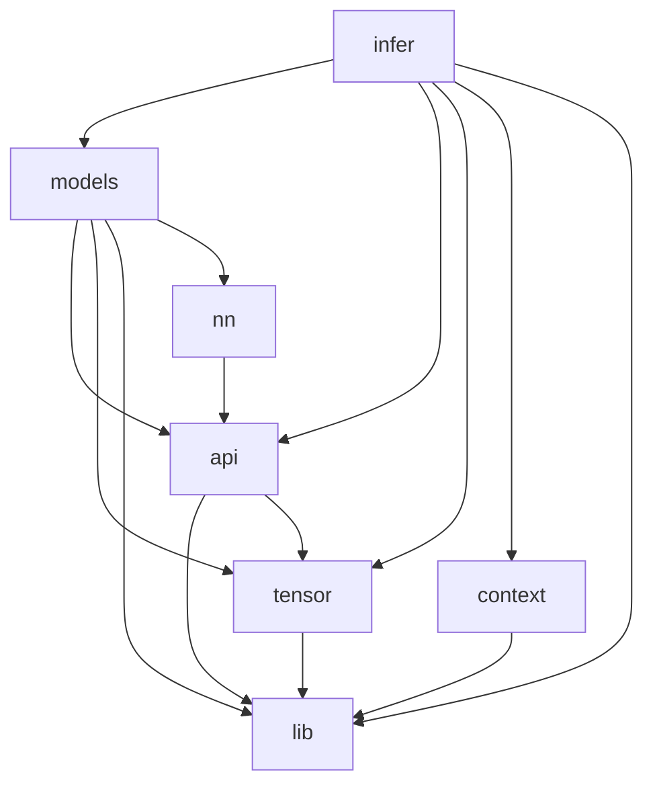

# ADR: Inference and generation (`infer` crate)

Status: Accepted
Scope: Layer 3 — the generation engine, request lifecycle, sampling, stop
conditions, streaming, and the request-owned key/value cache implementation
Date: 2026-10-10

## Context

Layer 3 gives the workspace the pieces a generation workflow needs:
`models` owns the causal-LM contract `causallm` and the request-scoped `kvcache`
contract ([models.md](models.md)), and `context` owns the execution checkpoint
and cancellation (`executioncontext`, `cancellation`). `infer` is the workflow
crate that turns a prompt into generated tokens on top of those, without holding
request state in the model and without depending on a concrete backend.

`infer` depends on `models`, `api`, `tensor`, `context`, and `lib`. It reaches
the backend only through the generic `api::compute` bound re-exported by
`models::causallm::forward`; `cpu` is a dev-dependency used only by the
integration tests. It does not depend on `nn`, `autograd`, `optim`, `train`,
`cli`, or `serve`.

Dependency edges this decision adds (no cycle):

## Decision

1. **The engine is stateless; the request owns all mutable state.**
   `generationengine<'a, M: causallm, C: compute>` borrows an immutable model and
   a compute provider and holds nothing else. Everything that changes while
   generating lives in a `generationrequest`: the immutable prompt, the
   accumulated context, the sampler position, the stop criteria, and the
   request-owned `kvstate`. Two requests therefore run concurrently against one
   model value without sharing mutable state (OW2), and a model's weights are
   never a place to stash request data.

2. **`generate` is prefill, then a sample/append/decode loop.** It resets the
   request to a fresh attempt, checks cancellation, runs one prefill forward
   pass over the prompt, then repeats: sample a token, stop on EOS, append the
   token, hand it to the sink, stop on the new-token cap, otherwise decode the
   full accumulated context. Every iteration begins with an `executioncontext`
   checkpoint, so cancellation and step-budget exhaustion stop the loop before
   the next forward pass and return an error rather than a result (CC5).

3. **Correctness first: the primary path recomputes the full context.**
   `prefillprompt` and `decodestep` both reduce to one `causallm::forward` over
   the tokens they are given and the last-position logits (`generation.rs`).
   While the cache is unwired, decode forwards the whole context. That is the
   tested baseline a cached decode must beat (PF1/PF5).

4. **Sampling is deterministic host logic seeded by `lib::seed`.** A
   temperature of exactly `0.0` is greedy (argmax, ties by lowest index).
   Otherwise logits are scaled by `1 / temperature`, optionally restricted to the
   `topk` largest and the smallest descending-probability prefix whose cumulative
   mass reaches `topp`, and one token is drawn from a categorical distribution
   driven by a SplitMix64 stream. Two samplers built from the same
   `samplingparams` and `seed` return the same tokens for the same logits
   sequence; `reset` rewinds the stream.

5. **Stop conditions are explicit and validated.** `stopcondition` names the
   end-of-sequence tokens and a non-zero new-token cap; `stopreason` reports
   which of `endoftoken`, `maxlength`, or `stopped` (the sink asked to stop)
   ended the run. A request that could emit nothing is rejected as a wiring
   error rather than accepted as a degenerate limit.

6. **The output contract is a call-scoped sink.** `streamsink::ongenerated`
   returns `true` to continue or `false` to stop, and `onstop` fires exactly once
   on normal termination. A failed or cancelled run returns an `infererror` and
   never calls `onstop`, so a stream cannot silently imply success. The engine is
   generic over `S: streamsink` (no `Box<dyn ...>`, A3); `collectingsink` is the
   in-crate recording implementation.

7. **`kvstate` implements the `models` cache contract; `infer` owns the buffer.**
   `kvstate` holds one key and one value tensor per layer, each `[cached_len,
   width]`, advances every layer in lockstep through `append`/`appendall` and
   resets with `clear`. It validates the `[1, width]` row shape, the layer index,
   and the capacity on every append, and it is created, owned, and reset by a
   `generationrequest`. The request-scoped cache is the reason `models` only owns
   the contract and `infer` owns the implementation.

8. **`reset` makes every termination path reusable.** After a completed,
   cancelled, or failed run, `reset` restores the context to the prompt, rewinds
   the sampler, and clears the cache, so no residual state can be reused
   incorrectly (OW3). All resources are released by `Drop`; there is no manual
   release path.

9. **`#![forbid(unsafe_code)]`, one owned error enum, no panics.** Every
   fallible path returns `infererror`, which wraps `modelerror` and
   `contexterror` transparently (ER2) and adds `invalidrequest`, `invalidparams`,
   `tokenoutofrange`, `emptylogits`, and `degeneratelogits`. Production code
   contains no `panic`, `unwrap`, `expect`, `todo`, or `unimplemented`.

## Design gate (DS0/DS5)

- **Boundary and interface (DS1).** The crate root exports twelve public types
  (`generationengine`, `infererror`, `generationresult`, `kvstate`,
  `generationparams`, `generationrequest`, `sampler`, `samplingparams`,
  `stopcondition`, `stopreason`, `collectingsink`, `streamsink`) and no
  constants or free functions — under the A4 bound of 20. Public
  type/trait/enum/variant/function names are lowercase concatenated; constants
  would be uppercase. Module file names differ from the types they export
  because a module and a re-exported type share one namespace (E0255 guard):
  `engine`→`generationengine`, `error`→`infererror`, `generation`→
  `generationresult`, `kvcache`→`kvstate`, `request`→`generationparams`/
  `generationrequest`, `sampling`→`sampler`/`samplingparams`,
  `stopping`→`stopcondition`/`stopreason`, `stream`→`collectingsink`/
  `streamsink`. `prefill` and `decode` expose only crate-private functions.
- **Invariants (DS2).**
  - Algorithmic: a `generationresult` owns exactly the accumulated generated
    tokens in order, so `gettokens().len() == getcount()` and no prompt token
    appears in it; for a greedy request with empty EOS and cap `N`, the engine's
    tokens equal `N` independent `argmax` steps over the growing context; and a
    sampler is a pure function of `(params, seed, logits sequence)`, so identical
    inputs reproduce identical tokens.
  - Implementation: a `generationrequest` created by `new` (or restored by
    `reset`) has `context == prompt`, `getgeneratedlen() == 0`, a cache of
    length 0, and a sampler at its seeded start; the context never exceeds
    `maxseq`, because construction rejects `prompt.len() > maxseq` or
    `prompt.len() + maxnewtokens > maxseq` and `pushgenerated` rejects once
    `context.len() >= maxseq`; a `samplingparams` that exists has a finite,
    non-negative temperature, `topk != Some(0)`, and `topp ∈ (0, 1]`; a
    `stopcondition` that exists has `maxnewtokens != 0`; a `kvstate` that exists
    has non-zero layers/width/maxseq and rejects any append that is not a
    `[1, width]` row or would exceed capacity; and the model is borrowed
    immutably for the whole call, so no request state is observable through it.
  - Error branches: empty prompt; prompt longer than `maxseq`; prompt plus cap
    longer than `maxseq`; zero `maxseq`/`kvlayers`/`kvwidth`; zero
    `maxnewtokens`; non-finite or negative temperature; `Some(0)` top-k; top-p
    outside `(0, 1]`; empty logits; non-finite logits; a distribution with no
    finite mass; an out-of-range prompt or generated token (surfaced as
    `modelerror` through `infererror::model`); a cache layer out of range, a bad
    row shape, or capacity overflow; and cancellation or step-budget exhaustion
    (`infererror::context`). Resource rollback: a rejected constructor returns
    before a request value exists; `reset` restores the fresh state after any
    terminal path; a partial run leaves all its state in the request and sink,
    never in the model.
- **Complexity (DS3).** Every function is below cyclomatic 10 and 80 effective
  lines; the largest are `sampler::samplecategorical` (a few guards plus one
  sorting/filtering pass over the logits vector) and `generationengine::generate`
  (one loop with three exits). (Reviewed by reading, evidence level T.)
- **Rejected alternatives (DS5).**
  - *Store request state in the model.* Rejected: model weights are immutable
    and shared across requests; mutable request data must not enter them (OW2).
  - *Implement the cache buffer inside `models`.* Rejected: `models` owns the
    cache abstraction, but the buffer is request-scoped mutable state; keeping it
    in `infer` is the ownership rule and avoids a request-state dependency in the
    model crate.
  - *A `Box<dyn streamsink>` stored in the request.* Rejected: the sink is a
    call-scoped generic borrow (`S: streamsink`), so there is no dynamic dispatch
    and no lifetime coupling in the request type (A3).
  - *Sample on the backend through `api::compute`.* Rejected: sampling is host
    logic over a small logits vector; keeping it in `infer` avoids widening the
    compute contract and keeps the reproducible seed in one place (`lib::seed`).
  - *Preallocate the cache and trust the caller's shapes.* Rejected: `kvstate`
    validates shape, layer, and capacity on every append so a bad token or index
    cannot corrupt the buffer (IN1/IN2).
  - *Wire the KV cache into `forward` now.* Rejected: there is no cache-aware
    forward entry point and no measured baseline, so a speedup could not be
    claimed honestly (PF1/PF5). The full-recompute path is the correctness
    baseline; the cached path is a separate, measured stage.
  - *Rebuild the context with insert/splice per step.* Rejected: `Vec::push` is
    amortized O(1) and the model receives the context by reference, so the loop
    performs no redundant copy.
  - *A `maxnewtokens == 0` no-op request.* Rejected: a request that cannot emit a
    token is a wiring error, rejected at construction.

## Consequences

- One immutable model and provider can serve concurrent requests: all mutable
  state is in the `generationrequest` and the sink, both request-scoped.
- The full context is recomputed on every decode step. That is the baseline a
  cached decode must beat; the cache contract and its `infer` implementation are
  already in place for that measurement.
- `generationresult` is a self-contained value that stays valid after the
  request is reset or dropped.
- Callers see one `infererror` enum that keeps the actionable distinctions
  (model failure, execution-control failure, invalid request, invalid sampling
  parameters, out-of-range token, unsampleable logits) while carrying the
  underlying `modelerror`/`contexterror` without loss (ER2).

## Deviations from the plan

- **The stop-condition module is `stopping.rs`, not `stopcondition.rs`.** The
  plan's file list names `stopcondition.rs`, but the crate re-exports a type
  named `stopcondition` and a module and a re-exported type share one name
  namespace, so the file would collide (E0255). The same reasoning names
  `error.rs` (not `infererror.rs`) and `stream.rs` (not `streamsink.rs`).
  Clause: NM2 / E0255 guard. Impact: none on the public interface.
- **Integration tests are crate-local.** The plan names root
  `tests/generation_greedy.rs` and `tests/request_isolation.rs`; this stage
  places `crates/infer/tests/generation.rs` and `crates/infer/tests/isolation.rs`
  (with `tests/common/mod.rs`) instead, because the task restricted this stage to
  crate-local tests and a later consolidation pass owns the root `tests/` and
  `benches/`. Clause: explicit task instruction / `docs/testing.md`. Impact: the
  integration tests are not yet in the root suite. Recorded per M4. Superseded:
  the later consolidation pass moved them to the root `tests/generation.rs` and
  `tests/isolation.rs` with a shared `tests/common/mod.rs` (see
  `testconsolidation.md`).
- **No baseline benchmark this stage.** Plan P7b asks for a cache baseline
  benchmark. Root `benches/` are owned by a later pass and this stage makes no
  performance claim, so no benchmark is added; the full-recompute path is the
  baseline a cached decode will be measured against. Clause: `rule.md` PF1/PF5,
  explicit instruction. Impact: the cached path has no before/after number yet.
  Recorded per M4.
- **The cache is implemented but not yet read by the forward pass.** `kvstate`
  satisfies the `models::kvcache` contract and is owned and reset by the request,
  but `causallm::forward` has no cache parameter, so decode recomputes the full
  context. This matches the `models` deviation ([models.md](models.md)); it wires
  a real cache-aware decode as a separate, measured stage. Clause: `rule.md`
  VF1/PF1. Impact: no cached decode, no speedup claimed.

## Validation

Executed 2026-10-10 (scoped commands only, because the sibling `optim` crate was
mid-build during this stage):

- `cargo check -p infer --all-targets` — clean, exit 0.
- `cargo clippy -p infer --all-targets -- -D warnings` — clean, exit 0.
- `cargo fmt -p infer -- --check` — clean, exit 0.
- `cargo test -p infer` — 29 unit tests, 9 `generation` integration tests, 3
  `isolation` integration tests, 0 doctests; 41 passed, 0 failed, exit 0.
- `RUSTDOCFLAGS='-D warnings' cargo doc -p infer --no-deps` — clean, exit 0.

The central correctness test,
`generation::greedy_generation_matches_an_independent_recomputation`,
cross-checks the engine's greedy tokens against an independent recomputation that
uses only the public model API (`causallm::forward` plus argmax). The remaining
tests pin determinism across requests, the EOS and max-length stops, a sink that
requests a stop, cancellation before the first forward and mid-generation with a
post-`reset` reuse, out-of-vocabulary rejection, independent request state and
cache isolation, and concurrent generation over one shared model matching the
sequential result. No speedup is claimed (VF5).

Environment: `rustc 1.99.0 (b940084d7 2026-09-28)`, macOS 27.0.0, arm64 (Apple
Silicon). All commands were run scoped to `-p infer`.

## Revisit Conditions

Reconsider when: a cache-aware forward entry point exists (then wire `kvstate`
into decode and record the before/after baseline against the full-recompute
path); `format`/`checkpoint` supply a serialized model (then add a load path and
a golden-token generation test); a new sampling rule is required (then extend
`samplingparams` with reference tests rather than editing the greedy path); a
streaming sink needs to own the model or live across calls (then revisit the
call-scoped `S: streamsink` bound); or the root `tests/`/`benches/` consolidation
pass runs (then move the integration tests into place and add the generation
benchmark).
