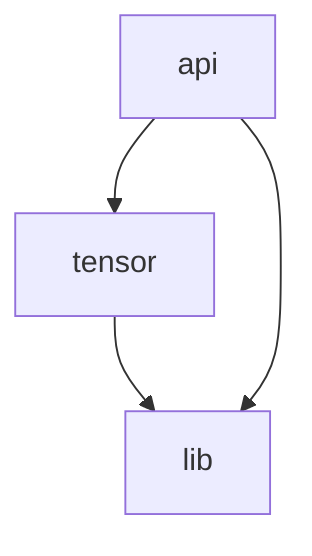

# ADR: Layer 0 Kernel Boundaries (`api` -> `tensor`, `api` -> `lib`)

Status: Accepted
Scope: Layer 0 minimal kernel (`lib`, `tensor`, `api`)
Date: 2026-10-10

## Context

Layer 0 defines three crates with a strict, one-way dependency graph:



[docs/crate-boundaries.md](../crate-boundaries.md) §5.3 requires the relationship
between `api` and `tensor` to be selected explicitly: because the kernel
invocation contract accepts tensors directly, the `api -> tensor` edge is
acceptable; otherwise the two crates must remain independently composable.

## Decision

1. Adopt the `api -> tensor` edge. The `kernel` trait's invocation contract
   accepts `tensorview<'_, T>` as input and returns `tensor<T>`:

   ```rust
   pub trait kernel<T: element> {
       fn getname(&self) -> &'static str;
       fn apply(&self, input: &tensorview<'_, T>) -> Result<tensor<T>, backenderror>;
   }
   ```

   Because kernel signatures name tensor types, `api` depends on `tensor`
   directly. This is the explicit selection required by
   [docs/crate-boundaries.md](../crate-boundaries.md) §5.3.

2. Adopt the `api -> lib` edge, realized by `capabilities.limits`. A backend
   declares its resource budget through the `limits` type owned by `lib`
   (produced via `capabilities::getlimits`). This is the only `api -> lib`
   dependency; `api` introduces no other foundational coupling.

3. `api` MUST NOT introduce a reverse dependency on `tensor` (i.e. `tensor` MUST
   NOT depend on `api`), and `api` MUST NOT depend on any crate above it in the
   dependency graph. Backend implementations (`cpu` and later) depend on `api`,
   never the reverse.

## Consequences

- `api` is not independently composable from `tensor`; this is accepted because
  the kernel contract is defined in terms of tensor views and owned tensors.
- `lib` remains free of workspace dependencies and is shared by both `tensor`
  and `api` without creating a cycle.
- Capability and device descriptions can be shared with callers without leaking
  backend implementation details.

## Alternatives Considered

- Keep `api` and `tensor` independent by boxing or erasing tensor inputs behind
  a trait object in kernel signatures. Rejected: it introduces unnecessary
  dynamic dispatch and indirection for a contract whose inputs are concretely
  tensor views, contradicting the static-composition preference in
  [AGENTS.md](../../AGENTS.md) §3.3.
- Duplicate a backend-local limit type inside `api`. Rejected: it would fork the
  single authoritative limit representation owned by `lib` and create a second
  source of truth for resource bounds.
