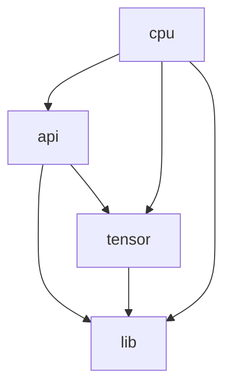

# ADR: Layer 1 Compute Extension (`api` kernel traits and `cpu` operator set)

Status: Accepted
Scope: Layer 1 — additive `api` operands contracts and the `cpu` operator set
(`matmul`, `add`, `mul`, `rmsnorm`, `rope`, `embedding`, `attention`)
Date: 2026-10-10
Supersedes in part: `layer1cpu.md` (which deferred binary/weighted operators)

## Context

Layer 0 ([layer0kernel.md](layer0kernel.md)) froze the unary kernel contract:

```rust
pub trait kernel<T: element> {
    fn getname(&self) -> &'static str;
    fn apply(&self, input: &tensorview<'_, T>) -> Result<tensor<T>, backenderror>;
}
```

[layer1cpu.md](layer1cpu.md) implemented four genuinely unary operators
(`relu`, `silu`, `gelutanh`, `softmax`) and **deferred** matrix multiply,
weighted normalization, embedding gather, and attention, because each needs a
second operand or a per-call attribute the frozen contract cannot carry.

Layer 1's differentiation (`autograd`), neural-network (`nn`), and model
(`models`) layers now require exactly those deferred operators. This stage
extends `api` **additively** (the frozen `kernel<T>` trait is untouched) and
adds the corresponding CPU kernels and their evidence.

The dependency graph this decision preserves:



## Decision

1. **Additive, operand-arity traits.** `api::kernels` gains three narrow
   trailing traits alongside the frozen unary `kernel<T>`:
   `binarykernel<T>` (two same-typed operands), `weightedkernel<T>` (input plus
   weight), and `gatherkernel<T>` (table plus `&[usize]` indices). Each reports
   `getname` and a single `apply`. The unary trait is not modified, so every
   existing implementation and test keeps compiling unchanged.

2. **One workflow-facing `compute` trait.** The differentiation and
   neural-network layers must compose operators without binding to a concrete
   backend. `api::compute` exposes the f32 operator set those layers use
   (`matmul`, `add`, `mul`, `rmsnorm`, `softmax`, `silu`, `embedding`, `rope`,
   `attention`) in terms of owned `f32` tensors. Per-call attributes (epsilon,
   head counts, rotary base, causal flag) are explicit parameters, so no
   per-model configuration hides inside a kernel instance. A backend implements
   `compute` once; the dependency edge stays `cpu -> api`.

3. **Kernels stay pure; policy stays in the executor.** `cpumatmul`, `cpuadd`,
   `cpumul`, `cpurmsnorm`, `cpuembedding`, `cpurope`, and `cpuattention` are
   stateless types that validate only their own shape preconditions.
   `cpuexecutor` keeps the single budget check (rank, element count, byte size)
   and dispatch:
   - `apply` (unary), `applybinary`, `applyweighted`, `applygather` for the
     enum-driven paths;
   - the `compute` implementation routes `matmul`/`add`/`mul`/`softmax`/`silu`/
     `embedding` through those same paths, and `rmsnorm`/`rope`/`attention`
     through budget checks plus the concrete kernel.

4. **Shape rules are explicit and validated, never assumed.**
   - `matmul` requires equal rank `r >= 2` with equal leading batch dimensions
     and `lhs[.., m, k] * rhs[.., k, n] -> [.., m, n]`; no broadcasting.
   - `add`/`mul` require exactly equal shapes.
   - `rmsnorm` normalizes the last axis; the weight length must equal that axis
     and the axis must be non-empty.
   - `rope` requires rank `>= 2`, the last axis divisible by `heads`, and an even
     `headdim`.
   - `embedding` requires every index `< table` first axis.
   - `attention` requires rank 2, equal sequence lengths, `heads` a positive
     multiple of `kvheads`, and the query last axis divisible by `heads`.

5. **Naive, deterministic attention.** `cpuattention` implements grouped-query
   scaled dot-product attention (`scale = 1/sqrt(headdim)`) with optional causal
   masking, as an O(seq^2 * heads * headdim) loop. Fully masked rows stay zero.
   No fusion, tiling, SIMD, or threading is introduced.

6. **f32-only, no `unsafe`.** The backend still declares `[dtype::f32]`. Every
   new crate keeps `#![forbid(unsafe_code)]`; kernels use safe indexing that
   shape validation has already bounded.

7. **Error mapping is explicit and lossless where it matters.** Kernel failures
   stay `backenderror`. The executor's CPU policy errors remain `cpuerror`
  ; the `compute` implementation maps a rejected budget onto
   `backenderror::resourceexhausted` and passes kernel errors through
   unchanged, so a caller of `compute` sees only the abstraction's distinctions.

## Design gate (DS0/DS5)

- **Boundary and interface (DS1).** `api::kernels` exports four traits
  (`binarykernel`, `weightedkernel`, `gatherkernel`, `compute`) totalling 16
  trait methods, under the A4 bound of 20. `cpu` exports 16 public symbols,
  under the same bound. Both interfaces are additive; no existing symbol moved.
- **Invariants (DS2).** Invariant (algorithmic): a validated shape plan produces
  an output whose element count equals the product of its dimensions. Invariant
  (implementation): kernels allocate the output only after validation and every
  index used to slice an input is `<` that input's element count. Error branch
  enumeration: rank below two (matmul/rope/attention), unequal batch/sequence
  axes, inner-dimension mismatch, weight-length mismatch, empty normalized axis,
  odd `headdim`, head-count mismatch, out-of-range index, element/byte/rank
  budget exhaustion, and element-count overflow. Resource rollback is automatic:
  a failed kernel returns before constructing the output tensor, and no partial
  allocation escapes (owner: the kernel; lifetime: the call).
- **Complexity (DS3).** Every new function is below the DS3 bounds (cyclomatic
  <= 10, effective lines <= 80). The largest are `cpuattention::apply` and
  `attentionplan`; both are loops plus short validations. (Reviewed by reading,
  evidence level T.)
- **Rejected alternatives (DS5).**
  - *Broadcast the binary operators.* Rejected: no concrete model in scope needs
    broadcasting, and silent broadcasting hides shape bugs the model layers
    should surface. `nn` layers reshape explicitly instead.
  - *Put `rmsnorm`/`rope`/`attention` behind new arity traits too.* Rejected:
    `rmsnorm` needs a weight plus an epsilon and `rope`/`attention` need
    attributes; a `compute` method with named parameters is narrower than three
    more generic traits with different attribute packs.
  - *A single `Box<dyn compute>` field in the layer crates.* Rejected: static
    dispatch is the stated preference (AGENTS.md §3.3); the layers are generic
    over `compute`, so inference and training reuse one implementation with no
    trait object.
  - *Implement `attention` with a fused, cached kernel now.* Rejected:
    correctness-first ordering; the naive path is the baseline a KV-cache
    optimization must beat, and no KV cache exists yet.

## Consequences

- `autograd`, `nn`, and `models` can compose operators through `api::compute`
  and never depend on `cpu`, keeping backend replaceability and acyclicity.
- The frozen unary contract is unchanged; the new traits are additional
  implementable contracts, so no existing backend or test is invalidated.
- `matmul` is a straightforward triple loop (measured below as the slowest
  operator per element). It is a documented correctness baseline, not an
  optimized kernel; any fast path must be measured against it.
- `embedding` gathers rows by copying; it allocates `indices.len() * width`
  elements per call. That is the contract's owned-output cost, not a hidden
  buffer.
- `cpuexecutor` now implements `api::compute`, so the executor is both the
  budget owner and the backend view the upper layers consume.

## Alternatives Considered

- **Extend the unary `kernel<T>` contract in place.** Rejected: it would force
  every existing implementor to change and would collapse distinct arities into
  one signature. Additive trailing traits keep `kernel<T>` frozen.
- **Name-keyed dynamic kernel registry.** Rejected: static dispatch remains the
  preference; a registry adds indirection with no runtime-selection need.
- **Reuse `backenderror` for budget rejections.** Rejected: `backenderror` does
  not model a configured budget, so the executor keeps `cpuerror` and maps only
  at the `compute` boundary.
- **SIMD/threaded `matmul` or `rmsnorm`.** Rejected for this stage: no measured
  bottleneck and no correctness plan exists yet (performance.md §11.4/§11.5).

## Validation

Executed 2026-10-10 (scoped commands only, because sibling crates were mid-build
during this stage):

- `cargo test -p cpu` — 84 passed, 0 failed.
- `cargo check -p cpu --all-targets` — passes, exit 0.
- `cargo clippy -p cpu -p testkit -p bench -p llm --all-targets -- -D warnings`
  — clean, exit 0.
- `cargo test -p testkit` — 20 passed, 0 failed (includes the four new scalar
  references and their cross-checks).
- `cargo test -p llm --test cpucontract` — 15 passed, 0 failed (new tests
  cross-check `matmul`, `rmsnorm`, `rope`, `embedding`, and attention against
  `testkit::reference`).
- `cargo check -p llm --all-targets` — passes, exit 0 (benches compile).

Baseline, `cargo bench -p llm --bench kernels` and `--bench cpuops`, release
profile (`lto = "thin"`, `codegen-units = 1`, `debug = 1`), criterion 0.7.0,
warm-up 1.0 s, measurement 2.0 s, 20 samples, no SIMD, no threading. Environment:
`rustc 1.99.0 (b940084d7 2026-09-28)`, macOS 27.0.1, arm64 (Apple Silicon); the
exact CPU model was not recorded, so these are a same-machine baseline, not a
portable result.

| Benchmark | Workload | Time (median) | Throughput |
| --- | --- | --- | --- |
| kernel/binary/matmul256 | 256x256x256 f32 | 974.0 µs | 67.3 Melem/s |
| kernel/binary/add | 65,536 f32 | 5.80 µs | 11.29 Gelem/s |
| kernel/binary/mul | 65,536 f32 | 5.95 µs | 11.01 Gelem/s |
| kernel/rmsnorm/rows512cols4096 | 2,097,152 f32 | 1.191 ms | 1.761 Gelem/s |
| kernel/rope/seq128heads8dim64 | 65,536 f32 | 85.59 µs | 765.8 Melem/s |
| kernel/embedding/gather128 | 131,072 f32 | 6.80 µs | 19.27 Gelem/s |
| kernel/attention/seq128heads8dim64 | 65,536 f32 | 1.268 ms | 51.70 Melem/s |
| executor/compute/rope | 65,536 f32 | 80.97 µs | 809.4 Melem/s |
| executor/compute/attention | 65,536 f32 | 1.207 ms | 54.29 Melem/s |

The executor path matches the raw kernel path within run-to-run noise
(noise-band criterion, performance.md §10). These figures are baselines; no
improvement is claimed (VF5).

## Revisit Conditions

Reconsider when: a profile shows `matmul` or `attention` dominating a documented
inference workload (then evaluate tiling/SIMD with a correctness plan and a
before/after comparison); a KV cache arrives (then `attention` gains a cached
variant whose win is measured against the naive baseline); or a model requires
a broadcasting or transposed operand convention (then extend `compute`
additively rather than overloading the existing signatures).
