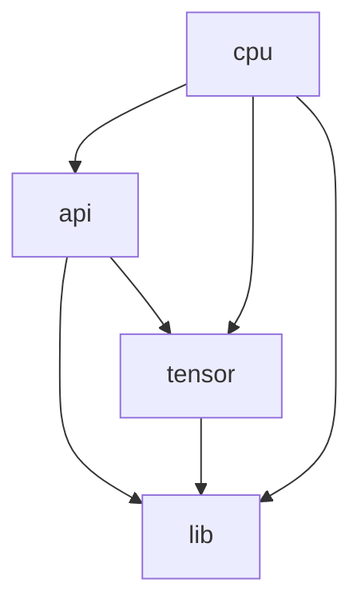

# ADR: Layer 1 CPU Backend and Unary-First Kernel Scope

Status: Accepted
Scope: Layer 1 `cpu` crate — backend identity, first kernel set, error boundary, and baseline
Date: 2026-10-10

## Context

Layer 0 (`lib`, `tensor`, `api`) is implemented. Its ADR
([layer0kernel.md](layer0kernel.md)) froze the kernel invocation contract:

```rust
pub trait kernel<T: element> {
    fn getname(&self) -> &'static str;
    fn apply(&self, input: &tensorview<'_, T>) -> Result<tensor<T>, backenderror>;
}
```

That contract is **unary**: it accepts one borrowed input view and returns one
newly owned tensor. It has no parameter for a second operand, an attribute, or a
reduction axis.

`tensor` implements `element` for every primitive with a native Rust
representation (`f32`, `f64`, `i8`, `u8`, `i32`, `i64`); `f16` and `bf16` have a
`dtype` variant but no native storage type
([docs/testing.md](../testing.md) §9.5 requires unsupported dtypes to be
rejected, not merely to compile).

[docs/crate-boundaries.md](../crate-boundaries.md) §5.4 requires the `cpu` crate
to implement the backend contracts, add no reverse dependency, introduce no
`unsafe`, and give every new operator boundary tests, numerical tests, and at
least one benchmark.

The dependency graph this decision must preserve:



## Decision

1. **Static composition, no registry.** `cpuexecutor` holds a `cpubackend` and
   resolves `cpuop` to a concrete kernel type with a `match`. No trait object,
   service locator, name-keyed registry, or global mutable state is introduced.
   Kernel types implement the frozen `kernel<f32>` trait directly.

2. **Unary-first kernel set.** The first kernel set is `relu`, `silu`,
   `gelutanh`, and `softmax`, because each is genuinely unary. Binary and
   weighted operators (`matmul`, `attention`, `embedding`, weighted `rmsnorm`)
   are **deferred**: implementing them now would require extending the frozen
   `api::kernel` contract, which is a separate, additive stage.

3. **f32-only.** The backend declares exactly `[dtype::f32]` in its
   capabilities. No `unsafe` narrowing is used to reach an unimplemented dtype.
   `i8`/`u8`/`i32`/`i64` activations are not implemented and are reported as
   unsupported.

4. **Crate-owned policy error.** `cpu::cpuerror` wraps
   `api::backenderror` (kernel-level failures, via `#[from]`) and adds the
   distinctions `backenderror` intentionally does not model: a rejected element
   or byte budget (`limiterror`) and a rejected rank (`rankexceeded`).
   [docs/error-handling.md](../error-handling.md) §6.1 assigns CPU kernel failures
   to `cpu`, and §15.2 permits backend-specific internal errors while the public
   abstraction exposes only unsupported-operation, resource-exhaustion, and
   execution-failure distinctions.

5. **Policy enforced once.** `cpuexecutor::apply` validates rank, element count,
   and byte size against the backend's declared budget before dispatching. The
   kernels remain pure, stateless, and free of resource policy.

6. **Baseline before optimization.** The operator benchmarks establish a
   baseline; no performance improvement is claimed and no SIMD or parallelism is
   introduced.

## Consequences

- Layer 1 has a working, tested CPU path for four unary operators without any
  change to Layer 0. `cpu` depends only on `api`, `tensor`, and `lib`, so the
  graph stays acyclic and every backend implementation remains replaceable.
- The `kernel` contract forces one allocation per `apply` call (the returned
  owned tensor). In-place or arena-based execution is not expressible through
  the frozen contract and is deferred.
- Operators that cannot be expressed as a single-operand map (matrix multiply,
  attention, embedding gather, weighted normalization) remain unimplemented
  until the contract is extended additively.
- Callers that use a kernel type directly bypass the executor's budget check;
  budget enforcement belongs to `cpuexecutor`, and the kernels document that
  they validate only their own shape preconditions.

## Alternatives Considered

- **Extend `api` now with binary/reduction kernel traits to implement
  `matmul` in the same stage.** Rejected: it enlarges the change boundary and
  mixes a contract change with a new backend, violating the one-testable-stage
  rule in [AGENTS.md](../../AGENTS.md) §11. It is reserved for a later stage.
- **Implement `matmul` behind a `cpu`-local richer trait.** Rejected: it would
  fork the operator contract and let `cpu` and `api` diverge, contradicting the
  single narrow contract required by §5.3.
- **Name-based dynamic kernel registry.** Rejected: static dispatch is the
  stated preference ([AGENTS.md](../../AGENTS.md) §3.3), and a registry adds
  indirection with no demonstrated runtime-selection requirement.
- **SIMD or threading for the elementwise kernels.** Rejected for this stage:
  [docs/performance.md](../performance.md) §11.4/§11.5 require a measured
  bottleneck and a correctness plan before introducing SIMD or parallelism. No
  such evidence exists yet.
- **Map budget rejections onto `backenderror::executionfailed`.** Rejected: it
  conflates resource exhaustion with execution failure, which
  [docs/error-handling.md](../error-handling.md) §11.2 forbids.
- **Reuse `tensorerror` for budget rejections.** Rejected: `tensorerror` is
  owned by `tensor` for metadata validation, and returning it from `cpu` would
  force callers to interpret another crate's error for a policy `cpu` owns.

## Validation

Executed on 2026-10-10:

- `cargo test -p cpu` — 34 unit tests pass; the 7 cpu integration tests now
  live in the repository-root `tests/cpucontract.rs`.
- `cargo test --workspace` — 131 tests pass, including the root integration
  suites in `tests/`.
- `bash scripts/check.sh` — format, `cargo check --workspace --all-targets`,
  `cargo clippy --workspace --all-targets -- -D warnings`, and
  `RUSTDOCFLAGS="-D warnings" cargo doc --workspace --no-deps` all pass.
- `bash scripts/test.sh` — full workspace unit, integration, and doc tests pass.

Baseline, originally measured with `cargo bench -p cpu --bench ops`. The
executor-level operator benchmark now lives at the repository root in
`benches/cpuops.rs` and is reproduced by `cargo bench -p llm --bench cpuops`;
a raw-kernel microbenchmark is available at `benches/kernels.rs`
(`cargo bench -p llm --bench kernels`), and the tensor metadata layer has its
own baseline at `benches/metadata.rs` (see
[workspacelayout.md](workspacelayout.md)). The numbers below are unchanged by
the relocation; they were not re-measured. Release profile, `lto = "thin"`,
`codegen-units = 1`, `debug = 1`; criterion 0.7.0; warm-up 0.2 s, measurement
1.0 s, 20 samples. No SIMD, no threading.

| Benchmark | Workload | Time (median) | Throughput |
| --- | --- | --- | --- |
| elementwise/relu | 1,048,576 f32 | 68.509 µs | 15.31 Gelem/s |
| elementwise/silu | 1,048,576 f32 | 1.0690 ms | 980.9 Melem/s |
| elementwise/gelutanh | 1,048,576 f32 | 1.5330 ms | 684.0 Melem/s |
| softmax/rows512cols4096 | 2,097,152 f32 | 2.5344 ms | 827.5 Melem/s |

Environment: `rustc 1.99.0 (b940084d7 2026-09-28)`, Darwin 27.0.0, arm64
(Apple Silicon). The exact CPU model was not recorded; the numbers are a
baseline for the same machine and toolchain, not a portable result.

These figures are baselines. They do not demonstrate, and are not claimed to
demonstrate, any improvement over a prior implementation.

## Revisit Conditions

Reconsider this decision when: a second operand contract is required by a
concrete model (then extend `api` additively); a profile shows the
transcendental elementwise kernels or softmax dominate a documented workload
(then evaluate SIMD with a correctness plan); or a request-scoped KV cache or
batch path makes per-call allocation the measured bottleneck (then evaluate
allocation reuse without weakening the contract).
