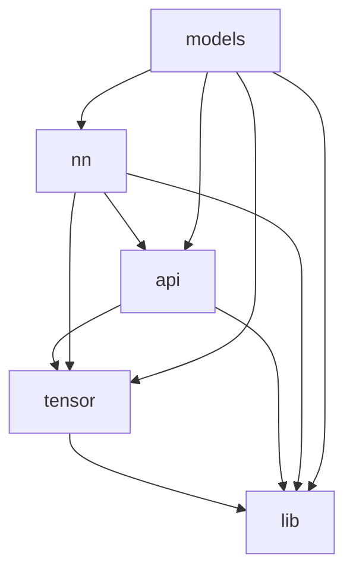

# ADR: Model architectures (`models` crate)

Status: Accepted
Scope: Layer 3 — the causal-LM and KV-cache contracts, the architecture
registry, and the Llama-family implementation
Date: 2026-10-10

## Context

Layer 2 gives the workspace reusable inference layers and parameter containers
([nn.md](nn.md)). The inference layer (`infer`, P7) needs a concrete model that
turns token ids into next-token logits from immutable weights, and a
request-scoped key/value cache contract whose owner is not the model. `models`
supplies both, plus a registry that maps an architecture name to its
constructor.

`models` depends on `nn`, `api`, `tensor`, and `lib`. It reaches the backend only
through `api::compute` (via the layers), never through `cpu`.

Dependency edges this decision adds (no cycle):

## Decision

1. **`causallm` is the model contract.** `causallm` exposes `getconfig` and
   `forward(engine, tokens) -> [tokens.len(), vocab]`. The model owns its
   weights immutably and holds no request-scoped state, so one model value
   serves independent requests (OW2).

2. **`kvcache` is owned here, implemented elsewhere.** `kvcache` is defined in
   `models` because the model layer owns the cache abstraction it consumes, but
   the buffer and its lifecycle belong to the caller that implements it
   (`infer`, P7). It holds one key and one value tensor per layer and reports
   its layer count, length, and capacity. This stage defines the contract only;
   the deterministic forward pass recomputes the full sequence and does not read
   or write a cache (see Deviations).

3. **The architecture is split by responsibility.** `llamaconfig` validates the
   dimensions and computes derived values (`head_dim`, `kv_width`) rather than
   storing them twice. `llamaweights` owns and validates every parameter as an
   `nn` layer, so the model reads the same values it validated with no copy.
   `llamablock` holds the configuration-derived operators (attention
   configuration and the two rotary embeddings) that do not depend on weights.
   `llamamodel` composes them.

4. **Weights are validated at construction, not during a forward pass.**
   `llamaweights::new` checks the embedding, the layer count, the final
   normalization, and the output projection against the configuration and
   returns `modelerror::shapemismatch` on any disagreement. `llamamodel::new`
   re-checks the same invariants so a model cannot be built from weights that
   belong to a different configuration.

5. **The forward pass is pre-norm and standard-Llama.** Each block is
   `x + Wo(attn(rope(Wq(xn)), rope(Wk(xn)), Wv(xn)))` followed by
   `x + down(silu(gate(xn2)) * up(xn2))`, where `xn`/`xn2` are the two RMS
   normalizations; the model then applies the final normalization and the
   output projection. Grouped-query attention and the causal mask are the
   backend's `api::compute::attention`; the layer introduces no operator.

6. **Deterministic random weights for reproducible tests and benchmarks.**
   `llamaweights::random(config, seed)` draws every parameter from a
   per-parameter substream derived from one `lib::seed`, so the same seed and
   configuration produce identical weights. Normalization weights start at one
   and projections are Xavier-uniform, with no bias.

7. **The registry is a checked `match`, not a name-keyed table.** `architecture`
   is an enum with one variant per supported family and `build` dispatches by
   `match`; `getarchitecture` maps a name to a variant and rejects unknown names
   with `modelerror::unknownarchitecture`. Static dispatch and compile-time
   coverage over a dynamic registry (A3).

8. **f32 only, no `unsafe`, no panics.** The crate declares
   `#![forbid(unsafe_code)]`; every fallible path returns `modelerror`, which
   wraps `backenderror`, `tensorerror`, and `nnerror` and adds `invalidconfig`,
   `shapemismatch`, `unknownarchitecture`, and `missingweight`. Production paths
   contain no `panic`, `unwrap`, or `expect`.

## Design gate (DS0/DS5)

- **Boundary and interface (DS1).** The crate root exports nine public types
  (`modelerror`, `causallm`, `kvcache`, `architecture`, `llamaconfig`,
  `llamaweights`, `llamalayerweights`, `llamablock`, `llamamodel`), one function
  (`getarchitecture`), and no constants — under the A4 bound of 20. Public
  type/trait/enum/variant/function names are lowercase concatenated. Module file
  names (`causal`, `registry`, `llama/config`, `llama/block`, `llama/weights`,
  `llama/model`) differ from the types they export (`causallm`/`kvcache`,
  `architecture`, `llamaconfig`, `llamablock`, `llamaweights`, `llamamodel`)
  because a module and a re-exported type share one namespace (E0255 guard).
- **Invariants (DS2).**
  - Algorithmic: for any valid input, `forward` returns a `[tokens.len(), vocab]`
    tensor whose values are finite; a token appears only in positions `<=` its
    own in the attention mask, so the first position attends to itself alone.
  - Implementation: a `llamaconfig` that exists has `dim % nheads == 0`,
    `nheads % nkvheads == 0`, and an even head dimension (checked in `new`); a
    `llamaweights` that exists has an embedding `[vocab, dim]`, exactly
    `nlayers` blocks, a `[dim]` final norm, and an output projection
    `[dim, vocab]` (checked in `new`); the model holds no mutable state, so no
    forward pass can observe a partially updated weight.
  - Error branch enumeration: zero/odd/incompatible dimensions, negative epsilon,
    non-positive rotary base, unknown architecture name, weight/configuration
    disagreement, out-of-range token (provider index error), and shape element
    count overflow. Resource rollback: a rejected constructor returns before a
    model value exists; the model is immutable during forward, so no partial
    state escapes.
- **Complexity (DS3).** Every function is below cyclomatic 10 and 80 effective
  lines; the largest are `llamaconfig::new` (nine field checks) and
  `llamaweights::random` (a loop over layers of straight-line construction).
  (Reviewed by reading, evidence level T.)
- **Rejected alternatives (DS5).**
  - *Store raw tensors in `llamaweights` and rebuild `nn` layers per forward.*
    Rejected: rebuilding a layer clones its parameter, duplicating the weight;
    holding the layers keeps one copy and reuses `nn`'s validation.
  - *A `Box<dyn causallm>` registry keyed by name.* Rejected: static dispatch and
    compile-time exhaustiveness over a dynamic registry (A3).
  - *Parse `config.json` inside `models`.* Rejected: external format parsing is
    the `format` crate's responsibility; `models` accepts a validated
    configuration and the registry maps the already-parsed architecture name.
  - *Fold the KV cache into the model.* Rejected: the cache is request-scoped
    mutable state and the model owns immutable weights; keeping them separate is
    the ownership rule (OW2/OW4) and the reason `infer` implements `kvcache`.
  - *Bias terms on the projections.* Rejected: the target architecture (Llama)
    has none, and adding an unused bias would expand the weight contract and the
    checkpoint format for no benefit.
  - *Tied input/output embeddings.* Rejected for this stage: the output
    projection is an explicit, separately validated weight; tying is a later
    choice that changes the checkpoint format and must be recorded when adopted.

## Consequences

- `infer` (P7) can build a `llamamodel` from a configuration and weights, call
  `forward`, and later implement `kvcache` without `models` depending on it.
- Weights are one copy shared by reference across every forward pass; a forward
  pass allocates only activation tensors.
- The full-sequence forward recomputes every position on every call. That is the
  correctness baseline a KV-cache decode phase must beat; the `kvcache` contract
  is in place for that measurement.
- Parameter names are stable and hierarchical
  (`layers.0.wq.weight`, `norm.weight`, ...), so a checkpoint's naming scheme is
  defined by `nn::module::collect` and not re-derived here.

## Deviations from the plan

- **The forward pass does not take or populate a `kvcache`.** The plan's
  signature sketch is `forward(weights, tokens, cache)`. The plan also states
  the inference-first ordering: P7a recomputes the whole sequence for
  correctness, and P7b adds the cache as a measured optimization. Wiring a cache
  parameter now would either be unused or would fake incremental decode before
  the sampling and request layers exist. This stage therefore defines the
  `kvcache` contract and ships the full-recompute forward, and P7 owns the
  cached path. Clause: `rule.md` VF1 (no unverified capability claims).
  Impact: no cached decode yet. Downgrade plan: implement `kvcache` in `infer`
  and add a cached forward variant with a before/after baseline vs this stage's
  measurement. Recorded per M4.
- **The registry resolves architecture names, it does not parse them.** The
  plan says the registry maps architecture to "加载配置" (loading
  configuration). The serialized `config.json` parser is owned by `format`
  (P5), so `models` owns the in-memory `llamaconfig` and the name-to-constructor
  mapping; wiring the parsed name from `format` is deferred to the inference
  milestone. Clause: AGENTS.md §3.1 (ownership boundaries). Impact: no
  file-to-model path yet. Recorded per M4.
- **The `models` production dependency set is `nn`/`api`/`tensor`/`lib`
  (no `autograd`).** The model path is inference-only in this stage; adding
  `autograd` would be an unused dependency (AGENTS.md §3.2). Training-path
  integration is deferred with the `nn` deviation.

## Validation

Executed 2026-10-10 (scoped commands only, because sibling crates were mid-build
during this stage):

- `cargo test -p models` — 16 unit tests passed, 0 failed; 0 doctests, exit 0.
- `cargo test -p llm --test model_forward` — 5 passed, 0 failed, exit 0. The
  central test cross-checks a full one-layer forward pass against an independent
  scalar reference assembled from `testkit::reference`; the others pin
  determinism for a fixed seed, finiteness at every position, out-of-range token
  rejection, and that the first position's logits do not depend on later tokens.
- `cargo clippy -p models -p llm --all-targets -- -D warnings` — clean, exit 0.
- `RUSTDOCFLAGS='-D warnings' cargo doc -p models --no-deps` — clean, exit 0.

Baseline, `cargo bench -p llm --bench models`, release profile
(`lto = "thin"`, `codegen-units = 1`, `debug = 1`), criterion 0.7.0, warm-up
1.0 s, measurement 2.0 s, 20 samples, no SIMD, no threading. Environment:
`rustc 1.99.0 (b940084d7 2026-09-28)`, macOS 27.0.1, arm64 (Apple Silicon); the
exact CPU model was not recorded, so this is a same-machine baseline, not a
portable result.

| Benchmark | Workload | Time (median) | Throughput |
| --- | --- | --- | --- |
| models/llama/forward | seq 16, dim 64, 2 layers, heads 4 / kvheads 2, hidden 170 | 135.57 µs | 118.02 Kelem/s |

Throughput is reported per token, matching the benchmark's element unit. This is
the first measurement for the model; no improvement is claimed (VF5).

## Revisit Conditions

Reconsider when: a cached decode path exists (then compare against this
baseline and record the speedup); a checkpoint format is wired (then validate
that `collect`'s names match it and add a load path with shape checks); a second
architecture is added (then extend `architecture` and its `match`, not a
registry table); or weight tying or bias terms are required (then change the
weight contract and the checkpoint format together as one testable stage).
