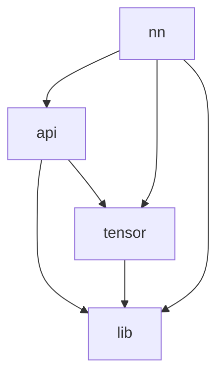

# ADR: Neural-network layers (`nn` crate)

Status: Accepted
Scope: Layer 2 — parameter containers and composed inference layers over the
`api::compute` contract
Date: 2026-10-10

## Context

Layer 1 gives the workspace backend-agnostic operators
([layer1compute.md](layer1compute.md)) and differentiation mechanics
([autograd.md](autograd.md)). The model layer (`models`, P3) needs reusable,
composable layers — projections, embeddings, normalization, rotary embeddings,
attention, and a feed-forward network — plus a way to name and carry their
parameters so a checkpoint can be written and read.

`nn` owns those layers and containers. It depends on `lib`, `tensor`, and `api`
only, so it composes the operator contract and never binds to a concrete
backend. The layers reach the CPU at runtime through `api::compute`, exactly as
`autograd` does.

Dependency edges this decision adds (no cycle):

## Decision

1. **Parameters are named, owned tensors.** `parameter` binds a leaf name to an
   owned `tensor<f32>`. It is immutable through the public interface, so a live
   layer cannot observe a parameter changing under it.

2. **`module` is name plus parameter export, not a forward signature.** The
   `module` trait exposes `getname` and `collect(prefix, dict)`; a default
   `getstatedict` collects a module at the root prefix. Forward is deliberately
   *not* on the trait: a projection takes one tensor, an embedding takes
   `&[usize]` indices, and attention takes three operands, so a single signature
   would force an enum-wrapped input that adds indirection without adding
   meaning. Each layer instead exposes an inherent `forward` whose arity matches
   its operation.

3. **`statedict` is the one place names and values meet.** `statedict` is an
   ordered `BTreeMap<String, tensor<f32>>`. A layer composes a hierarchical name
   by prefixing its leaf name (`mlp` yields `gate.weight`, `up.weight`,
   `down.weight`). Duplicate insertion is rejected with
   `nnerror::duplicateparameter` rather than silently overwriting a weight.
   Ordering by name makes iteration deterministic without a separate sort.

4. **Layers compose only the provider's primitives.** Each forward pass calls
   `api::compute`; layers introduce no operator of their own. Where the
   primitive set deliberately omits a behavior, the layer performs it
   explicitly: `linear` tiles its bias into `[rows, out]` before `add`, because
   `api::compute::add` requires equal shapes and the `layer1compute` ADR
   deliberately rejected broadcasting so that layers reshape explicitly.

5. **Weight layout is `[in_features, out_features]`.** Storing the weight in
   that order lets `linear` call `api::compute::matmul` directly, with no
   transpose operator and no per-call transposed copy. Bias is `[out_features]`.
   Leading batch dimensions of the input are flattened for the rank-two matmul
   and restored afterwards, so `[..., in]` maps to `[..., out]`.

6. **Attention is configuration, its math is the backend contract.** `attention`
   owns `heads`, `kvheads`, and `causal` and validates the head layout, then
   forwards to `api::compute::attention`, which already composes the grouped
   heads, causal mask, scaling, matmul, and softmax. The layer does not
   reimplement that math beside the backend; duplicating it would create a
   second implementation to keep in sync.

7. **The feed-forward network is SwiGLU.** `mlp` is
   `down(silu(gate(x)) * up(x))`, the Llama-family gated MLP. It is built from
   three `linear` layers and the `silu`/`mul` primitives, and validates the
   projection shapes once at construction rather than on every forward pass.

8. **Initialization is deterministic and local.** `initxavier`, `fillnormal`,
   `filluniform`, `fillvalue`, `fillzero`, and `fillone` each build their own
   SplitMix64 stream seeded from a `lib::seed`. There is no global generator, so
   two runs from the same seed and call order produce identical parameters;
   there is no hidden process-wide RNG state (A6).

9. **f32 only, no `unsafe`, no panics.** The crate declares
   `#![forbid(unsafe_code)]`; every fallible path returns `nnerror`, which wraps
   `backenderror` and `tensorerror` and adds `shapemismatch`, `invalidconfig`,
   `duplicateparameter`, and `missingparameter`. Production paths contain no
   `panic`, `unwrap`, or `expect`.

## Design gate (DS0/DS5)

- **Boundary and interface (DS1).** The crate root exports 10 public types
  (`nnerror`, `parameter`, `statedict`, `module`, `linear`, `embedding`,
  `rmsnorm`, `rotary`, `attention`, `mlp`), six functions (`fillzero`,
  `fillone`, `fillvalue`, `filluniform`, `fillnormal`, `initxavier`, plus
  `joinname`), and two
  constants (`DEFAULTEPS`, `DEFAULTBASE`) — under the A4 bound of 20 symbols.
  Public type/trait/enum/variant/function names are lowercase concatenated;
  constants uppercase concatenated. Module file names (`parameters`,
  `dictionary`, `modules`, and the layer files `projection`, `lookup`,
  `normalize`, `rotate`, `multihead`, `gated`) all differ from the types they
  export (`parameter`, `statedict`, `module`, `linear`, `embedding`, `rmsnorm`,
  `rotary`, `attention`, `mlp`) because a module and a re-exported type share one
  namespace (E0255 guard).
- **Invariants (DS2).**
  - Algorithmic: a layer's forward output has the shape its documented layout
    implies, and a parameter's element count equals the product of its shape.
  - Implementation: every index used to slice a parameter is bounded by that
    parameter's element count (the provider guarantees this for its own
    operators; `linear` bounds its bias tiling by `rows * out` with a checked
    multiply). A `statedict` never contains a duplicate name. A layer stores no
    request-scoped mutable state.
  - Error branch enumeration: rank mismatch (weight/bias/table), last-dimension
    mismatch (`linear`, `rmsnorm`), odd or non-divisible head layout
    (`rotary`, `attention`), sequence/head mismatch (`attention`), out-of-range
    embedding index (provider), invalid epsilon/base/head count, and shape
    element-count overflow. Resource rollback: a rejected `new` returns before
    any layer value exists; a rejected forward returns before the layer is
    mutated (layers are immutable during forward), so no partial state escapes.
- **Complexity (DS3).** Every function is below cyclomatic 10 and 80 effective
  lines; the largest are `attention::forward` and `linear::forward`, both short
  validation followed by provider calls. (Reviewed by reading, evidence level T.)
- **Rejected alternatives (DS5).**
  - *A uniform `module::forward` signature.* Rejected: heterogeneous arities
    would need an enum-wrapped input, which adds indirection and a failure mode
    (wrong variant) without adding meaning.
  - *A `provider` trait abstracting inference and training so one layer
    implementation serves both.* Analyzed and rejected for this stage: it is a
    universal provider abstraction over two value domains (`tensor` for
    inference, an autograd handle for training) with no shared graph-reshape
    operator to bridge them; it would be a larger abstraction than the problem
    it solves. The layers are forward-only and the training path is deferred
    (see Deviations).
  - *PyTorch weight layout `[out, in]`.* Rejected: it forces a transpose on
    every forward pass because `api::compute` has no transpose operator and this
    stage adds none.
  - *A keyed layer registry (`Box<dyn layer>`).* Rejected: static composition is
    the stated preference; the model composes concrete layers.
  - *Broadcasting bias inside the provider.* Rejected: the `layer1compute` ADR
    already decided layers expand explicitly, and a hidden broadcast rule would
    revive the shape bugs that decision avoids.
  - *`tensor::PartialEq` for parameter comparison.* Rejected: element equality
    is not tensor-metadata semantics; `nn` defines `tensoreq` (shape and data)
    locally and implements `PartialEq` on its own containers.

## Consequences

- `models` (P3) composes `linear`, `embedding`, `rmsnorm`, `rotary`,
  `attention`, and `mlp` and collects their parameters into one `statedict`
  whose names are stable and hierarchical.
- The layers are pure functions over immutable parameters: no layer holds a
  forward-pass buffer between calls, so request isolation (OW2) follows from the
  type without extra work.
- `linear` allocates a flattened input copy and a tiled bias per forward pass.
  That is the owned-output cost of the `api::compute` contract plus the explicit
  broadcast decision, not a hidden buffer. It is the documented baseline a fused
  kernel must beat.
- Attention's cost is dominated by `cpu::attention` (O(seq^2 * heads *
  headdim)); the layer adds only validation.
- `rotary` and `attention` hold no parameters and collect nothing, so a model's
  `statedict` contains only learned weights.

## Alternatives Considered

- **Layers over `autograd::graph` rather than `api::compute`.** Deferred, not
  adopted: it would make the forward path depend on differentiation and would
  need reshape/embedding/rope VJPs that `autograd` does not yet have.
- **Per-layer error enums.** Rejected: one `nnerror` owned by the crate keeps the
  contract in one place; the variants already separate the distinctions a caller
  acts on (ER2).
- **Fusing `rmsnorm` + `linear` or the SwiGLU triple into one kernel.** Rejected
  for this stage: correctness-first and no measured bottleneck; a fused kernel
  is a later optimization measured against these baselines.

## Deviations from the plan

- **The `autograd` dependency is not wired in this stage.**
  [`rule.md`](../../rule.md) A2/§3.2 and AGENTS.md §3.2 forbid introducing a
  dependency solely for convenience, and the plan's own cross-phase decision
  rejects "one implementation per eval/train" because it drifts. `autograd`
  currently exposes no reshape, embedding, or rope operator, so a differentiable
  layer path cannot reuse these forward implementations without either
  duplicating them or introducing a universal provider abstraction that is
  larger than the problem (see DS5). This stage therefore ships the inference
  layers only and declares the deviation. The intended unification — layers
  generic over a provider so inference and training share one implementation —
  is deferred until `autograd` owns the reshape/embedding/rope operators the
  model path needs, at which point `nn` (or an adapter) gains the autograd edge.
  Clause: `rule.md` A2, AGENTS.md §3.2. Impact: training-path reuse is not yet
  available. Downgrade plan: add the missing `autograd` operators (a separate,
  independently testable stage), then wire the provider without duplicating
  layer math. Recorded per M4.

## Validation

Executed 2026-10-10 (scoped commands only, because sibling crates were mid-build
during this stage):

- `cargo test -p nn` — 37 unit tests passed, 0 failed; 0 doctests, exit 0.
- `cargo test -p llm --test nnlayers` — 12 passed, 0 failed, exit 0. Covered:
  `linear` with/without bias and with preserved leading batch dimensions,
  `embedding`, `rmsnorm`, `rotary`, `attention` (against an independent scalar
  grouped-query causal reference), `mlp` (against the explicit SwiGLU
  composition), shape-error rejection, prefixed parameter collection, and
  initialization reproducibility.
- `cargo clippy -p nn -p llm --all-targets -- -D warnings` — clean, exit 0.
- `RUSTDOCFLAGS='-D warnings' cargo doc -p nn --no-deps` — clean, exit 0.

Baseline, `cargo bench -p llm --bench nn`, release profile (`lto = "thin"`,
`codegen-units = 1`, `debug = 1`), criterion 0.7.0, warm-up 1.0 s, measurement
2.0 s, 20 samples, no SIMD, no threading. Environment: `rustc 1.99.0
(b940084d7 2026-09-28)`, macOS 27.0.1, arm64 (Apple Silicon); the exact CPU
model was not recorded, so this is a same-machine baseline, not a portable
result.

| Benchmark | Workload | Time (median) | Throughput |
| --- | --- | --- | --- |
| nn/linear/forward | 128x512 in, 512x512 weight | 1.9002 ms | 34.49 Melem/s |
| nn/mlp/forward | 128x512, hidden 1365, SwiGLU | 18.518 ms | 3.539 Melem/s |
| nn/attention/forward | seq 128, heads 8, headdim 64 (causal) | 1.2131 ms | 54.03 Melem/s |

No improvement is claimed (VF5); these are the first measurements for these
layers.

## Revisit Conditions

Reconsider when: a profile shows `linear`'s input flatten or bias tiling
dominating a model forward pass (then add a fused or in-place path with a
before/after comparison); `autograd` gains reshape/embedding/rope operators
(then wire the shared provider and remove this deviation); a model needs a
weight layout other than `[in, out]` (then add an explicit transpose to the
provider rather than changing the layer's storage); or a checkpoint format fixes
a different parameter naming scheme (then adapt `collect` and record it).
