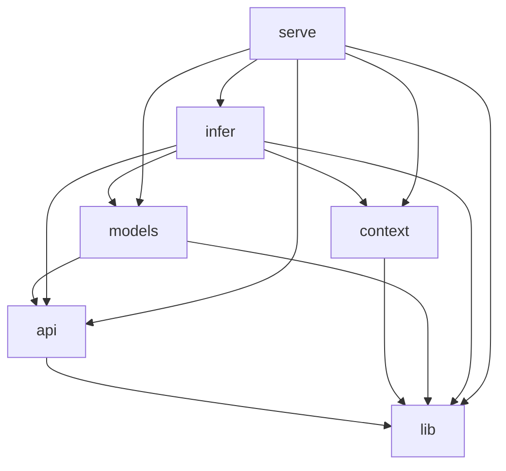

# ADR: HTTP inference service (`serve` crate)

Status: Accepted
Scope: Layer 4 — the optional HTTP application boundary: routing, transport
validation, request/response mapping, admission control, and transport
cancellation mapping
Date: 2026-10-10

## Context

Layer 3 already owns the reusable generation workflow: `infer` provides
`generationengine`, `generationrequest`, `generationparams`, `samplingparams`,
`stopcondition`, `streamsink`/`collectingsink`, and `infererror`, and `context`
provides `executioncontext`, `cancellation`, `executionconfig`, and
`metrics`. `serve` is the thin Layer 4 application that turns an HTTP request
into that workflow and an HTTP response back out. It adds no model logic and
owns no request-scoped generation state of its own.

`serve` depends on `models` (the `causallm` contract), `api` (the `compute`
provider contract), `context` (execution controls), `infer` (the workflow), and
`lib` (identifiers and seeds). `cpu` is a dev-dependency used only by the
integration tests. It does not depend on a concrete backend and is not a
dependency of any Layer 0–3 crate.

Dependency edges this decision adds (no cycle):

## Decision

1. **The HTTP stack is a minimal, standard-library-only HTTP/1.1 adapter.**
   The server is built on `std::net::TcpListener`/`TcpStream` and
   `std::io::BufRead`/`Read`/`Write`, with a bounded request parser and a
   blocking, thread-per-connection accept loop (`std::thread::scope`). No async
   runtime, no HTTP framework, and no TLS are used. This keeps the dependency
   closure of a Layer 4 application minimal (AGENTS.md §3.2), keeps the whole
   adapter unit-testable without a socket, and honors the "static composition
   over unnecessary indirection" preference (A3). The rejected `tokio`-based
   alternative is recorded under DS5 below.

2. **The transport and the application are separated by one value type.**
   `httprequest` is a transport-validated request (method, target, lowercased
   headers, raw body) and `httpresponse` is a transport-neutral response
   (status, reason, content type, owned body). `inferenceservice` maps one
   `httprequest` to one `httpresponse` and never touches a socket, so routing,
   validation, mapping, admission, and cancellation are all testable without
   opening a port.

3. **Transport errors and model errors stay distinct.** `serveerror` is the
   crate's single owned error enum. Transport/protocol failures (malformed
   request line or header, unsupported version/method, oversized line/headers/
   body, invalid content length, unsupported media type, too many fields,
   missing/invalid field, overloaded, not found, dispatch failure, I/O) are
   distinct variants; a model execution failure is carried transparently as
   `serveerror::inference(#[from] infererror)` (ER2). A transport failure is
   never reported as a model failure and vice versa. The single mapping from
   `serveerror` to an HTTP status lives in `httpresponse::fromerror`, keeping
   protocol concerns at the application boundary.

4. **Every external input is validated before it reaches the model.** The
   request parser enforces explicit, caller-supplied `transportlimits` on the
   request line, header line length, header count, content-length, and body size
   (IN1/IN2/IN4); form parsing bounds the field count and each field value
   length; prompt and EOS token lists are bounded by `maxprompttokens`;
   `maxnewtokens` is non-zero and bounded by `maxnewtokens`; numeric fields
   return a field error rather than panicking on overflow or non-numeric input
   (IN1/IN2). The server additionally caps the total bytes it reads per
   connection with `Read::take(maxrequestbytes)`.

5. **Admission control bounds concurrency before expensive work.** `admissions`
   is an atomic compare-and-update counter over a fixed `maxconcurrent` ceiling.
   `inferenceservice::generate` takes an `admission` RAII guard before
   constructing the generation request or running the model, so a request that
   exceeds the ceiling fails fast with HTTP 429 and reserves nothing. The guard
   releases the admission on drop in every termination path (OW1), and a zero
   ceiling is rejected at configuration time as a wiring error.

6. **Cancellation is mapped at the transport boundary and owned by the
   request.** `inferenceservice::handlewith` calls the transport's `onstart`
   callback with the request's `context::cancellation` handle after admission
   succeeds and immediately before the model runs. When a deadline is
   configured, the server runs the request on a scoped worker and waits with
   `mpsc::Receiver::recv_timeout`; on timeout it cancels through that handle and
   returns HTTP 504, while the worker observes the cancellation at its next
   engine checkpoint and terminates (`infererror::context(cancelled)`). A
   cancellation requested before the first checkpoint maps to HTTP 408. No
   termination path leaves reusable residual state: all mutable state lives in
   the per-request `executioncontext`/`generationrequest`/sink and is released on
   drop (OW2, OW3, CC5).

7. **Requests are isolated and the service is shareable.** `inferenceservice`
   borrows an immutable model and provider and owns only immutable
   `serviceconfig` plus an atomic counter, so one service value serves
   concurrent requests without sharing mutable generation state (OW2). Every
   response is written with `connection: close`, so the server keeps no
   keep-alive or session state between requests.

8. **`#![forbid(unsafe_code)]`, one owned error enum, no panics.** Production
   code contains no `panic`, `unwrap`, `expect`, `todo`, or `unimplemented`; the
   integration tests, which may legitimately fail loudly, carry
   `#![allow(clippy::unwrap_used, clippy::expect_used)]`. I/O failures retain
   only their `ErrorKind`, so an error response never exposes an internal
   filesystem or socket detail.

## Design gate (DS0/DS5)

- **Boundary and interface (DS1).** The crate root exports ten public types
  (`admission`, `admissions`, `serveerror`, `httpmethod`, `httprequest`,
  `transportlimits`, `httpresponse`, `inferenceservice`, `serviceconfig`,
  `httpserver`) and no constants or free functions — under the A4 bound of 20.
  Public type/trait/enum/variant/function names are lowercase concatenated;
  constants would be uppercase. Module file names differ from the types they
  export because a module and a re-exported type share one name namespace (E0255
  guard): `admit`→`admission`/`admissions`, `error`→`serveerror`,
  `request`→`httpmethod`/`httprequest`/`transportlimits`,
  `response`→`httpresponse`, `routes`→`inferenceservice`/`serviceconfig`,
  `server`→`httpserver`.
- **Invariants (DS2).**
  - Algorithmic: one `httprequest` maps to exactly one `httpresponse`; the
    `/generate` route never runs the model without a held `admission`; a
    successful `/generate` response body encodes exactly the engine's generated
    tokens, stop reason, and step count for the equivalent `infer` call; and the
    in-flight admission count is `0` after every request terminates, success,
    error, or cancellation alike.
  - Implementation: an `httprequest` that exists was parsed within
    `transportlimits` and its body length equals its declared content-length; an
    `httpresponse` that exists has a status in the HTTP range and a body whose
    length matches the emitted `content-length`; an `admission` guard exists only
    while the controller count is below the ceiling and decrements it exactly
    once on drop; `serviceconfig` rejects a zero `maxconcurrent`; the model and
    provider are borrowed immutably for the whole service lifetime, so no request
    state is observable through them.
  - Error branches: malformed/oversized request line or header; too many
    headers; unsupported HTTP version or method; unsupported media type;
    invalid content-length; oversized or incomplete body; too many or oversized
    form fields; missing or invalid `prompt`/`maxnewtokens`/`eos`/sampling
    fields; unknown route (404); admission ceiling reached (429); configuration
    error; dispatch worker failure; I/O failure; deadline elapsed (504); and
    every `infererror` carried through unchanged. Resource rollback: the body and
    header buffers are bounded and per-connection; the admission guard releases
    on drop; the service returns before the model runs whenever validation or
    admission fails; the scoped dispatch worker always terminates because
    cancellation is delivered through the request handle.
- **Complexity (DS3).** Every function is below cyclomatic 10 and 80 effective
  lines; the largest are `httprequest::parse` (a short linear sequence of bounded
  readers) and `inferenceservice::handlewith` (a single match with at most two
  arms). (Reviewed by reading, evidence level T.)
- **Rejected alternatives (DS5).**
  - *A `tokio`-based async HTTP server.* Rejected: it would add an async runtime
    and its transitive dependency closure to a Layer 4 adapter whose concurrency
    ceiling is already enforced by an atomic admission counter; the generation
    workflow is synchronous and CPU-bound, so async I/O adds indirection without
    a measured benefit (A3, AGENTS.md §3.2, PF1). The workspace declares `tokio`,
    but `serve` uses only `std`.
  - *An existing HTTP framework (hyper/axum/warp).* Rejected: a framework plus
    its runtime is a much larger dependency surface than a bounded HTTP/1.1
    parser, and the protocol surface this application needs is two routes.
  - *Collapse the transport and model errors into one status mapping.* Rejected:
    a client must be able to distinguish a protocol mistake (400/413/415) from a
    model failure (400/500), and `serveerror::inference` keeps the `infererror`
    distinction intact (ER2).
  - *Accept unbounded input and rely on the model to fail.* Rejected: resource
    ceilings must be enforced before expensive work (IN4); parsing rejects
    oversized input before any allocation proportional to it.
  - *Store the request's cancellation token in the service or a global.*
    Rejected: cancellation is request-scoped state and belongs to the
    `executioncontext`, not to shared configuration (OW2, A6).
  - *Keep-alive sessions and a connection state machine.* Rejected: the workflow
    is request-scoped and stateless, so `connection: close` per response avoids a
    session lifecycle with no benefit.
  - *Serve the model directly from the accept thread with no admission limit.*
    Rejected: unbounded concurrency would defeat the execution-context resource
    controls; admission makes the ceiling explicit and observable (IN4).

## Consequences

- The application boundary is a small, blocking HTTP/1.1 adapter; scaling beyond
  one process relies on the deployment layer, not on runtime concurrency inside
  `serve`.
- All routing, validation, mapping, admission, and cancellation behavior is unit-
  and integration-testable without a socket, and the real server is exercised on
  an ephemeral loopback port.
- One immutable model and provider serve concurrent requests: all mutable state
  is request-scoped and released on drop.
- Clients receive one `serveerror`-derived status per failure category while
  model failures keep their `infererror` distinction; no error response leaks I/O
  internals.

## Deviations from the plan

- **The transport is standard-library-only instead of `tokio`-based.** The plan
  offered either an async stack or a smaller std-only adapter; this stage chose
  the smaller std-only adapter and records the rejected `tokio` alternative above
  (DS5). Clause: explicit task instruction. Impact: no async I/O and no TLS;
  keep-alive is not supported. Recorded per M4.
- **The admission module is `admit.rs`, not `admission.rs`.** The crate
  re-exports a type named `admission`, and a module and a re-exported type share
  one name namespace, so the file would collide (E0255). The same reasoning names
  `error.rs` (not `serveerror.rs`), `request.rs` (not `httprequest.rs`),
  `response.rs` (not `httpresponse.rs`), `routes.rs` (not
  `inferenceservice.rs`), and `server.rs` (not `httpserver.rs`). Clause: NM2 /
  E0255 guard. Impact: none on the public interface.
- **Integration tests are crate-local.** Because a later consolidation pass owns
  the root `tests/` and `benches/`, this stage places
  `crates/serve/tests/service.rs`, `crates/serve/tests/server.rs`, and
  `crates/serve/tests/common/mod.rs` under the crate instead of the root `tests/`
  directory. Clause: explicit task instruction / `docs/testing.md`. Impact: the
  integration tests are not yet in the root suite. Recorded per M4. Superseded:
  the later consolidation pass moved them to the root `tests/service.rs` and
  `tests/server.rs` with a shared `tests/common/mod.rs` (see
  `testconsolidation.md`).
- **No benchmark or performance claim this stage.** Root `benches/` are owned by
  a later pass and no performance claim is made, so no benchmark is added.
  Clause: `rule.md` PF1/PF5, explicit instruction. Impact: no throughput or
  latency number is claimed (VF5). Recorded per M4.

## Validation

Executed 2026-10-10 against the workspace root with `-p serve`, after the sibling
`train` crate's in-progress build finished. While `train` was mid-build its
manifest had no `src/lib.rs`, so `cargo metadata` failed for every `-p` command
in the whole workspace (a sibling state, not a `serve` defect); the same four
commands were therefore verified first against a throwaway virtual workspace that
mirrored `serve` and its dependency crates, and then repeated unchanged against
the real workspace once it loaded.

- `cargo fmt --all` — clean, exit 0.
- `cargo check -p serve --all-targets` — clean, exit 0.
- `cargo clippy -p serve --all-targets -- -D warnings` — clean, exit 0.
- `cargo test -p serve` — 23 unit tests across `admit`, `error`, `request`,
  `response`, `routes`, `server` plus 3 `server` integration tests and 10
  `service` integration tests, 0 doctests; 36 passed, 0 failed, exit 0.
- `RUSTDOCFLAGS='-D warnings' cargo doc -p serve --no-deps` — clean, exit 0.

The central integration test, `service::generation_matches_the_engine`,
cross-checks the HTTP service's generated tokens and stop reason against an
independent `infer` `generationengine` run over the same model and parameters.
The remaining tests pin routing (health, unknown route, wrong method), media-type
and field validation, out-of-range prompt rejection, admission rejection past the
ceiling, transport cancellation mapping (408), deadline mapping (504),
concurrent request isolation, and the real server over an ephemeral loopback
port. No speedup is claimed (VF5).

Environment: `rustc 1.99.0 (b940084d7 2026-09-28)`, macOS 27.0.0, arm64 (Apple
Silicon).

## Revisit Conditions

Reconsider when: the deployment target requires async I/O or TLS (then add an
async transport behind the same `inferenceservice` boundary and measure the
throughput change against this baseline); the root `tests/`/`benches/`
consolidation pass runs (then move the integration tests into place and add a
request-throughput benchmark); streaming responses are required (then extend
`httpresponse`/the sink contract rather than the transport parser); or a
cache-aware `infer` decode lands (then re-measure request latency without
changing this boundary).
