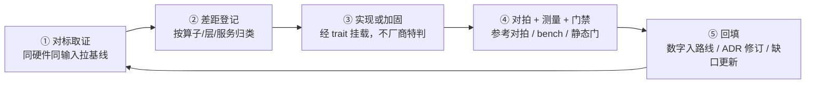

# P0→P3 自主反思迭代闭环

- 版本：v1.0
- 日期：2026-11-15
- 目的：把"超越 llama.cpp / burn / candle，并对照 vLLM / TRT-LLM"变成每轮可执行、可证伪的反思循环，而不是口号；每阶段出口达标才进入下一阶段
- 配套：[`engine-benchmark-roadmap.md`](engine-benchmark-roadmap.md)（阶段目标与里程碑）、[`prim-layer-review.md`](prim-layer-review.md)（片段层评审）、[ADR 0025](adr/0025-runtime-backend-abstraction.md)（后端边界）、[ADR 0027](adr/0027-kernel-registry-and-fragment-contract.md)（注册表与片段契约）

## 1. 迭代闭环（每轮固定五步）

1. **对标取证**：同硬件、同驱动、同输入形状与批次，拉取对照实现的时延/吞吐/内存；机型、驱动、形状、批次记录在案（roadmap §7）。静态 flops/带宽估算只作 roofline 上界，不当实测结论。
2. **差距登记**：把差距落到具体算子/层/服务维度，标阶段归属（P0/P1/P2/P3）、证据等级（L0–L3）与归属 crate；区分"刻意阶段占位"与"真缺口"（`prim-layer-review.md §4`）。
3. **实现或加固**：P0 只做架构/质量/契约；P1+ 内核与运行时经后端 trait 挂载，选择只走能力闭集，模型/调度代码不出现厂商特判（ADR 0025 §7）。
4. **对拍 + 测量 + 门禁**：数值与标量参考对拍（`max_rel_err` 在 dtype 阈值内）；bench 按统一口径采样；fmt / clippy `-D warnings` / nextest / doc-test / deny / machete / jscpd / 覆盖率 / bench 编译全绿。
5. **回填**：实测数字回填 roadmap §1.1 指标族；ADR 修订形状；评审缺口状态更新；未达标的项退回②。

**出口判据**：上一阶段"可运行 + 可测量 + 门禁守护"达标，才进入下一阶段；未在可运行后端落地前，不对外引用吞吐领先结论（roadmap §2.1）。

## 2. 阶段矩阵：对标对象、超越判据与现状

| 阶段 | 对标对象 | 超越判据（可证伪） | 当前状态（2026-11-15） | 下一批动作 |
|---|---|---|---|---|
| **P0** 架构/质量加固 | burn trait 塔的可扩展度；candle/ggml 的类型收口 | 结构密度、依赖数、`unsafe` 边界、每后端新增代码量、复用率领先；门禁全绿 | 闭集单一事实源、三表编译期生成、L0–L3 证据分级；ADR 0025/0026/0027；gemm 泛型骨架；签名解析单源化；本地 1059 测试、cutile 覆盖率 75.56% 行 / 77.98% 函数、jscpd 1.16% 行 / 1.38% token | 片段同构一致性校验；参数维度装载期校验；缓存身份字段填值（形状已定 ADR 0027 §3/§4/§6） |
| **P1** CPU 最小闭环 | llama.cpp CPU 同档 decode | 单序列/单 token 时延 `tokens/s` 同硬件对照；对拍 `max_rel_err` 达标；首批对照数字入表 | 张量仍是只读 `&[u8]` 视图；`Executor` 仅 `submit(graph, stream)` 雏形，无设备/缓冲/事件；`gemv_f32`/`softmax_f32`/`rope_f32` 标量参考已在 `op` | 可写张量 + CPU 分配器；Executor 补设备/缓冲/同步；三条首批 CPU 内核；bench harness 统一记录硬件/形状/批次/后端 |
| **P2** CPU 推理运行时 | llama.cpp 同档 decode 速度、内存占用 | 多序列批处理端到端；吞吐/时延对照曲线入表；KV 分配释放有对拍 | KV 仅页表/存活位图簿记，页内不持数据；调度为契约 | KV 缓冲落地；continuous batching 与准入；注意力内核；prefix cache；线程池分片；按 roofline 贡献度排序优化 |
| **P3** Metal + CUDA 并行 | burn / candle 同后端；ggml 设备内核 | 同后端关键算子打平到领先；decode 吞吐/时延有对照；roofline 达成率可追；边界 crate 之外无新增 `unsafe` | 无设备内核；dp4a/dpas/mmad/wmma、量化反量化、通信原型均未落地 | 独立后端边界 crate，FFI/`unsafe` 局部 `allow` 收敛；双后端经同一 trait 挂载；量化块格式与内核；通信原型 |
| **P4** 模型与服务化 | vLLM / TRT-LLM 服务化 | 同硬件同负载 TTFT/TPOT/吞吐/P99；端侧/内存受限细分场景争取领先 | 权重可读 safetensors 并对拍；无模型前向、无服务端点 | 主流权重端到端前向；HTTP/gRPC 端点；并发流式；服务基准 |

## 3. 每轮反思检查清单（顶尖质量护栏）

每次实现或加固后逐条自问，任一不达标退回闭环：

- **骨架审查**：空操作/占位是否标注了阶段归属；有没有会被误读为"已可用"的空实现；L0/L1 片段是否与档案证据等级一致。
- **单一事实源**：算术、解析规则、配置口径是否只写一份；跨设备同构文本有无漂移校验。
- **泛型单态化**：热路径是否保持编译期单态化；有无误入 `enum`/`dyn` 运行时分发；格式差异是否收进 trait 关联项。
- **对拍边界**：退化输入、空/非对齐、odd tail、饱和转换、量化零点是否都有参考对拍断言。
- **测量口径**：bench 是否记录机型/驱动/形状/批次；跨机器绝对值是否被当成结论；缓存命中样本是否被排除。
- **依赖与安全**：生产依赖面是否扩大；`unsafe` 是否只出现在后端边界 crate；解析是否仍零外部宏依赖。
- **代码密度**：减行是否来自更优架构/写法，而不是删注释或压数值常数；复用率是否提升。
- **防返工**：新能力是否经 trait/注册表挂载；第二后端加入是否需要回改模型/调度/权重代码。

## 4. 不变的取舍边界（不得突破）

- 不造通用 IR / 跨算子融合编译器（ADR 0017）；重建触发条件见 roadmap §2.2。
- 热路径零动态分发；注解维持手写解析，不引 `syn`/`quote`/`proc-macro2`。
- 生产核心 `unsafe deny`；Metal/CUDA FFI 与 `unsafe` 只在独立后端边界 crate，动工前出边界 ADR（ADR 0025 §9）。
- 依赖方向只能向下或同层向左；后端边界 crate 不被运行时反向依赖（ADR 0001）。
- 量化常数、零点、种子不进配置；设备能力只认 `prof` 档案与 L0–L3 分级，不设第二套能力闭集。
- 不为速度牺牲内存安全与正确性对拍。

## 5. 当前外部约束（影响迭代节奏，非代码问题）

- **CI 调度**：最新 run 在 runner 领取前被拒，annotation 为"账号支付失败或支出上限需提高"，job 未启动任何步骤；本地门禁已全绿。需在 GitHub Billing & plans 处理账号侧额度，代码侧无需改动。
- **硬件环境**：Metal 链路可在本机 macOS 验证；CUDA 链路需 Linux + NVIDIA 驱动/工具链，无 GPU 环境只保留编译与契约对拍，不出吞吐数字（roadmap P3 前置约束）。
- **并行工作树**：tokenizer / train / prof 等有并行演进改动；本轮提交只卷入 `prim` 与评审/ADR 文档，外部改动不并入。

## 6. 迭代顺序（防返工）

1. **P0 收尾**：纯架构/测试，不引后端与可写缓冲——片段一致性校验、参数维度校验、缓存身份字段。
2. **P1 前置**：先定回填 `Device/Allocator/Executor` trait 形状（ADR 0025），再落 CPU 分配器与可写张量。
3. **P1 内核**：按 decode 瓶颈优先 `gemv_f32` → `softmax_f32` → `rope_f32`，每条保留标量参考对拍；i4 量化 GEMV 作为候选，按 roofline 贡献度排序。
4. **P2**：KV 数据落地、批处理调度、注意力与线程并行。
5. **P3**：双后端边界 crate 并行挂载，量化内核与 roofline 优化。

> 本闭环是迭代机制，不替代路线里程碑；每阶段实测数字必须回填 roadmap §1.1，未回填前不引用领先结论。
