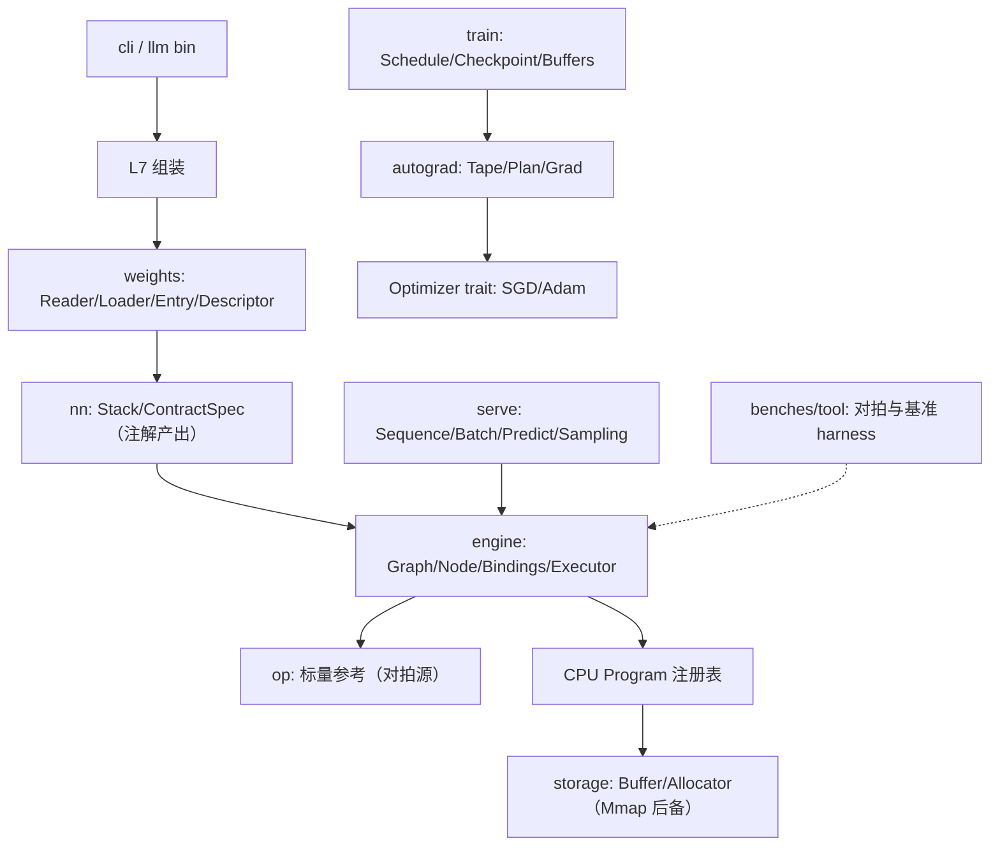

# 对照 `llm.u` 的能力补齐与整体优化设计

- 版本：v1.2
- 日期：2026-11-17
- 状态：决策已定形；完整决策看板见 [`implementation-task-plan.md`](implementation-task-plan.md) §4 D1–D13
- 适用范围：全 workspace（24 个 `crates/*` 成员 + 根包 `llm`）
- 取证口径：当前工作树源码 + 本机两个前代目录与本机可获取的对标仓库；所有现状结论回链源码 `文件:行`，未实测的性能数字不预填。
- 谱系裁决：本仓库是 `llm.u` / `llmu-p2` 的接续重写，不是另起炉灶；`llm.u` 已落地的关键功能是**不得退化的下限**，不是可选项。

## 0. 结论先行

1. **平台方向不推翻**：当前仓库的分层所有权、依赖方向门禁、算子/设备闭集、单一错误类型、核心 `unsafe deny`、运行时依赖趋零，是相对 `llm.u` 的真实长板，保留并加固。
2. **回退的是运行时实现密度**：`llm.u` 已有的训练步闭环、解码运行时、多后端内核、mmap 生产装载，在当前仓库分别停在契约、簿记、片段或 harness 形态。本方案按既有分层把这些件补回来，**不把 `llm.u` 长在一起的 `exec/device/graph` 结构搬回来**。
3. **补回方式必须走泛型 / 注解 / 配置**：新后端、新优化器、新采样策略、新算子都经 trait 或注册表挂载；层与参数的形状、算子选择、参数组由声明与档案推出，模型与调度代码不出现厂商特判和第二份手写常数。
4. **"领先 n 倍"只作为可证伪目标，不作为当前结论**：在可运行后端落地、同硬件同模型对照之前，不出吞吐/时延领先数字；密度、依赖数、unsafe 边界、测试完备度这类结构指标现在就可以对照。
5. **减量原则**：减的是仪式、重复、手写解析、装饰性闭集；运行时能力代码不按行数砍。每个新增模块动工前给行数棘轮预算，超预算红灯、功能排队（沿用 `10k-analysis.md §6.1`）。
6. **不退化下限**：`llm.u` 已有的训练步、解码循环、KV、采样、权重装载、后端挂载能力，在对应里程碑出口必须以等价或更优形态回归；回归清单见 §1.5，每条有归属里程碑与验收门，不允许以"平台重写"为由删掉。
7. **密度目标的口径**："代码少 15 倍"只在**同口径机制代码**上成立——排除测试、fuzz/benches 工具成员、构建脚本、生成片段与 vendor；对标分母取各框架同口径机制代码。当前仓库先按 §5.3 的规则重测基线，再逐里程碑回填倍数，不用总行数或含测试行数凑倍数。

## 1. 基线取证

### 1.1 对照对象

| 仓库 | 路径 | 末次提交 | 角色 |
|---|---|---|---|
| 当前仓库 | `/Users/fei/code/llm` | `aa18a9fa` 2026-11-17 | 本次设计对象 |
| `llm.u` | `/Users/fei/code/llm.u` | `cf4e8fe` 2026-11-11 | 主要对照基线（用户所称"原来 llm 点 u"） |
| `llmu-p2` | `/Users/fei/code/llmu-p2` | `d9178fa` 2026-11-05 | 更早一版，仅作演进参照 |

### 1.2 规模与质量口径（本机实测，不含 `target/`）

| 口径 | `llmu-p2` | `llm.u` | 当前 `llm` | 备注 |
|---|---:|---:|---:|---|
| crate 数 | 13 | 14 | 24 目录 + 根包（lock 内内部包 31） | 当前含工具成员 `annotation`/`fuzz`/`benches` |
| Rust 总行数 | — | 104,592 | 76,839 | 粗口径，含注释与测试；机制代码分母见 §5.3 |
| `#[test]` 函数 | 801 | 1,127 | 1,396（workspace 实测通过，0 失败，1 ignored） | 函数数与"实测通过"口径不同，只作量级参照 |
| 锁文件条目 | 204 | 220 | 122 | 条目含内部包；当前运行时第三方依赖基本为零 |

> 行数、测试函数数不作为"质量倍数"结论；结构质量以架构门禁、重复密度、依赖面、unsafe 边界、对拍完备度为准。

### 1.2.1 对标阵营规模（本机取证 + `10k-analysis.md` tokei 口径）

| 框架 | 语言/形态 | 规模（tokei Code 列，11-12 快照） | 本机 fresh `wc` 复核 | 备注 |
|---|---|---:|---:|---|
| 当前 `llm` | Rust workspace | 32,976 总 / 30,296 Rust | 76,839（含内联与外部测试） | 机制代码口径见 §5.3 |
| `llm.u` | Rust workspace | — | 104,592（含测试） | 谱系下限基线 |
| burn | Rust 多 crate 泛型塔 | 384,717 总 / 369,340 Rust | 487,938 | 后端 trait 塔 + 全产品面 |
| candle | Rust 一模型一文件 + 三后端 | 239,934 总 / 192,513 Rust | 226,644 | CPU/CUDA/Metal 手写后端重复 |
| cubecl | Rust 编译器 IR | 313,707 总 / 290,723 Rust | 369,496 | IR/fusion/dispatch 编译器税 |
| mistral.rs | Rust 模型动物园 + 后端 | — | 591,779 | 本机复核，未进 10k 表 |
| vllm.rs | Rust 单体服务 | 85,741 总 / 78,020 Rust | 88,052 | 调度/执行/协议长在一起 |
| llama.cpp | C/C++/CUDA/Metal | 1,072,502 | 875,462（1,415 个 C/C++/CUDA/MM 文件） | 架构 × 后端 kernel 矩阵税 |
| cutile-rs | 前代 DSL 平台 | 135,508 / 120,854 Rust | 156,275 | 前代对照 |
| TensorRT-LLM | C++/Python 量产服务 | 本机未取证 | — | M4 服务化对照，规模口径补齐后再入表 |
| SGLang | Python/C++ 服务化 | 本机未取证 | — | M4 连续批/调度对照，规模口径补齐后再入表 |

> 两个口径不可混用：tokei Code 列排除注释与测试；fresh `wc` 含测试。密度倍数只在同口径机制代码上计算（§5.3）。

### 1.3 能力对照矩阵

成熟度口径沿用 `engine-benchmark-roadmap.md §4`：**契约** = 类型/接口已定无实现；**簿记** = 只管元数据/账；**片段** = 生成代码文本未接运行时；**实现** = 在真实缓冲上跑出结果。

| 能力 | `llm.u` 状态与证据 | 当前状态与证据 | 差距 | 归属里程碑 |
|---|---|---|---|---|
| 训练优化器 | 实现：`train/src/optim.rs` SGD + Adam（矩估计、偏差修正、AdamW wd）；`trainer.rs::Session.train_step` 前向缓存 → 反向 → 裁剪 → 更新 | 无优化器：`train`/`autograd` 源码 grep 不到 Adam/SGD/参数更新；`Schedule`/`Checkpoint`/`Buffers`/tape/plan/梯度需求分类齐全 | 反传结果接不到参数 | T1 |
| 训练命令闭环 | 实现：`cli/src/cmd/train.rs:445` 建 `Session`，`:552` 按 `save_every` 落盘，`:362` `load_learn` 恢复；梯度累积、软目标蒸馏、RL、offload 有模块 | 契约：CLI 只有 `status/run/verify/bench/help`（`cli/src/lib.rs:59-85`）；`Schedule` 仅在 status 摘要构造一次 | 无训练入口、无样本通路 | T1 |
| 模型前向 | 实现：`exec/src/decode.rs:142 forward`、`:156 full`，embed → 层块 → norm → 词表投影 | harness：bin `run` 逐层走 cutile 子进程编译片段 + 标量参考对拍（`src/main.rs:259-386`）；`docs/backend-runtime-design.md §1.3` 自证"不是生产运行时" | 无驻留权重、无图装配、无进程内前向 | M1-B |
| 解码循环与 KV | 实现：`decode.rs:171 greedy`，每层 `HostKvCache`，提示过完后逐 token 投影 + 因果注意力 | 在途：`engine::kv` 页池已持真实 `Vec<f32>`；`Predict` 路线 B 签名 `logits(&Sequence, &mut Batch)` 已定形，历史读/当前步写回已接；投影/点wise/归一化首层仍 `Unsupported`（`serve/src/model_host.rs:70`），多序列批量循环未接 | 向量首层通路、多序列批、前缀页共享 | M2 |
| 采样 | 实现：`exec/src/sampler.rs` 温度、top-k、校准表 | 契约：`Sampling` trait 与端点调用在（`serve/src/completion.rs:266-272`），生产前向接不住序列 | 随 M1-B 落地 | M1-B |
| 权重装载 | 实现：`exec/src/weights.rs:79 Weights::open` 同时建 `Store` 与 memmap2 视图；raw 单块 `Cow::Borrowed`，多块/rANS 解压（`storage/src/store/internal.rs:336-390`）；safetensors 是离线导入器 | 双后端契约：`Reader` 借用 / `Loader` 拷贝（`weights/src/lib.rs:264-292`）；生产 `File` 按条目 seek+read（`weights/src/safetensors.rs:136-210`）；`Mmap` 是 dev-only feature，`storage` 只出现在 weights dev-dependencies | 生产路径未接 mmap；读出后仍 `Vec<u8> → Vec<f32>` 两次拷贝 | M1-A |
| 外部权重格式 | safetensors 离线转 v4；运行时只认自有容器 | 实现：运行时直读 safetensors/gguf/json/bin + 自有 Archive；量化分组推断 | **当前更宽**，保持 | 已具备 |
| 计算后端 | 实现：CPU NEON/AVX2/AVX-512 微核、Metal、CUDA+graph capture、MUSA、OpenCL/SYCL、CLBlast、CoreML/NPU（`device/Cargo.toml` 可选 cudarc/metal/coreml-native/libloading；`device/src/backend/{cuda,metal,intel,blas,npu.rs}`） | 契约/数据：`prof` 档案含 cpu/intel/ascend/nvidia/metal；无设备队列、无 kernel launch；真实后端属 P3 边界 crate | 后端实现密度回退最大 | M3 |
| 服务端点 | 契约：OpenAI schema（`serve/src/openai.rs`）+ 路由纯逻辑；`server.rs:1-4` 注释 axum/tokio 未接 | 契约：端点、线格式、帧/CRC/解码器齐全；无 socket | 两边都未接 HTTP，不作差距 | M4 |
| 架构治理 | 模块图为手工约定；外部依赖面较大 | 实现：依赖方向由 `tests/architecture.rs` 对照 `cargo metadata` 自动守门；闭集单一事实源；错误类型唯一；核心 `unsafe deny` | **当前领先**，保持 | 已具备 |

### 1.4 已经领先、不许在追赶中丢掉的长板

- 唯一依赖规则可执行门禁：向上依赖、成环在编译/测试阶段不可能出现。
- 算子清单（`op::REGISTRY` 24 条）、设备档案、族别归属各有唯一声明处，不存在手写第二份映射。
- 错误类型唯一 `diagnostic::{Code, Error, Result}`；新错误不另立类型。
- 核心 `unsafe_code = "deny"`；FFI/mmap 收敛在隔离文件与 feature 后。
- 运行时外部依赖趋零；锁文件 122 条 vs 基线 220 条。
- 测试证据：1,396 条 workspace 实测通过（0 失败，1 ignored）；架构门、clippy、fmt、对拍门禁全绿。

### 1.5 `llm.u` 关键功能不退化清单（下限，非可选）

每条在对应里程碑出口必须回归；验收以"等价能力 + 对拍达标"为准，不以代码行数为准。

| # | `llm.u` 已有能力 | 回归形态（新平台） | 归属 | 出口判据 |
|---|---|---|---|---|
| P1 | SGD + Adam（矩估计、偏差修正、AdamW wd、梯度裁剪） | `Optimizer` trait + 两实现，参数组元数据来自 `nn` 声明 | T1 | 小模型一步更新可断言；gradcheck 阈值内 |
| P2 | 训练会话：前向缓存 → 反向 → 优化器步 → 调度 | `train` 会话接 autograd 反传计划与梯度需求分类 | T1 | 夹具语料跑通指定步数；loss 单调趋势可记录 |
| P3 | checkpoint 存/载恢复 | 沿用 `train::snapshot` 字节格式并扩优化器矩状态字段，补 `--load` 通路 | T1 | 权重与矩状态存载往返逐位一致；步数/图规模/批形状可恢复 |
| P4 | 梯度累积、参数 offload、tie 权重回填 | 先落地累积；offload/tie 列入 T1 后续，不丢接口 | T1 | 累积窗口梯度汇总正确；tie 回填有对拍 |
| P5 | embed → 层块 → norm → lm_head 前向 | `nn::Stack` 装配 + CPU `Program` 注册表前向 | M1-B | 进程内对拍 `max_rel_err` 达标 |
| P6 | 贪婪解码 + 每层 KV cache | KV 页背后真实缓冲；decode 逐 token 投影 + 因果注意力 | M2 | 多步 decode 与参考序列对拍；KV 分配/释放边界测试 |
| P7 | 温度 / top-k / top-p 采样 | `Sampling` trait 实现同一参数闭集 | M1-B | 采样负例（坏温度/空候选/top-p 越界）有测试 |
| P8 | 权重 mmap 零拷贝装载 | 既有 `Reader`/`Loader` 下 `MmapSource`（Unix feature）+ 文件流源 | M1-A | raw 段借用生命周期断言；装载基准入表 |
| P9 | safetensors / 自有容器 / 量化分组 | 运行时直读多格式；量化分组推断保留 | 已具备 | 格式往返 round_trip 全绿 |
| P10 | 多后端挂载（CPU/Metal/CUDA/MUSA/OpenCL/SYCL/ANE） | 同一 `Executor/Allocator` trait；后端收边界 crate | M3 | CPU 先通；Metal 本机、CUDA 目标环境各自跑通同一前向 |
| P11 | 算子内核矩阵（matmul/elemwise/reduce/attention/量化反量化） | 24 条声明 + 标量参考；按 decode 瓶颈序逐后端落地 | M1→M3 | 每落地一条保留独立参考对拍 |
| P12 | OpenAI schema 与路由 | 既有端点契约保留；HTTP 传输 M4 再接 | M4 | 契约测试全绿；真实服务器替换桩路由 |
| P13 | 设备档案/能力闭集/性能档位 | `prof` 档案数据保留；后端选择走闭集，不写厂商特判 | 已具备 | 协商要求档案 L2 + 见证 L3 双证据 |

> 蒸馏、RL、投机解码、通信原型在 `llm.u` 是模块/参考层形态；本清单不把它们列为 T1 下限，但接口形状在对应阶段预留，不删除既有模块。

### 1.6 全仓分层深度体检

| 层 | 成员 | 现状判定 | 长板 | 待补动作 | 归属 |
|---|---|---|---|---|---|
| L1 基础 | `diagnostic` `testkit` `dtype` `wire` `tool` | 实现 | 唯一错误类型、精度闭集、字节码闭集、静态门与回退判定 | 解析器收敛到一份；报告排版合一 | P0 |
| L2 数据 | `prof` `op` `prim` | 实现（声明/数据） | 24 条算子清单、einsum 代价单源、设备档案 L0–L3 证据分级 | 装饰性骨架名清理；算子按 decode 序接后端实现 | M1→M3 |
| L3 内核 | `cutile` | 片段 + 见证 | 协商/拼接/emit/编译执行/内容寻址缓存骨架；命令共用一条流水线 | 产物缓存砍台账；驻留执行从子进程 harness 接到引擎 | M1 |
| L4 运行时 | `tensor` `storage` `tokenizer` | 大部分实现 | 张量元数据/布局搬运、BPE/unigram 词法、feature 门控 mmap | mmap 进生产源；可写分配器接驻留缓冲；编解码接生产链路 | M1-A/B |
| L5 模型训练 | `weights` `autograd` `data` `nn` `shard` | 契约/簿记为主 | 多格式读取、反图与显存计划、层契约下界、拓扑簿记 | 驻留权重；参数组声明；反传接优化器；样本通路；集合通信实现 | T1/M2/M3 |
| L6 调度服务 | `train` `engine` `serve` `cli` | 契约 + 簿记 | 训练状态/检查点格式、连续批与页账、端点契约与线格式、准入三态 | CPU 内核桥、KV 数据、批量前向、train 命令、HTTP 后端 | M1→M4 |
| L7 入口 | `llm` bin | 组装 | 不定义新类型；status/run/verify/bench 分流 | 装配驻留模型；补 train/serve 子命令 | M1/M4 |

## 2. 需求

### 2.1 功能需求

- **F1 装载与驻留**：统一 `Entry`/`Descriptor` 抽象；支持整文件映射与流式读两条源；未压缩段零拷贝借用，压缩段显式解压；权重在装载期一次性解码进驻留缓冲，生成循环内不再读文件、不再二次分配元素缓冲。
- **F2 CPU 单序列前向**：embed → 注意力块 → 归一化 → lm_head 出 logits；进程内 `Program` 执行，输出与独立 `op` 标量参考对拍达标；接 `Sampling` 产出第一个真实 decode token。
- **F3 训练闭环**：前向缓存 → 反向可达节点计划 → 梯度裁剪 → 优化器更新 → 学习率调度 → checkpoint 存/载；补 `train` CLI 命令；样本通路先接最小语料夹具，真实语料随数据层落地。
- **F4 KV 与连续批**：页表背后是真实张量缓冲；多序列每序列一步前向；准入只依据能力闭集与 KV 状态；前缀页共引用随 prefix cache 落地。
- **F5 后端边界**：同一 `Executor`/`Allocator`/`Collective` trait 下挂 CPU 与后续 Metal/CUDA；FFI 与 `unsafe` 只在独立边界 crate；核心继续安全 Rust。
- **F6 服务化**：既有 `Endpoint` 契约不动，M4 接真实 HTTP 后端；传输层与端点模型分离。

### 2.2 非功能需求

- **性能**：decode TPOT、单 token ms、`tokens/s`、TTFT、峰值 RSS、KV 字节；口径沿用 `engine-benchmark-roadmap.md §1.1`，同硬件同形状同批次对照。
- **正确性**：每条生产路径保留独立标量参考对拍；`max_rel_err` 在 dtype 容忍阈值内；截断/越界/空序列/非对齐尾段都有负例测试。
- **可维护性**：新增后端、优化器、采样策略、算子不改模型与调度代码；热点路径保持编译期单态化，不引入 `dyn` 热路径分发。
- **安全**：核心 `deny(unsafe_code)`；边界例外按 ADR-0035 收敛；无内存不安全的静默降级。
- **依赖**：生产路径继续趋零；任何破零依赖的取舍必须 ADR 显式拍板。
- **可观测**：基准 harness 统一记录机型、驱动、形状、批次、精度、后端标识与 roofline 上界。

### 2.3 约束

- 既有分层与依赖方向不可破；新 `pub` 类型必须进 `docs/ARCHITECTURE.md §三` 所有权表或 `lints/vocabulary.toml`。
- 不造通用 IR、不做跨算子融合编译器（ADR-0017 取舍）；触发条件满足再经 ADR 重建。
- 不为假想规模预埋抽象；trait 形状在第一个实现落地时定形，预留扩展点记录在案。
- 文档与代码同步：阶段状态、证据指针、实测数字回填对应路线文档。

## 3. 目标架构

### 3.1 分层不变量（沿用 `ARCHITECTURE.md`）

```text
L1 diagnostic/testkit/dtype/wire/tool
L2 prof/op/prim            数据：档案、算子声明、片段
L3 cutile                  机制：协商/拼接/emit/执行/见证
L4 tensor/storage/tokenizer
L5 weights/autograd/data/nn/shard
L6 train/engine/serve/cli
L7 llm bin                 组装，不定义新类型
```

运行时新增件只能落在上述层内；后端 FFI 收在 L3 之下的独立边界成员，不回流核心。

### 3.2 泛型 / 注解 / 配置挂载点

| 关注点 | 机制 | 不允许的写法 |
|---|---|---|
| 层与参数声明 | `#[annotation::spec]`（`nn` 内重导出为 `#[spec]`）产出 `ContractSpec`；算子侧 `#[annotation::model]` 产出 `Model` 条目；可训练参数、参数组、权重格式进声明；形状/算子名与 `op::REGISTRY` 双向锁死 | 手写第二份层构造字面量；调度代码硬编码层名宽度 |
| 算子与内核 | 算子声明在 `op`；`Program`/CPU 内核经注册表挂载；多后端实现同一算子按能力闭集选择 | 算子里写 `if Metal {} else if CUDA {}` |
| 后端 | `Executor`/`Allocator`/`Collective` trait；CPU 首实现，设备实现挂边界 crate | 模型/调度持有具体设备类型 |
| 权重源 | 既有 `Reader`（借用）/`Loader`（拷贝）trait；mmap、文件流、远端分块各为一实现 | 装载路径散落 `fs::read` 整文件读入 |
| 优化器 | `Optimizer` trait + 参数组元数据；SGD/Adam 为实现；矩状态按参数组分配 | 优化器直接改私有字段、绕过梯度需求分类 |
| 采样 | `Sampling` trait；温度/top-k/top-p 参数进闭集档案 | 采样参数散落在请求字面量 |
| 调度准入 | 只依赖能力闭集与 KV 存活状态 | 调度器知道具体后端缓冲类型 |

### 3.3 组件关系（M1 目标形态）



## 4. 分阶段落地

阶段出口统一满足：**可运行 + 可测量 + 门禁守护**；上一阶段出口未达标不进入下一阶段（沿用 `iteration-loop.md §1`）。

### 4.1 M1-A 装载与驻留权重

- **目标**：去掉生产路径的二次拷贝，权重装载有可对照的 RSS/时延基准。
- **改动落点**：`weights`、`storage`、`serve/src/assembly.rs`。
- **设计要点**：
  1. 收口既有 `Reader`/`Loader`：Unix 上补 `MmapSource`（feature 门控，复用 `storage::Mmap` 唯一 unsafe 岛）实现 `Reader` 零拷贝；既有 `File` Loader（seek+read）复核边界检查单点；非 Unix 只留文件源，缺失类型在编译期报错，不静默降级为整文件读入。
  2. `Archive` 借用路径保持 `Cow<'a, [u8]>`：raw 段 `Borrowed`，rANS 段 `Owned`；`File` 流后端在有映射后备时对 raw 条目返回借用切片。
  3. 驻留缓冲：装配期按描述符一次性解码权重进驻留 `Buffer`；生成循环只覆写输入与逐层激活，不重新分配元素缓冲（`CpuModel::forward` 现有形态保留，补投影/归一化首层通路）。
  4. 基准：mmap vs read 的首条/全量装载、冷/热缓存、RSS 与时延入 `benches`；数字回填 roadmap §1.1。
- **复用既有**：`Reader`/`Loader` 双 trait（`weights/src/lib.rs:264-292`）、`Mmap`（`storage/src/lib.rs` 的内联 `mmap` 模块）、`Entry`/`Descriptor`/段 CRC 校验。
- **验收**：raw 条目零拷贝有测试证据（借用生命周期断言）；压缩段解压边界与余数失败有负例；装载基准可重复；架构门通过；新增 unsafe 为零。
- **暂缓**：远端分块源、权重热更新、设备权重驻留。

### 4.2 M1-B CPU 单序列前向闭环

- **目标**：一条真实链路上从 token 到 logits 到采样 token，进程内对拍达标。
- **改动落点**：`engine`、`serve`、`nn`、`op`、`tensor`。
- **设计要点**：
  1. 注册表驱动的 CPU 内核桥：算子名 → `Program` 映射表（补缺口 G1）；`CpuExecutor` 装配生产图（补 G2）。
  2. 首批 decode 主路径算子：`gemv_f32`、`softmax_f32`、`rmsnorm_f32`、`silu/gelu`、add/mul/residual/scale、两条归约；`rope_f32` 与注意力随 M2；标量/形状通道按 D9 落定长类型化闭集槽（不查表）。
  3. `Predict` 生产实现接全族首层：投影/点wise/归一化首层由装配侧提供隐向量输入，不再直接 `Unsupported`；序列上下文按层族别折成输入缓冲。
  4. 进程内对拍 harness：同一输入跑 `Program` 输出与独立 `op::forward` 参考，`testkit::close` 判 `max_rel_err`（补 G6）。
  5. `Sampling` 接入端点步：logits → 采样 → `emit` 记账；停止符/上限/被挡三态保持现有 `Step` 结局分类。
- **复用既有**：`Completion` 生成循环（`completion.rs:243-281`）、`Batch/Sequence/Pager` 簿记、op 24 条标量参考、nn 层栈。
- **验收**：一层/两层合成模型端到端前向对拍达标；单序列 decode 出 token；首批算子基准入回归基线；无新增热路径 `dyn` 分发。
- **暂缓**：多序列批、KV 数据、注意力 decode 变体、设备后端。

### 4.3 M1-C 基准 harness 骨架

- **目标**：在出第一个后端数字前把对照口径定死。
- **改动落点**：`benches`、`tool::regress`、`testkit`。
- **要点**：统一记录硬件/驱动/形状/批次/精度/后端标识/roofline 上界；先记 llama.cpp CPU 同模型对照；本机无基线时登记跳过而非伪造数字。
- **验收**：每条 M1 算子/层/整模型有对照条目；CI 守不回归，跨机绝对值不进结论。

### 4.4 T1 训练最小闭环（不阻塞 M1 推理出口）

- **目标**：反传结果能更新参数，训练命令可跑可恢复。
- **改动落点**：`train`、`autograd`、`nn`、`weights`、`cli`。
- **设计要点**：
  1. `Optimizer` trait：`step(params: &mut [ParamSlot], grads: &[GradSlot], meta: &ParamGroup)`；矩状态由优化器按参数组持有；SGD、Adam（含偏差修正、AdamW 解耦衰减）为首两个实现。
  2. 参数元数据来自 `nn::ContractSpec`：可训练参数、参数组、wd/bias/norm 豁免组；优化器不自己猜字段名。
  3. 接 autograd：tape 记录 → `backward` 可达节点计划 → 梯度需求分类（`Requirement::Grad`）→ 裁剪 → 优化器更新；`train::Buffers` 作为重放存储实现复用。
  4. CLI 补 `train` 命令：配置（lr/warmup/总步数/裁剪/累积）→ 会话 → 周期性 checkpoint → `--load` 恢复；样本先接夹具语料。
  5. 调度器沿用 `Schedule` 的确定函数口径；checkpoint 字节格式不变。
- **复用既有**：`autograd` tape/plan/account/replay、`train` schedule/checkpoint/snapshot/pool/shape、`wire` 字节码。
- **验收**：单参数/小模型一步前向-反向-更新后权重变化可断言；梯度对拍（gradcheck）在阈值内；checkpoint 存载往返一致；训练命令在夹具数据上跑通指定步数。
- **暂缓**：分布式数据并行、ZeRO 分片、蒸馏/RL 通路、真实大语料通路。

### 4.5 M2 推理运行时（KV 与连续批）

- **目标**：簿记升级为持有真实数据的推理运行时，CPU 对照 llama.cpp 同档。
- **要点**：KV 行缓冲落地（补 G7）；前缀页共引用与回收（G8）；`Predict` 扩批量视图（G9/G11）；注意力 decode 变体登记；连续批调度与准入；prefix cache；decode 整步/整模型基准（G10）。
- **验收**：多序列端到端跑通；KV 分配/释放有对拍与边界测试；单序列/批次吞吐时延对照曲线入表；调度不违反页表不变量。

### 4.6 M3 后端边界、量化与性能

- **目标**：隔离边界内挂 Metal/CUDA，补量化反量化内核与通信原型，同后端对标 burn/candle。
- **要点**：独立边界成员实现 `Executor`/`Allocator`；FFI/`unsafe` 按 ADR-0035 收敛到边界模块；`i4`/`i8` lane `Program` 适配（G14）；集合通信实现（G15）；roofline 达成率报告。
- **环境约束**：Metal 在本机 macOS（M5 Pro / Metal 4）验；CUDA 在 win 远端（T600 sm_75 / CUDA 13.3）验；设备内核管线未建前只出编译与契约对拍，不出吞吐数字（G16）。
- **验收**：两条后端跑通 M2 同一前向；同算子对拍一致；同后端关键算子有对照数字；边界 crate 之外无新增 `unsafe`。

### 4.7 M4 模型与服务化

- **目标**：真实权重端到端生成；真实 HTTP 端点；细分场景对照 vLLM/TRT-LLM。
- **要点**：主流权重格式端到端装载与前向；`Endpoint` 的 HTTP 实现；并发与流式；服务基准并发与 P50/P99。
- **验收**：给定真实权重跑通生成；端点契约被真实服务器替换；TTFT/TPOT/吞吐/P99 同负载对照入表。

## 5. 代码与文件减量方案

### 5.1 减量分类

| 类别 | 手段 | 归属 |
|---|---|---|
| 仪式成本 | 同层小成员降为模块文件，crate 边界只留给真独立编译单元；架构门只校验模块集合与方向 | 需 ADR 拍板，见 D4 |
| 重复闭集/映射 | 清单与表驱动宏合一；族别/字段/内核表由声明派生名字，不手抄第二份 | 沿用 serve 优化已落地模式 |
| 手写解析 | TOML/JSON 解析收敛到模块内单源；维持生产零外部依赖（D5 已定，diagnostic `toml` 保持 feature 门控） | 引入 toml+serde 仅在维护成本实测超阈值时经 ADR 复议 |
| 报告/排版 | audit/tool/witness 三处排版合一为一个报告器 | P0 加固 |
| 缓存台账 | 只留内容寻址 key/artifact/复用计数，砍 GC ledger 与状态台账 | cutile |
| 装饰性闭集 | 无构造点的变体/骨架名删除，或补唯一事实源投影 | op/annotation |
| 模型动物园重复 | 不收录一模型一文件；模型由权重档案 + 层声明装配，新模型不改框架代码 | nn/weights |
| 后端 kernel 矩阵重复 | 同一算子只写一份声明/参考；后端差异收进片段数据与边界实现，不按架构 × 后端手写乘法表 | op/prof/cutile |
| 编译器 IR 税 | 不造通用 IR 与跨算子融合编译器；算子表达直接落 einsum 求和式与片段模板 | cutile |
| 测试密度 | 13k 行单测转向 golden 对拍 + 标量参考 + 少量属性测试；证据不降级，测试/生产比受控 | 全仓 |

### 5.2 行数棘轮

- 每个阶段动工前给模块行数预算（参照 `10k-analysis.md §6.1` 的 base/semantic/kernel/runtime/model/train/serve/entry 分账）。
- 超预算红灯：先说明超支来源（能力新增 vs 仪式回潮），功能排队，不靠压注释或砍常数凑数。
- 减量不得删除正确性证据：对拍、负例、契约测试只允许重构合并，不允许削弱断言。

### 5.3 密度倍数口径（"少 15 倍"怎么算）

- **分子（本仓机制代码）**：只统计生产机制 Rust；排除 `tests/`、`#[cfg(test)]` 体内、`fuzz`/`benches` 工具成员、`build.rs`、生成片段与 vendor。按 L1–L7 分账（base/semantic/kernel/runtime/model/train/serve/entry，沿用 `10k-analysis.md §6.1`）。
- **分母（对标框架机制代码）**：同一排除规则下取对方 Rust 机制行；C/C++ 框架（llama.cpp）只在"机制等价职责"口径上对照，不拿全文件行数直接除。
- **倍数目标**：核心机制集相对 burn/candle/cubecl 同口径机制代码达到约 1/15；相对 `llm.u` 的提升以"同能力下机制行数下降 + 能力不退化"双条件衡量，**不接受靠砍功能凑倍数**。
- **回填规则**：M1 出口先重测本仓机制基线；M3/M4 出口在同口径下回填与各框架的实际倍数；未重测前文档不写具体倍数结论。
- **"强 20 倍"的可证伪拆解**（对 `llm.u`）：不是单一数字，而是四条并列门——能力覆盖不低于 §1.5 清单；同硬件同模型 decode 时延/吞吐不劣于基线；结构质量（依赖数、unsafe 边界、重复密度、对拍完备度）优于基线；机制代码密度优于基线。任一维不达标都不能宣称整体更强。

### 5.4 当前大文件观察（待阶段内拆分，不在本方案强制立即拆）

`weights/src/bin.rs` 900、`benches/tests/regress.rs` 918（benches 工具成员，不计机制行数）、`src/bin/cutile/main.rs` 883、`train/src/snapshot.rs` 768、`op/src/decl.rs` 758、`annotation/src/syntax.rs` 755、`prof/src/atom.rs` 726、`cutile/src/device.rs` 711。拆分按职责轴走，优先把解析、排版、台账从机制文件里移出。

## 6. 关键决策与 ADR 落点

决策已全部定形，选定方案 / 被否备选 / 取证依据 / ADR 编号见 [`implementation-task-plan.md`](implementation-task-plan.md) §4 看板 D1–D13；本节只留编号预留与口径。

- ADR 编号：0033 空缺；新 ADR 从 **0036** 起（0036 D1、0037 D2/D11、0038 D4、0039 D5、修订 0025 或 0040 D6、0041 D7、0042 D8、0043 D9、0044 D10）；0035 为 unsafe/FFI 边界并发裁决，未评审前 M3 不动工。
- 已定方向摘要：D1 沿用 Reader/Loader；D2 优化器归 train + ParamRole 角色闭集；D3 T1 并行不阻塞 M1；D4 24 成员维持到 M2，合并凭实证；D5 零生产依赖；D6 沿用后端 trait；D7 双注解宏保留；D8 M4 再上 HTTP；D9 定长类型化标量槽；D10 元数据留装配侧；D11 角色进 ContractSpec；D12 KV 复用既有引用计数接线；D13 词表解析归 weights。
- ADR 正文在对应任务动工前补齐；实现不得在看板之外另起平行抽象。

## 7. 风险与故障模式

| 风险 | 影响 | 缓解 |
|---|---|---|
| 过早接 GPU，后端 trait 被私有设备假设分叉 | M3 第二后端要回改算子/模型 | trait 在 CPU 实现落地后再稳定；设备句柄不进模型代码（ADR-0025 §7） |
| 压缩段被误判为零拷贝 | RSS 失真、对外内存结论错误 | `Cow` 借/有显式二分；测试断言解压段必须 `Owned` |
| 训练反传没有真实样本通路 | 闭环空转、梯度无意义 | T1 先用夹具语料跑通，再接数据层；gradcheck 守门 |
| 行数减量误伤正确性证据 | 对拍/负例被删，回归无感知 | 减量清单逐条标注对应测试；断言只能合并不能削弱 |
| 跨机器绝对时延被当成领先结论 | 对标结论不可证伪 | 基准记录机型/驱动/形状/批次；CI 只守不回归，领先结论同环境对照后回填 |
| 并发在途改动与本方案冲突 | 落档与实现错位 | 一切以工作树现状为准；新 ADR 与所有权表同步更新 |
| mmap 非 Unix 目标静默降级 | "不占内存"前提失真 | 缺失类型编译报错；不提供假装映射的空实现（`storage/src/lib.rs:12-14` 既有取舍） |

## 8. 验收指标与回填口径

### 8.1 指标族（沿用 roadmap §1.1）

- 正确性：`max_rel_err` 在 dtype 阈值内；gradcheck 达标；checkpoint 往返一致。
- 延迟：TTFT、TPOT、单 token ms。
- 吞吐：单序列 `tokens/s`、批 `tokens/s`、服务聚合吞吐。
- 内存：权重驻留、KV 字节、峰值 RSS/显存。
- 架构密度：机制代码行数、外部依赖数、`unsafe` 边界数、每后端新增代码量、复用率、jscpd 重复密度。

### 8.2 对照阶段

| 阶段 | 首要对照对象 | 对照指标 |
|---|---|---|
| M1 | llama.cpp CPU 同档 | 单序列 decode 时延/吞吐、对拍精度 |
| M2 | llama.cpp CPU；SGLang 调度思路 | 多序列吞吐/时延、KV 内存、准入公平性 |
| M3 | burn / candle 同后端；llama.cpp 指令集内核 | 同后端算子性能、新增后端代码成本、roofline 达成率 |
| M4 | vLLM / TensorRT-LLM / SGLang | TTFT/TPOT/并发/P99、prefix cache 命中、端侧内存细分场景 |

### 8.3 四个"更优"的判定门

| 维度 | 判定方式 | 不允许的捷径 |
|---|---|---|
| 能力 | §1.5 清单逐条回归；功能广度以可运行链路为准，不以模块存在为准 | 用占位模块、契约类型冒充已落地功能 |
| 性能 | 同硬件/同模型/同形状/同批次对照；roofline 达成率 + 实测时延吞吐 | 静态 flops 估算、跨机绝对值、vendor 峰值当自己成绩 |
| 质量 | 对拍 `max_rel_err`、gradcheck、负例覆盖、clippy/门禁全绿、jscpd 密度、依赖与 unsafe 边界 | 删测试、放宽断言、把校验推给运行期 |
| 密度 | §5.3 同口径机制代码行数、每后端新增代码量、复用率 | 含测试/vendor/生成代码凑分母；砍能力换行数 |

### 8.4 不可回填为结论的内容

- 静态 flops/带宽估算只作 roofline 上界，不当实测吞吐。
- 设备内核管线未建前，CUDA/Metal 条目只算编译与契约对拍。
- 未在可运行后端落地前，不对外引用吞吐领先结论。

## 9. 与既有文档的关系

- `engine-benchmark-roadmap.md`：对标目标、里程碑 M1–M4、指标族与预留点；本方案引用不重写。
- `backend-runtime-design.md`：缺口 G1–G16 与落点裁决（复用 `serve` 不新建 crate）；本方案的 M1-A/M1-B/T1 逐条对应这些缺口。
- `iteration-loop.md`：五步反思闭环与阶段出口判据。
- `10k-analysis.md` §6：万行预算与减量手段；本方案 §5 承接。
- `ARCHITECTURE.md`：层表、边集、所有权表；新增类型以该文档为准登记。
- `serve-deep-optimization-design.md`：serve 端点/准入/内核表/族别描述符的已落地优化，本方案在其上接生产实现。

## 附录 A：当前关键证据指针

| 主题 | 指针 |
|---|---|
| CLI 命令集 | `crates/cli/src/lib.rs:59-85` |
| bin `run` 对拍 harness | `src/main.rs:259-386` |
| 生产 Predict 首层限制 | `crates/serve/src/model_host.rs:70` |
| Reader/Loader 双后端 | `crates/weights/src/lib.rs:264-292` |
| safetensors 流式 File | `crates/weights/src/safetensors.rs:136-210` |
| mmap 隔离实现 | `crates/storage/src/lib.rs` 的内联 `mmap` 模块；feature 门控 `crates/storage/Cargo.toml:15-17` |
| Archive Cow 二分 | `crates/weights/src/archive.rs:182-186` |
| 训练侧状态与不拥有项 | `crates/train/src/lib.rs:1-18` |
| 反图与计划 | `crates/autograd/src/{tape,plan,schedule,account,replay}.rs` |
| 引擎执行器 | `crates/engine/src/exec.rs:536-560` |
| 缺口清单 G1–G16 | `docs/backend-runtime-design.md §3` |

## 附录 B：`llm.u` 能力证据指针

| 主题 | 指针 |
|---|---|
| 优化器 SGD/Adam | `llm.u/crates/train/src/optim.rs:4-69` |
| 训练会话步 | `llm.u/crates/train/src/trainer.rs:102-150` |
| 训练 CLI 闭环 | `llm.u/crates/cli/src/cmd/train.rs:362,445,552` |
| 模型前向/full | `llm.u/crates/exec/src/decode.rs:142-160` |
| 贪婪解码与 KV | `llm.u/crates/exec/src/decode.rs:171-180` |
| 采样 | `llm.u/crates/exec/src/sampler.rs:32-185` |
| mmap 视图装载 | `llm.u/crates/exec/src/weights.rs:73-107`；`llm.u/crates/storage/src/store/internal.rs:327-390` |
| 后端可选依赖 | `llm.u/crates/device/Cargo.toml`；`llm.u/crates/device/src/backend/{cuda,metal,intel,blas,npu.rs}` |
| 服务桩 | `llm.u/crates/serve/src/server.rs:1-7`；`llm.u/crates/serve/src/openai.rs` |
