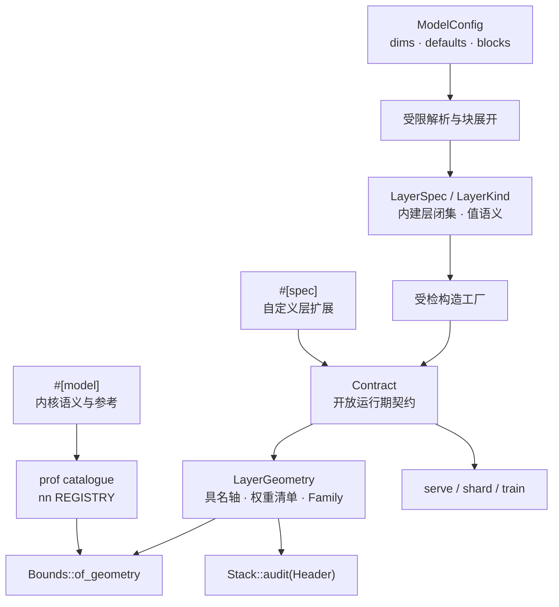

# `crates/nn` 架构优化章程

日期：2026-11-25  
范围：`crates/nn`；涉及下游时仅限 `annotation`、`serve`、`shard` 的必要接缝。  
状态：**设计基线已核实，作为后续实施与验收依据；不是完成报告。**

本文区分四类陈述：

- **现状**：已在当前工作区核对，可用文件、行数、测试或基准复现。
- **决策**：后续实现必须遵守的架构约束。
- **提交目标**：各阶段完成时必须达到的可验收结果。
- **冲刺目标**：只有在不损害内聚、公开接口和性能时才继续追求，不得倒因为果。

---

## 1. 基线与结论

### 1.1 当前基线

| 指标 | 当前值 | 口径 |
|---|---:|---|
| `src` 文件 / 行数 | 34 / 15,747 | `crates/nn/src/**/*.rs` |
| 测试文件 / 行数 | 37 / 8,910 | `crates/nn/tests/**/*.rs` |
| 合计 | **71 文件 / 24,657 行** | 两项直接相加 |
| 层声明与模型装配 | 10 文件 / 3,883 行 | 根目录层侧模块 |
| 内核与神经算子 | 24 文件 / 11,864 行 | `kernel`、`conv` |
| `macro_rules!` 定义 | 29 | 当前源码文本计数 |
| 层声明机制 | 6 套 | `axis!`、运行期 `OpLayer`、`spatial_layer!`、`norm_layer!`、`attention_layer!`、手写／`#[spec]` |
| 手写 `bounds` | 14 处 | 含默认与组合层实现 |
| `LayerConfig` 变体 | 10 | 配置仍逐项镜像构造器 |
| 最近完整 `nn` 测试基线 | 556 通过 / 0 失败 / 4 忽略 | 后续每阶段必须重新取得完整结果 |
| jscpd | 0 clones / 0.00% | 当前 `src` 扫描结果 |

补充证据：朴素注意力容量复用方案已取得同 crate 前后对照，16×16 为 1.135×、64×64 为 1.030×，两档 `max_err = 0`；20 项注意力定向测试通过。**定向结果不能替代完整质量门。**

### 1.2 结论先行

当前主要问题不是“泛型不够”或“文件还不够少”，而是：

1. **同一份层知识仍存在多个事实源**：类型、配置、下界、下游分类各写一遍。
2. **仍有三个真实正确性缺陷**：Embedding 下界错误、`WeightFormat::dtype()` 静默回落、注解层错误经 panic 暴露。
3. **配置与运行期职责没有分开**：配置需要闭集和值语义，运行期契约需要开放扩展；不能用一个巨型 `Layer` 同时替代两者。
4. **物理平铺快于语义收敛**：继续机械合并文件会得到巨型模块，而不是更好的架构。

因此，后续顺序必须是：**先修正确性 → 再统一语义 → 再统一配置 → 最后按内聚平铺文件。**

---

## 2. 必须保留的现有能力

以下内容已经有效，不得在重构中退回多份实现：

| 能力 | 当前做法 | 重构约束 |
|---|---|---|
| 多精度泛型 | `Precision` / `Scalar`；一元、二元、归约按档单态化 | 不为 f16／bf16 复制平行算子族 |
| 浮点档配置 | `float_tiers!` 一张表生成身份、切片、后缀和字节宽 | 新精度只改一张表 |
| 单轴层声明 | `axis!` 统一生成构造、校验、访问器与契约 | 继续收敛，不恢复逐层手写 |
| 算子选择 | 精度 × 档位使用配置表；量化格式由 `WeightFormat` 决定 | 不允许按形状借兄弟算子凑下界 |
| 内核注解 | `#[model]` 描述算子语义 | 属于内核域，不能与层注解混为一谈 |
| 层注解 | `#[spec]` 描述层契约 | 演进而非另建第三个平行层注解 |
| 公共路径 | crate 根保留原算子与空间层重导出 | 文件搬家不得破坏下游路径 |
| 数值与性能 | 泛型对拍、性质测试、Criterion 与同 crate 前后对照 | 无对照不得宣称提速；无完整测试不得宣称完成 |

---

## 3. 现存问题与优先级

### P0-A：Embedding 下界丢失行宽，属于现行正确性错误

`contract.rs` 中 `Embedding::bounds` 当前调用：

```rust
Bounds::of_ctx(Self::OP, self.tokens, 1)
```

但内核形状是 `{ n: tokens, d: dim }`，代价随 `tokens * dim` 增长。这里把 `dim` 错写为 1；`tokens = 8`、`dim = 128` 时，流量会被少算 128 倍。

对应测试仍用同一个错误调用作期望值，属于“测试复述实现”。**必须先修实现，再用手算或独立语义重算测试，不得只改期望值。**

### P0-B：`WeightFormat::dtype()` 有静默 U4 回落

`weight.rs` 使用 `map_or(DType::U4, ...)`。未覆盖变体不应被解释为 4 位格式。该函数应是穷尽匹配：

- 每种格式都有明确 `DType`；
- 新增变体时编译器报错；
- 不存在“未知格式默认 U4”的运行期路径。

### P0-C：注解角色有危险兜底，声明错误仍会 panic

`annotation/src/render.rs` 在 `OnceLock` 中构造 `ContractSpec` 失败时生成 panic；`role_variant` 还把未知角色兜底为 `Embedding`。

决策：P0 先删除角色兜底并穷尽映射；用户可触发的声明错误随后在 P3 经构造或注册边界返回诊断。不得把 `OnceLock` 的 panic 当作输入校验接口，也不得用合法但错误的角色掩盖映射缺口。

### P1：六种层声明机制，配置又镜像构造器

层的基本事实——名字、几何、算子、参数角色、权重与下界——分散在六套机制中。`LayerConfig` 再逐项声明字段和构造闭包，产生第二份镜像。

直接后果：

- 新增内建层要同步多个位置；
- `Recurrent` 的构造参数与默认值尤其容易漂移；
- `Scan`、`LmHead` 等能力不能由配置自然表达；
- 宏数量增加，但扩展成本没有下降。

### P2：下界有 14 处手写，缺少统一几何翻译

下界的通用部分应只有一条：

> 层几何 → 算子具名轴 → `prof` 语义表 → 读／写／FLOP。

当前各层自行选择 `of_op`、`of_ctx`、`of_ops` 或手算，Embedding 错误正是这一结构的产物。组合层需要求和，但“组合”不应成为每层重算基础口径的理由。

### P3：五个具体类型下行方法，下游仍重复分类

`Contract` 为 `Linear`、`Embedding`、`AttentionBlock`、`MemoryBlock`、`Recurrent` 各提供一个默认 `None` 的下行方法。新增组合类型就继续扩 trait，开放扩展因此退化为一串内建类型识别。

与此同时，下游又按算子名建立分类表。层的族、几何与执行规划没有单一来源。

### P4：配置到权重是单向的

除 `Recurrent` 外，层普遍不能声明自己在 checkpoint 中应拥有的条目、形状和格式。结果是：

- 配置装配出的模型不能与 `Header` 完整对账；
- 缺失、多余、形状不符和量化分组不符没有统一报告；
- 下游需要再次根据名字猜结构。

### P5：配置表达能力不足

当前 `ModelConfig` 主要是扁平 `[[layers]]` 列表，缺少：

- 顶层维度与默认值；
- 受限整数表达式；
- 块模板、`repeat` 与名字插值；
- 配置生成后的权重对账。

图组合应建立在上述能力稳定之后，不能先引入一个递归、可序列化、可执行又包含所有语义的巨型枚举。

### P6：`Stack` 的值语义与开放扩展被混为一谈

`Stack` 当前存放 `Vec<Box<dyn Contract>>`，适合异构内建层和自定义注解层。要求整个 `Stack` 无条件 `Clone + PartialEq + Serialize`，会迫使所有自定义层承担同一约束，或彻底关闭扩展。

正确目标是：**`ModelConfig` 和内建 `LayerSpec` 具备完整值语义；运行期 `Stack` 保持开放。** 内建层的连续存储与减少 `Box` 是后续性能优化，不是牺牲扩展性的前置条件。

### P7：文件碎与宏多仍须治理，但不得机械合并

当前有 6 个生产文件少于 300 行；29 个宏中仍有相当部分只是补偿层声明机制分裂。继续合并前必须先回答：

- 是否同一概念；
- 合并后是否超过 899 行；
- 是否把冷路径声明与热路径内核耦合成巨型文件；
- 是否只是移动代码而没有减少事实源。

---

## 4. 目标架构：闭集配置，开放契约，统一几何



### 4.1 配置数据与运行期契约分离

**内建配置闭集**：

- `LayerSpec`：名字、角色与 `LayerKind`；
- `LayerKind`：投影、矩阵乘、单轴、Embedding、注意力、卷积、池化、归一化、循环、记忆等内建几何；
- 可直接 serde，具备 `Clone + PartialEq`；
- 由受检工厂构造现有具体类型，不在配置中镜像第二份构造参数。

**开放运行期契约**：

- 保留 `Contract`，允许 `#[spec]` 和下游自定义类型；
- 内建层与自定义层走同一模型装配和下界求和；
- `ModelConfig` 可序列化，不代表所有 `dyn Contract` 必须可序列化。

### 4.2 两类注解各有边界

- `#[model]`：算子形状、样本、代价、参考与模板，属于**内核语义**。
- `#[spec]`：层契约与构造，属于**模型声明**。

决策：不新增 `#[nn::layer]` 作为第三套平行概念。层侧增强现有 `#[spec]`，删除其运行期文本宏约束和危险兜底。

### 4.3 一个几何入口，两类下界组合

引入 `LayerGeometry` 作为层到算子轴的唯一翻译。基础层使用：

```rust
Bounds::of_geometry(operator, geometry)
```

组合层只调用统一的组合函数累加子层结果。目标是删除 14 份手写口径，保留：

1. 一个基础几何计价入口；
2. 一个组合下界求和入口。

`of_op` / `of_ctx` 等现有函数可暂时作为私有适配器，迁移结束后删除，不另建平行 API。

### 4.4 一个族分类来源

内建 `LayerKind` 派生 `Family`；自定义契约提供显式族或 `Custom`。下游消费 `Family` 和几何，不再按算子名重新猜测。

五个具体类型下行方法只有在 `serve` / `shard` 完成迁移后才可删除，不能留下双份分类长期并存。

### 4.5 权重清单成为一等能力

每层可生成 `WeightSpec`：名称、形状、格式、角色与量化分组。组合层由子层清单拼接。

`Stack::audit(&Header)` 至少报告：

- 缺失条目；
- 未覆盖条目；
- 形状或格式不符；
- 标度与分组不符；
- 已声明但无法计价的层。

该能力是配置正确性的组成部分，不是附加工具。

### 4.6 配置表达式必须受限且可诊断

支持：整数、`[dims]` 引用、`+ - * /`、括号、`repeat` 与 `${i}` 插值。  
拒绝：函数调用、未知名字、循环依赖、除零、整数溢出、无界展开。

解析器必须设置表达式与展开数量上限；任何失败都包含配置路径。默认值只在配置层应用一次，不得在构造器里再猜第二套默认值。

---

## 5. 平铺与减量规则

### 5.1 平铺的定义

平铺是**相同主题在一个文件中完整可读**，不是：

- 给旧文件加一层内联 `mod`；
- 保留新旧两份源码；
- 把多个超过 899 行的主题强行拼成巨石；
- 为减少文件而删除注解、诊断或测试；
- 改变公开模块路径。

### 5.2 合并前置条件

只有同时满足以下条件才合并：

1. 语义事实已经单源化；
2. 合并后同时满足最新 `AGENTS.md` 与静态 gate；本次新增／修改文件以 **≤300 行**为准，既有 899 行上限不构成新修改的许可；
3. 新文件不因 `file_min_lines = 300` 增加豁免；
4. 函数 **≤30 行**、嵌套 **≤3 层**、`ccn ≤ 5`，不以旧 `nloc ≤ 60` 放宽最新约定，不新增 gate debt；
5. 公开路径通过现有测试锁定；
6. 内核热路径有数值与性能对照；
7. 删除旧文件后 jscpd 保持 0；`cargo dupes` 不新增精确或近重复组，后续通过语义收敛逐步降低基线。

### 5.3 数量预算

| 指标 | 当前 | 提交目标 | 冲刺目标 |
|---|---:|---:|---:|
| `src` 文件 | 34 | 按 ≤300 行的修改面重新核算，显著减少碎片 | 不以数量替代质量门 |
| `src` 行数 | 15,747 | ≤ 12,500 | ≤ 11,000 |
| 全 crate 行数 | 24,657 | ≤ 20,000 | ≤ 19,000 |
| `macro_rules!` | 29 | ≤ 18 | ≤ 14 |
| 内建层声明表 | 多份 | 1 | 1 |
| 基础／组合下界入口 | 14 处手写 | 2 | 2 |
| `LayerConfig` 构造镜像 | 10 个变体 | 0 | 0 |
| 具体类型下行方法 | 5 | 0 | 0 |
| 内建层权重清单覆盖 | 不完整 | 100% | 100% |
| jscpd | 0 | 0 | 0 |

**任何文件数量目标都不是合并许可证。** 若数量目标与最新工程约定、主题内聚或能力保持冲突，必须重新计算并记录原因，不得利用存量基线掩盖新增修改。

---

## 6. 分阶段实施

| 阶段 | 交付内容 | 必须通过的验收 |
|---|---|---|
| P0：正确性 | 修 Embedding 下界及独立测试；`dtype()` 穷尽化；注解角色映射穷尽化；重新取得完整基线与性能基线 | 手算 Embedding 用例、格式与角色穷尽测试、完整 `nn` / `annotation` 测试 |
| P1：统一几何 | `LayerGeometry`、`Family`、基础与组合两个下界入口；迁移现有层 | 各层下界等价性测试；Embedding 回归不退化 |
| P2：统一配置 | `LayerSpec` / `LayerKind`；内建构造工厂；删除配置镜像；dims、defaults、block、repeat | 配置往返、默认值单源、错误路径、展开上限 |
| P3：权重与注解 | 全内建层 `WeightSpec`；`Stack::audit`；`#[spec]` 声明错误经诊断返回，不再 panic | 缺失／多余／错形报告；注解错误非 panic 用例 |
| P4：下游收口 | `serve` / `shard` 改读 `Family`；删除重复分类与五个下行方法 | 全工作区测试；无双重分类 |
| P5：物理平铺 | 按内聚合并文件、删除旧副本、压缩剩余宏 | 文件预算、公开路径、gate、零重复、性能对照 |

每阶段都必须可独立审阅和回退。不得把 P0 的正确性修复藏进大规模重命名或文件搬家。

---

## 7. 每阶段统一质量门

### 7.1 正确性与兼容性

```bash
cargo fmt --all --check
cargo test -p llm-nn -p llm-annotation
cargo clippy -p llm-nn -p llm-annotation --all-targets --no-deps -- -D warnings
cargo clippy -p llm-nn --all-targets --features bench --no-deps -- -D warnings
RUSTDOCFLAGS="-D warnings" cargo doc -p llm-nn --no-deps
cargo test --workspace
```

另需通过：静态 gate、命名检查、所有权表、jscpd 与 `cargo dupes`。测试数量不得因重构下降；被证明无效的“复述实现”测试应由独立测试替代，而不是直接删除。

### 7.2 性能

- 内核重构必须固定机器、输入、形状、特性和优化档位。
- 优先使用同 crate 前后实现、交替采样和中位数；报告形状、样本数与误差。
- 单次 Criterion 绝对值只能作为基准，不能作为提速证据。
- 分配优化既要看分配次数，也要看实际耗时；若变慢，恢复原实现。
- 不允许用某一形状的收益掩盖另一形状的回退。

### 7.3 性能基线示例

以下只用于证明测量方式，不是未来实现的固定承诺：

| 场景 | 前后结果 | 数值判据 |
|---|---|---|
| RMSNorm 64×4096 批路径 | 1.066× | 新旧输出一致 |
| i8 MatMul 67×83×1025 | 1.014× | 逐位一致 |
| 朴素注意力 16×16 | 1.135× | `max_err = 0` |
| 朴素注意力 64×64 | 1.030× | `max_err = 0` |

---

## 8. 明确禁止的方案

1. 用一个闭集 `Layer` 取代所有自定义 `Contract`，以换取表面上的统一。
2. 把 `#[model]` 与 `#[spec]` 合并成跨内核／层领域的万能注解。
3. 为追求 `Stack: Serialize` 给所有自定义层增加无谓约束。
4. 把 Embedding 修复仅改成另一个共享函数，而不写独立数值测试。
5. 通过 `map_or`、默认角色或默认分组掩盖未知配置。
6. 为减行删除错误文案、注解、边界检查或测试。
7. 为减文件保留 `.new`、旧目录副本或双份 `#[path]` 接线。
8. 在没有前后对照时报告性能提升百分比。
9. 在语义仍多源时做大规模文件搬家。

---

## 9. 下一步执行清单

按顺序执行，不并行跳过：

1. **修 `Embedding::bounds`**：使用 `tokens` 与 `dim` 的真实几何；测试直接核对 8×128 的独立代价，不再调用同一错误入口作期望。
2. **穷尽化 `WeightFormat::dtype`**：移除 U4 回落，并证明所有变体映射正确。
3. **穷尽化注解角色映射**：删除未知角色回落 `Embedding` 的分支；panic 错误通道在 P3 单独迁移，不与本次正确性修复混合。
4. **建立 P0 完整基线**：完整 `nn` / `annotation` 测试、两组 Clippy、文档、workspace、gate、jscpd；随后才进入 `LayerGeometry` 迁移。

本章程所定义的“两个档次提升”，不是主观评分，而是：**正确性缺陷清零、声明与配置单源、权重可对账、下游不重复分类、文件与代码达到预算、所有性能结论可复现。**

---

## 10. P0 实施记录（2026-11-25）

### 已落地

- `Embedding::bounds` 已改用 `tokens × dim`；测试独立手算 8×128 的读、写与 FLOP，不再复述错误入口。
- `WeightFormat::dtype()` 已移除 U4 默认回落；主匹配穷尽格式，分组映射保持 CCN≤5，九个变体有显式存储类型用例。
- 注解角色映射已覆盖四个合法角色；未知角色生成 `compile_error!`，不再回落 `Embedding`。
- 严格 rustdoc 发现的 `Values` 失效链接已改为完全限定路径。

### 已取得的验证

- P0 最终目标代码复测：`nn` 557 通过 / 0 失败 / 4 忽略；`annotation` 63 通过；两组 Clippy 与 `nn` rustdoc 通过。
- 静态 gate 中 `crates/nn` 条目为 **0**；目标格式与命名检查未出现 `nn` 问题。
- jscpd：34 个源文件，0 clones / 0.00%。
- P0 完成时 `src` 为 15,765 行；正确性修复较章程基线增加 18 行，**不计为减量成果**。

### 目标验收与全工作区开口

P0 的目标 crate 验收已通过。全工作区验收仍开放：完整测试在 `shard` 出现 4 项空间算子对拍失败，静态 gate／命名总门仍有 `cutile` / `prof` 条目；这些结果不冒充全工作区全绿，也不计入 `nn` 的失败。

---

## 11. P1 统一几何迁移（进行中）

### 已落地

- 新增公开 `LayerGeometry`：`Projection` 与 `Shape` 显式区分两种算子轴映射，并提供 `projection` / `shape` / `axis` 构造器。
- 新增 `Bounds::of_geometry`；全部生产层已迁移，旧 `of_op` / `of_ctx` 仅保留为兼容适配器。
- 投影、单轴、Embedding、MatMul、注意力、空间层与循环层共用同一入口；组合层仍按原语义求和。
- 新测试同时锁定投影等价、Embedding 8×128 手算代价与单轴构造；`LayerGeometry` 已登记所有权表。

### 当前验证状态

- 静态 gate 无 `nn` 条目，jscpd 保持 0 clones / 0.00%，目标格式与差异检查通过。
- 当前 `src` 为 15,829 行；几何接缝较 P0 增加 64 行，属于后续删除多份适配器前的架构投入，不计为减量。
- 当前完整数值回归：**566 通过 / 0 失败 / 4 忽略**，文档测试 2 项通过。
- 最新统一入口 `scripts/ci.sh`：rustfmt、全工作区全特性 Clippy、Ruff 与 cloc 均通过；nextest 阶段在 `train/src/geometry.rs:272/290/301` 因不存在的 `shapes::shapes::lengths` 路径出现 3 处编译错误。完整 CI 未通过；数值回归不能替代 CI。按最新 `AGENTS.md` 的文件／函数限制与完成定义，P1 仍标记为**未完成**。
- 并行修改仍可能改变输入；任何阶段通过都只对当时的工作区内容有效，不能把历史单次结果当作最终状态。

