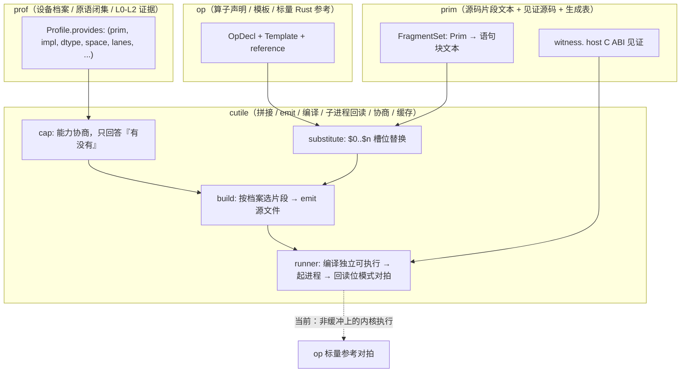

# `prim` 片段层深度对标评审（架构 / 算子 / 设计模式 / 质量）

- 版本：v1.0
- 日期：2026-11-15
- 范围：`crates/prim`（片段文本 + 见证源码 + 编译期生成表），上溯到 `cutile` 的拼接/执行消费点、`prof` 的能力档案与 `op` 的算子声明/标量参考
- 视角：Rust 专家、大模型推理算子专家、架构师、设计模式专家、质量专家联合评审
- 取证口径：结论回链源码路径；阶段归属沿用 [`engine-benchmark-roadmap.md`](engine-benchmark-roadmap.md) P0–P4 与 [ADR 0025](adr/0025-runtime-backend-abstraction.md) 边界，不重复展开后端实现
- 配套：[`ARCHITECTURE.md`](ARCHITECTURE.md)（分层所有权）、[`architecture-test-review.md`](architecture-test-review.md)（测试体系）、[`audit.md`](audit.md)（静态审计）

---

## 0. 总体判断

### 0.1 先厘清定位：`prim` 不是业界意义上的算子内核层

这是本次评审最容易被误读的一点。在本仓既有架构边界里，`prim` 是**跨设备源码片段仓库 + 见证源码 + 编译期生成表**，不是可执行算子内核：

- **拥有**：`Builtin` / `Fragment` / `FragmentSet`（装载后的片段）、`Device` / `Image` / `Status`（设备侧源码与可选镜像）。
- **不拥有**：设备能力区间（`prof`）、词法拼接与 emit（`cutile`）、运行时缓冲与数值（运行时各层）。
- **依赖方向**：`cutile → prim → {prof, diagnostic}`，`prim` 不反向依赖 `cutile`（`crates/prim/src/lib.rs:1-11`）。

一段片段是语句块（`$0..$3` 由算子模板的 `@prim(...)` 绑定），脱离模板不能独立编译成可调用内核（`crates/prim/src/device.rs:19-21`、`build.rs:20-22`）。真实算术验证走 `op` 的标量 Rust 参考；`cutile::runner` 把见证源码编成独立可执行文件、起子进程、回读 stdout 位模式做对拍，不在跨张量缓冲上执行内核（`crates/cutile/src/runner.rs:1-10`、`execution.rs:1-15`）。

因此，"算子必须是顶尖实现、不能是骨架"这个诉求，落点必须分清两层：

1. **片段文本层（`prim` 现状）**：P0 标量语句块是路线刻意选择——tile / SIMD / 设备指令（dp4a / mmad / wmma）落点划归后端阶段（roadmap §6 P1/P3）。
2. **真实内核能力（目前在仓内没有归属层）**：分块向量化点积、线程并行、量化块格式、块矩阵乘、设备内核注册表与选择——这些在 `prim` 里没有，在 `cutile`/`engine` 里也还没有，属 ADR 0025 预留、P1/P3 落地的后端边界 crate。

**诚实口径**：在可运行后端落地之前，本仓不出任何吞吐对比结论（roadmap §2.1）。`prim` 层当前能做、也应该做到顶尖的，是把**抽象边界、注册表形状、量化格式契约、证据体系、片段复用与质量校验**定死，让后续 CPU / Metal / CUDA 内核能在稳定骨架上长出来，而不是到 P3 推倒重写。

### 0.2 结论摘要

`prim` 的结构纪律（闭集同源、编译期扫描生成三表、签名声明与档案交叉校验、证据等级 L0–L2、单一所有者）在同等原型阶段是一流的，与 burn 的 trait 塔、candle 的后端模块组织相比，架构密度与可解释性是长板。但对标 llama.cpp / candle / TRT-LLM 的内核层，存在三类差距：

- **架构抽象差距（A）**：缺内核注册表与"同一原语多签名多后端实现"的挂载形状；后端 trait 在 ADR 0025 只是预留，`prim` 片段层没有可注册、可选择、可融合的内核单元抽象；片段参数只有"槽位有无实参"的校验，没有类型化契约。
- **功能缺口（B）**：无 SIMD / 分块 / 线程并行内核；量化只有单 scale 的 i4 解包；16 原语里 5 条 L0（`mma`/`scan`/`exp2`/`rcp`/`atomic`）无片段文本；高频推理算子（RMSNorm / Softmax / RoPE / 量化块格式）的设备内核形态未定。
- **代码质量差距（C）**：签名解析规则在 `prim` 与 `build.rs` 各抄一份；片段跨设备逐字同构却无模板复用；测试只校验内嵌=磁盘与声明形态，无片段语义对拍；缺产物身份字段（内核名 / 指令集 / 块宽）进缓存指纹。

这些差距里，**刻意保留的阶段占位**与**现在就该补的架构/质量缺口**在 §4 逐一定性，避免把 P3 后端的活误记成 `prim` 的欠账，也避免把现在定死边界能防的返工留到后面。

---

## 1. 现状基线（取证事实）

| 项 | 现状 | 证据 |
|---|---|---|
| 规模 | `prim` 约 1248 行（`src/*.rs` + `build.rs`）；5 个 vendor（`cpu`/`nvidia`/`intel`/`ascend`/`metal`）× 9 段片段 + 1 份 `witness.<ext>`；45 段片段 | `crates/prim/` 目录、`build.rs:97-182` |
| 原语闭集 | 16 个指令级原语：`mma` `dot` `load` `load_async` `commit_wait` `store` `bar` `shuffle` `broadcast` `reduce` `scan` `exp2` `rcp` `cvt` `quant` `atomic` | `crates/prof/src/atom.rs:158-182` |
| 片段覆盖 | 每设备 9 段：`dot` `load` `load_async` `commit_wait` `store` `bar` `cvt` `reduce` `quant`；`shuffle`/`broadcast` 刻意不声明（单 lane 无可交换对象）；`mma`/`scan`/`exp2`/`rcp`/`atomic` 为 L0，磁盘上无片段文本 | `crates/prim/cpu/`、`crates/prof/devices/cpu.toml:126-179` |
| 片段语义 | 全部标量语句块：`dot` 是顺序标量循环 `$0 += $1[k]*$2[k]`；`reduce` 仅 `($0)=($1)` 拷贝单部分和；`bar`/`commit_wait` 空操作；`load` 取地址；`load_async` 退化为同步、令牌恒 0；`cvt` 用 C 隐式转换；`quant` 每字节解两个 nibble、减零点 8、乘单 scale | `crates/prim/cpu/{dot,reduce,bar,load,load_async,cvt,quant}.c`；`nvidia/dot.cu`、`metal/dot.metal`、`intel/dot.cl`、`ascend/dot.cpp` 同构 |
| 三表生成 | `build.rs` 编译期扫描目录生成 `BUILTIN`（片段）/ `WITNESS`（见证源码）/ `DEVICES`（设备原语枚举 + 入口 + 可选镜像），写 `$OUT_DIR/tables.rs`；`tables.rs` 仅 `include!` | `build.rs:57-64`、`src/tables.rs:7` |
| 签名声明 | 片段第一行 `/* cutile-sign: <prim>/<impl> */`，是元数据：不进 emit body、不进缓存指纹；缺声明 / 原语与文件名不符 / impl 为空即 invalid | `src/lib.rs:93-157`、`build.rs:210-246` |
| 证据等级 | L2 = 编过执行并与参考对拍、带 witness；L0 = 有见证源码但无片段文本，协商视为不具备；cpu 档案 9 条 L2 + 5 条 L0 | `cpu.toml:44-124`（L2）、`cpu.toml:126-179`（L0） |
| 设备镜像 | `Device{vendor, ext, emit, tool, tool_ver, prims, source, image, status}`；`Status` 闭集 `Source / Compiled / NoRecipe / Skipped{reason}`；只有 Metal 有构建配方（MSL 普通函数可进 metallib，CUDA/OpenCL/AscendC 只收 `__global__`/`__kernel__`） | `src/device.rs:38-147`、`build.rs:495-524` |
| 参数绑定 | 片段槽位 `$0..$9` 位置参数、`$name` 命名参数；拼接时只校验"槽位有没有实参"，缺参报模板错误；不校验参数 dtype / 空间 / lane / 对齐与档案 provides 属性 | `cutile/src/substitute.rs:61-141` |
| 线程 / SIMD | 全仓生产核心无 `rayon` / 线程池 / `std::simd` / 平台 intrinsics；`probe.rs` 仅探测 `neon` 能力标志，不实现内核 | 全仓 `grep`（`std::arch` 仅 `probe.rs:30-31`） |
| 算子参考 | `op` 约 35 个模块文件，算子声明 + 模板 + 标量 Rust 参考；`gemm` 已抽泛型骨架（ADR 0026），三格式 f32/i8/i4 薄转发；无设备内核 | `crates/op/src/`、`crates/op/src/gemm.rs` |
| 测试覆盖 | `prim` 单测 9 条（`tests.rs`）+ 设备测试 8 条（`device/tests.rs`）：校验内嵌表=磁盘、签名声明、闭集名、非法形态报错；无片段数值语义对拍 | `src/tests.rs`、`src/device/tests.rs` |

### 1.1 执行链路现状图

> 图中虚线：当前执行是"见证程序回读 stdout"的契约验证，不是张量缓冲上的真实算子内核。真实设备队列 / kernel launch / 可写缓冲属 P1/P3（ADR 0025 §1-3）。

---

## 2. 业界对标：三层模型与本仓映射

顶尖推理引擎普遍分三层组织算子能力。把本仓现状逐一对上去，差距位置就清晰了。

### 2.1 业界三层参考

**① 算子 / 张量 API 层**：用户面张量与算子声明，后端无关。
- burn：`Tensor` → Bridge → Dispatch → Backend；`Backend` trait 与 `BackendTypes` 在低层，用户面张量运行时分派、不暴露后端泛型<RichMediaReference>["https://burn.dev/books/contributor/project-architecture/tensor.html","https://burn.dev/books/burn/advanced/backend-extension/"]</RichMediaReference>。

**② 后端抽象与调度层**：后端 trait、装饰器（autodiff / fusion）、图规划、线程池、能力选择。
- burn：autodiff 与 kernel fusion 是套在后端上的装饰器；多后端（CUDA/ROCm/wgpu/Metal/Vulkan/WebGPU/CPU/Flex）经同一 trait 接入<RichMediaReference>["https://crates.io/crates/burn-tensor/0.22.0-pre.2","https://burn.dev/docs/burn/"]</RichMediaReference>。
- llama.cpp/ggml：compute graph → graph plan → `thread_pool` → backend 执行；CPU 经 SIMD 映射宏（`GGML_F32xt` / `FMA` / `REDUCE`）抽象不同架构 intrinsics<RichMediaReference>["https://deepwiki.com/ggml-org/llama.cpp/4.3-metal-backend"]</RichMediaReference>。
- candle：CPU 后端模块（Unary/Binary/Reduce/Sort 等），CUDA 内核编译成 PTX 并索引；量化 vec_dot 分架构 `avx.rs` / `neon.rs` / `simd128.rs`<RichMediaReference>["https://deepwiki.com/huggingface/candle/8-advanced-topics","https://deepwiki.com/huggingface/candle/4-quantization-system"]</RichMediaReference>。

**③ 设备内核层**：手写指令集特化内核、量化块格式、块矩阵乘、内核库注册表。
- ggml：块量化格式（Q4_0 / Q8_0 / Q5_K / Q4_K 等）+ 分架构 vec dot；KleidiAI 作为 `ggml-cpu` 的一个 trait 接入 SME / I8MM / DotProd<RichMediaReference>["https://learn.arm.com/learning-paths/mobile-graphics-and-gaming/performance_llama_cpp_sme2/kleidiai_integration/"]</RichMediaReference>。
- candle：CPU 可选 MKL / Accelerate 走 BLAS；CUDA 路径用 WMMA 做 MoE；`candle-kernels` 承载 GPU 特化内核<RichMediaReference>["https://aiwiki.ai/wiki/candle_hf"]</RichMediaReference>。
- TRT-LLM：编译器为图中每个算子选最优 kernel、识别可融合子图合成单 kernel、整图编译成一条 CUDA Graph；FlashAttention 这类无法自动发现的复杂融合用 plugin 显式替换<RichMediaReference>["https://nvidia.github.io/TensorRT-LLM/architecture/core-concepts.html"]</RichMediaReference>。
- vLLM：内核库 + 流水线编排（programmatic dependent launch），expert combine 融合进相邻 gemv<RichMediaReference>["https://vllm.ai/blog/2026-10-21-flint"]</RichMediaReference>。

### 2.2 映射到本仓

| 业界层 | 代表机制 | 本仓现状 | 归属阶段 |
|---|---|---|---|
| ① 算子 / 张量 API | Tensor、graph 节点、算子声明 | `op`：声明 + 模板 + 标量参考；张量是只读 `&[u8]` 视图 | 声明层已就绪；可写张量 P1 |
| ② 后端抽象 / 调度 | Backend trait、装饰器、plan、thread_pool、能力选择 | ADR 0025 预留 `Device/Allocator/Executor`；`cutile::cap` 只回答"有没有能力"，无 plan / 线程池 / 内核选择 | P0 定 trait 形状；P1 CPU 实现；P3 双后端 |
| ③ 设备内核 | SIMD 分架构、量化块格式、块 MMA、内核注册表 | `prim` 仅标量占位片段；无分架构内核、无块格式、无内核注册表 | P1 CPU 内核；P3 Metal/CUDA 内核 |

**关键差距集中在 ③**：与 llama.cpp / candle 的手写指令集内核矩阵相比，本仓目前是零内核；这是阶段问题（roadmap §4 算子内核行：P1 起逐算子落地），不是 `prim` 片段层的设计失误。但 ② 里"内核注册表 / 选择契约"的形状，属于 P0 就该在抽象层定死、否则 P3 双后端分叉返工的部分——这正是本次评审要推动补的。

---

## 3. 问题清单（分级）

### A. 架构与抽象（设计模式）

#### A1. 缺内核注册表抽象：`(prim, impl, dtype, space, lanes, arch)` → 内核实现 / 入口
**现状**：`cutile::build` 按 `(vendor, ext)` 从目录找片段文本（`cutile/src/build.rs:361-369`）；`cap` 协商回答"设备有没有这条签名"，但没有一张"原语 × 后端 × 签名 → 具体内核实现"的注册表。业界 candle 按模块索引 PTX、ggml 按后端挂 kernel trait、burn 经 Backend trait 分派。
**影响**：P3 接 Metal + CUDA 时，同一原语要挂多条后端实现，没有注册表形状就会在算子/调度里长出 `if Metal {} else if CUDA {}` 厂商特判分支——正是 ADR 0025 §7 要防的分叉。
**定性**：**真缺口（P0 应定形状，P1/P3 填实现）**。当前 `Device::prims` 只到"原语 → 见证入口名"，粒度不够承载多内核实现。

#### A2. 后端 trait 未落到 `prim`/`cutile` 可见的契约
**现状**：ADR 0025 §1 定了 `Device / Allocator / Executor` 三件套，但 `prim` 片段与 `cutile` SPECS 表行（probe / 生成 / 回读）面向见证验证，不面向张量执行；`engine::Executor` 仍是 `submit(graph, stream)` 雏形，无设备、缓冲、事件同步。
**影响**：片段绑定的 `$0..$3` 是裸指针/表达式文本，与后端缓冲句柄（CPU 指针 → 未来设备句柄）之间没有抽象层承接。
**定性**：预留已在 ADR 0025，**本轮不重复造**；评审要求在 P1 动工前把 trait 形状回填（ADR 0025 修订节已注明）。

#### A3. 算子到内核之间缺 plan 层：选哪条内核、怎么切分、怎么并行
**现状**：协商只做能力闭集匹配（`cap.rs:92`）；没有"给定形状/批次/硬件，在多条候选内核里选最优、按线程/线程束切分"的规划层。业界 ggml 有 graph plan + thread_pool，TRT-LLM 编译器做 kernel 选择与融合，burn 有 fusion 装饰器。
**影响**：这是 P2/P3 的调度职责；当前原型不展开，但内核注册表（A1）的键必须预留形状/批次/指令集维度，否则 plan 层后补要改注册表。
**定性**：阶段缺口（P2/P3），**注册表键设计现在要留维度**。

#### A4. 量化表示未结构化成块格式类型
**现状**：i4 解包散在 `cpu/quant.c`、`nvidia/quant.cu`、`metal/quant.metal` 与 `op` 标量参考里；没有独立的"块量化格式"抽象（block size / scale / zero / 偏移 / 打包-解包-点积一体）。业界 ggml/candle 用块格式（Q4_0/Q8_0/Q_K）把打包、解包、点积绑在同一格式类型上。
**影响**：P3 加 Q8_0 / Q5_K / FP8 时要回改权重读取与解包代码（roadmap §5 量化抽象行：P1 解耦、P3 接内核）。
**定性**：**真缺口（P1 解耦类型，P3 填格式与内核）**；与 ADR 0012 量化权重同源衔接。

#### A5. 跨设备片段无复用：五份同构文本靠人保持一致
**现状**：`dot` 在 cpu/nvidia/intel/ascend/metal 五段正文逐字同构（仅注释语言名与 impl 名不同）；`quant` 五份同一份 nibble 解包。标量参考实现只该写一份，各设备语言外壳由生成/模板产出。
**影响**：改点积口径要改五处，漂移风险高；与代码密度长板相悖。
**定性**：**真缺口（P0 可做）**：在不引通用 IR（ADR 0017）前提下，把"标量语义一段、设备外壳按语言模板展开"的复用关系定下来。

### B. 功能缺口（算子 / 内核能力）

#### B1. 无 CPU 原生 SIMD / 分块点积内核
**现状**：`dot` 标量顺序循环，无 AVX2/AVX-512/NEON/SME 向量归约，无分块累加。对照 ggml-cpu 的 `GGML_F32xt` 映射、candle `avx.rs/neon.rs/simd128.rs` 的 `vec_dot`。
**定性**：阶段缺口（**P1 CPU 内核**）。`prim` 片段层此刻不实现；但 `op::gemv::Format` 泛型骨架（ADR 0026）已为分架构单态化留好接口。

#### B2. 无线程并行 / 线程池
**现状**：单线程；无任务分片、无 pool。对照 ggml `thread_pool`、candle 的并行分片。
**定性**：阶段缺口（**P1/P2**）。调度与并行属运行时层，不在 `prim`。

#### B3. 无分块矩阵乘（tile MMA）内核
**现状**：`mma` 是 L0 占位（`cpu.toml:141-151`），磁盘无片段；无块宽 / 寄存器分块 / 向量化累加。GPU 侧 dp4a / dpas / mmad / wmma 均未实现（`nvidia/dot.cu:4` 注释明确归 P3 tile 落点）。
**定性**：阶段缺口（**P1 标量分块 GEMV/GEMM；P3 设备 MMA**）。

#### B4. 量化内核不完整
**现状**：仅 i4 解包 + 单 scale、减零点 8；缺 per-channel/group scale、对称/非对称、Q8_0、K-quants、整数点积（dp4a/dpas）、量化 GEMV/GEMM。
**定性**：阶段缺口（**P3 量化内核**）；块格式抽象（A4）P1 先解耦。

#### B5. 高频推理算子的设备内核形态未定
**现状**：`op` 已有 `rmsnorm_f32` / `softmax_f32` / `rope_f32` / `silu_f32` / `gelu_f32` / `embed_f32` / `attention` / `flash_attention` / `reduce_*` 标量参考，但 `prim` 片段层只为 9 条原语备了文本；这些算子在设备内核上由哪些原语组合、分块口径如何，尚无落点定义。
**定性**：部分阶段缺口（**P1 优先 gemv/softmax/rope**，roadmap P1 出口口径）；算子到原语的分解契约应在 P1 随首条真实内核一起定型。

#### B6. 无内存布局 / 缓冲抽象
**现状**：片段只按裸指针取地址；无 strided 视图、行/列主序、对齐、跨设备拷贝概念。ADR 0025 §2-3 预留双形态张量与分配器。
**定性**：预留已在 ADR 0025，**P1 落地**；不在 `prim` 内补。

#### B7. 无内核级 benchmark 回填与注册表指标
**现状**：`prof` 档案记 `peak.flops_f32` / `bw` 结构上界（`cpu.toml:33-38`）；`cutile::bench` 按 p50 折达成率，但只对已有见证计时，无"每内核 × 形状 × 指令集"的实测矩阵回填档案。
**定性**：阶段缺口（**P1 搭 harness，P2/P3 接内核实测**，roadmap §4 性能测量行）。

### C. 代码质量 / 工程

#### C1. 签名解析规则双份抄写
**现状**：`Fragment::parse` / `split_declaration` / `declaration_parts`（`src/lib.rs:128-193`）与 `build.rs::signature`（`build.rs:210-246`）是同一套规则的两份实现；注释说明"刻意不共用，因 build 不能依赖正在构建的 crate"。规则一旦改一处漏另一处，构建期校验与运行期装载会漂移。
**定性**：**真缺口（P0 已落地）**。规则已抽到 `crates/prim/src/signature.rs` 零依赖纯函数，`prim` 与 `build.rs` 经 `include!` 共用（ADR 0027 §5），消除双份规则漂移。

#### C2. 片段参数无类型化契约
**现状**：`splice` 只校验槽位有无实参（`substitute.rs:124-140`）；哪根是 A、哪根是 B、累加器、长度、dtype、空间、对齐，全靠片段注释约定，装载期不与档案 `provides` 的 `dt/space/lanes/align/...` 逐条对齐。
**定性**：**真缺口（P0 可做装载期交叉校验）**。档案已有属性集合（`cpu.toml:44-124`），可在装载/构建期把片段引用的参数维度与 provides 属性核对，缺配或越界即 invalid。

#### C3. 测试无片段语义对拍
**现状**：`prim` 测试只验证内嵌=磁盘、声明合法、闭集名；片段正文算出的数是否与标量参考一致，只由 witness host 自检覆盖 L2 那 9 条；L0 片段（无文本）与占位片段的语义无对拍断言。
**定性**：**部分真缺口**。L2 已有见证对拍；建议补"片段槽位 → 参数维度"的静态契约测试（C2 落地后），数值对拍仍归 `op::reference` 与 `cutile::verify`。

#### C4. 错误类别未覆盖片段内部绑定越界
**现状**：装载错误有 `Invalid / Io / Missing`；片段内引用了未提供参数由 substitute 报模板错误；片段文本自身引用了闭集外原语/非法槽位形态，无独立类别。
**定性**：轻量缺口，随 C2 契约校验一并补类别。

#### C5. 产物身份字段不进缓存指纹
**现状**：签名声明不参与缓存指纹（`src/lib.rs:98-99`）；缓存 key 含 source/tool 等（`cutile/src/cache.rs:163-166`），但不含内核名/指令集/块宽。未来同原语多内核时，指纹无法区分两条实现产物。
**定性**：**真缺口（P0 预留字段，P1 填值）**；A1 注册表落地时一并把 impl/arch/块宽纳入 key。

### D. 泛型 / 注解 / 配置化落点（呼应用户三招）

| 手段 | 落点 | 现状与建议 |
|---|---|---|
| **泛型** | 内核层按 `Elem` / 位宽 / 架构 trait 单态化；量化块格式 `PackedQ` trait；后端 `Backend` trait | `op::gemv::Format` / `Gemm` trait 已示范（ADR 0026）；P1 内核沿此模式，热路径保持编译期单态化，不引 enum/dyn 运行时分发 |
| **注解** | 仿 `op` 的 `#[model]` 声明，为内核登记 `(prim, impl, dtype, arch, lanes, block)` 编译期元数据，由生成器产出注册表与校验测试 | 维持手写解析、零外部依赖（不引 syn/quote/proc-macro2）；注解元数据进注册表键与缓存指纹（C5） |
| **配置化** | 设备能力 / arch 特性 / 块宽 / 线程分组进 `prof` 档案；内核选择规则（arch → 最优 impl）表驱动 | 现状已有 `provides` / `peak` / `space` / `simt`；补注册表选择表与块宽维度即可，不在模型/调度代码里写厂商特判 |

---

## 4. 刻意保留 vs 真缺口（定性对照）

| 现状 | 业界对应 | 定性 | 归属 |
|---|---|---|---|
| 片段是标量语句块，无 SIMD/分块 | ggml/candle 分架构 vec dot | **刻意 P0 占位** | P1 CPU 内核 |
| `bar`/`commit_wait` 空操作、`load_async` 退同步 | 设备屏障/异步拷贝/完成令牌 | **刻意 P0 占位**（单线程 CPU 语义） | P2/P3 设备后端 |
| `reduce` 拷贝单部分和 | 分块归约 + 跨 lane 交换 | **刻意 P0 占位** | P1 标量归约，P3 设备归约 |
| `load` 取地址、`store` 单元素 | 向量化批量搬运、对齐拷贝 | **刻意 P0 占位** | P1/P3 |
| `shuffle`/`broadcast` 不声明 | 子组 lane 交换/广播 | **刻意不声明**（单 lane 无可交换对象，声明即伪造证据） | P3 加速器 |
| `mma`/`scan`/`exp2`/`rcp`/`atomic` L0 无片段文本 | 块 MMA、前缀和、快速 2^x、倒数牛顿迭代、全局原子 | **阶段缺口**：档案有见证声明，片段文本待补 | P1/P3 |
| 五份同构 dot/quant 文本 | 标量参考一处、外壳生成 | **真缺口（P0 可做复用）** | 本轮 P0 |
| 签名解析规则双份 | 单一事实源 | **真缺口（P0 可做）** | 本轮 P0 |
| 片段参数无契约校验 | 类型化内核签名 | **真缺口（P0 可做）** | 本轮 P0 |
| 无内核注册表/多后端挂载 | Backend trait + kernel registry | **真缺口（P0 定形状）** | P0 ADR，P1/P3 填实现 |
| 无 SIMD/线程/分块/量化块格式内核 | 手写指令集内核矩阵 | **阶段缺口**（核心性能差距） | P1/P3 |
| 无可写缓冲/分配器/设备队列 | 后端内存与执行 | 已预留 ADR 0025 | P1/P3 |
| 内核 benchmark 矩阵未回填 | 实测吞吐对拍基线 | **阶段缺口** | P1 harness，P2/P3 实测 |

---

## 5. 分阶段建议（对齐 roadmap P0–P4）

### P0：在不引入后端前提下，把抽象边界与质量补齐（本轮可做）

1. **内核注册表形状落 ADR（建议 ADR 0027）**：键 `(prim, impl, dtype, space, lanes, arch, block)`，值为内核实现挂载点（片段文本 / 未来后端句柄）；选择只走能力闭集；为 plan 层（形状/批次/指令集）预留维度。与 ADR 0025 §4「算子多后端挂载」衔接。
2. **片段复用**：标量语义一处定义，设备语言外壳按模板展开；先收敛 `dot`/`quant` 五份同构文本，jscpd 重复率不回升破 1.5%。
3. **签名解析单源化**：抽零依赖解析微模块，`prim` 与 `build.rs` 共用，消除 C1 双份规则漂移。
4. **片段参数契约装载期校验**：片段引用的参数维度与档案 `provides` 属性对齐；补错误类别（C2/C4）。
5. **缓存指纹预留内核身份字段**：impl/arch/块宽入 key 形状（C5），P1 填值。
6. **测试补契约层**：槽位参数维度、声明-档案交叉校验的表驱动测试；数值对拍仍归 reference/verify。

### P1：最小可运行闭环（CPU 真实内核，经 ADR 0025 trait）

- 可写张量 + CPU 分配器；落地 `gemv_f32` / `softmax_f32` / `rope_f32` 三条 decode 主路径真实内核，保留标量参考对拍。
- 量化块格式 `PackedQ` trait 解耦；标量分块 GEMV/GEMM；首条 SIMD 内核（NEON/AVX2 按探测门控，unsafe 仍在后端边界）。
- 基准 harness 统一记录硬件/形状/批次/后端，首批 llama.cpp 同硬件对照数字回填文档。

### P2：CPU 追平 llama.cpp 同档

- KV 缓冲落地、continuous batching、注意力内核接入、prefix cache；线程池分片；按 decode 瓶颈 roofline 贡献度排序优化。

### P3：Metal + CUDA 并行，量化与 roofline

- 独立后端边界 crate，FFI/unsafe 关在边界内；同一套后端 trait 挂两条链路；dp4a/dpas/mmad/wmma、量化反量化内核、集合通信原型；同后端对比 burn/candle 打平到领先。

### P4：模型与服务化

- 真实权重端到端前向、HTTP/gRPC 端点、并发流式、服务基准对照 vLLM/TRT-LLM。

---

## 6. 风险与护栏（既有不变量，不得突破）

- **不造通用 IR**（ADR 0017）：片段复用走模板生成，不建跨算子 IR；重建触发条件按 roadmap §2.2。
- **热路径零动态分发**：内核选择与分派保持编译期单态化，不引 enum/dyn 运行时分发。
- **零外部解析依赖**：注解维持手写解析，不引 syn/quote/proc-macro2。
- **unsafe 边界**：生产核心继续 `unsafe deny`；Metal/CUDA FFI 与 `unsafe` 只在后端边界 crate，局部 `allow` 收敛，动工前出单独 ADR（ADR 0025 §9）。
- **依赖方向**：`cutile → prim → {prof, diagnostic}`，后端边界 crate 只能指向运行时 trait，禁止反向（ADR 0001、ADR 0025 §1）。
- **性能主张可证伪**：未在可运行后端落地前，不对外引用吞吐领先结论；所有对照同硬件同输入、记录机型/驱动/形状/批次（roadmap §7）。
- **量化常数/种子不进配置**；设备能力只认 `prof` 档案与 L0–L3 证据分级，不设第二套能力闭集。

---

## 7. 裁决结论（已落 [ADR 0027](adr/0027-kernel-registry-and-fragment-contract.md)）

1. **注册表抽象落点**：类型契约（七元组键 `prim/impl/dtype/space/lanes/arch/block` 与选择规则）先定义在 `cutile` 协商侧，不新增 crate；实现挂载随 P1 CPU、P3 Metal/CUDA 由后端边界 crate 填入。选择只走能力闭集，不出厂商特判。
2. **片段复用粒度**：标量语义事实源在 `op` 标量参考；设备外壳保留手写空间。本轮先落同构一致性校验，模板展开延后到算法分化、手写空间被证明受限后再上。
3. **L0 五条原语**（`mma`/`scan`/`exp2`/`rcp`/`atomic`）：本轮不补片段文本，随 P1 首条对应真实内核一起补片段与见证。
4. **P1 内核优先级**：维持 roadmap 顺序 `gemv_f32` / `softmax_f32` / `rope_f32`；i4 量化 GEMV 作为 decode 带宽瓶颈候选，P1 harness 期按 roofline 贡献度排序。

### 7.1 本轮已落地（P0，不引入后端 / `unsafe` / 新依赖 / IR）

- **ADR 0027**：注册表键与挂载分离、片段契约形状、复用原则、缓存身份字段、量化格式边界定档。
- **C1 签名解析单源化**：规则抽到 `crates/prim/src/signature.rs`，`prim` crate 与 `build.rs` 经 `include!` 共用同一份纯函数源码，消除双份抄写漂移。
- 其余 P0 项（参数维度装载期校验、一致性校验、缓存身份字段填值）形状已在 ADR 0027 定档，代码随 P1 首条真实内核落地。

> 本评审只做架构/质量定性与路线对齐；真实内核实现、线程池、设备 FFI 随 P1/P3 动工，不在 `prim` 片段层内提前展开。
