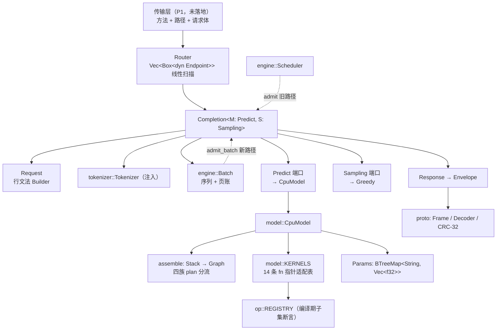
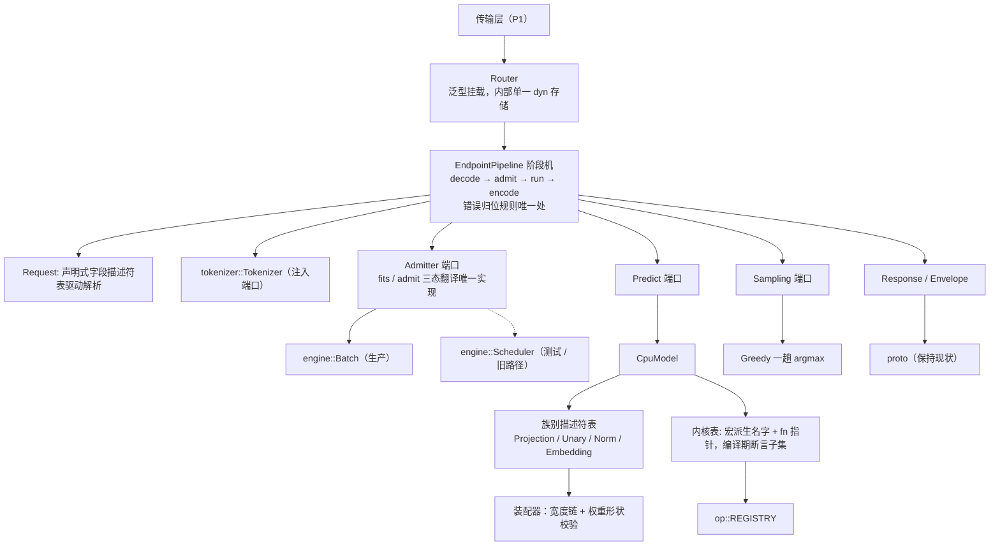

# `llm-serve` 深度优化：架构评审与设计

- 日期：2026-11-17
- 取证口径：当前工作树 `crates/serve/` 全部源码 + 测试；依赖契约取 `engine` / `nn` / `op` / `tokenizer` / `diagnostic` 公开 API；仓库约束取 `docs/ARCHITECTURE.md`、ADR 0005/0006/0016/0019/0020/0022/0023/0025。
- 基线度量：生产源码 **2 533** 行，内联测试 **394** 行，外部测试 **1 425** 行；`cargo test -p llm-serve` 101 条单测 + 3 条 doctest 全绿；`cargo clippy -p llm-serve` 无警告。
- 定位：本文是**架构评审 + 优化设计**，不是一次性重写。所有改动按"不破坏公开契约、测试基线全绿"的前提分阶段落地；结构性决策以 ADR 草案形式给出，待评审采纳后再动代码。

---

## 0. 结论先行

1. **serve 的架构边界是对的，不需要推倒重来**：端口（`Predict` / `Sampling` / `Tokenizer`）已倒置，准入三态（200 / 400 / 503）语义清晰，线格式 `proto` 自洽且依赖最小。优化对象是**内部重复、散落的声明、可泛型收敛的胶水**，而不是分层本身。
2. **减法空间集中在三处**：准入双路径（`admit` / `admit_batch`）、请求文法的三段同构 setter、`model/assemble.rs` 四套层族 plan 构造。三者合计占可消除重复的大部分；其余是小而确定的性能点。
3. **"配置化"在本仓的含义是编译期声明收敛**（常量表、类型参数、注解生成物），**不是运行期配置文件**——ADR 0022 之后运行期不带 TOML/JSON 解析器，这条红线不变。
4. **"注解"分两步走**：先用 crate 内声明宏（编译期展开，零新依赖）收敛内核表项；只有当第二类端点或第二族内核出现时，再把规则上提到 `llm-annotation` proc-macro。现在就写 proc-macro 属于为假设规模过度设计。
5. **泛型已有基础**（`Completion<M, S>`），缺口在路由存储过早 `dyn`、准入路径 concrete、装配族别用字符串表匹配。泛型化方向是单态化 + 表驱动，不是把所有边界都改成 trait object。
6. **性能短板是少量每步分配与双趟扫描**，没有热路径上的算法级问题；按既定偏好，循环只在存在串行依赖（宽度链、argmax、CRC）时保留，其余走整块 slice / 单次写入 / 预分配。

---

## 1. 需求与约束

### 1.1 功能需求（现状已覆盖，优化不得回退）

| # | 能力 | 归属 |
|---|---|---|
| F1 | 路由解析 `方法 路径`，方法大小写不敏感，路径逐字节比较 | `Route` |
| F2 | 响应状态闭集：`200 / 400 / 404 / 503`，三个失败态对应三种客户端动作 | `Status` |
| F3 | 请求行文法：`id` / `prompt` / `max_new` 三行；未知键、重复键、缺字段、坏数字一律 `invalid` → 400 | `Request` |
| F4 | 端点契约：`route()` + `call(body) -> Result<Response>`；`Err` 只留给服务端故障 | `Endpoint` |
| F5 | 准入三态：进去 200 / 现在满 503 可重试 / 永远装不下或请求不成立 400 | `admit` / `admit_batch` |
| F6 | 生成协作端口：一步 logits（`Predict`）、选 token（`Sampling`，`None` 即停止）、贪心实现（等值取最小下标） | `generate` |
| F7 | 补全端点：解析 → 编词 → 准入 → 前向 + 采样 → 归还页 → 包帧；失败路径同样归还页 | `Completion` |
| F8 | 路由分派：未命中 404，重复挂载拒绝 | `Router` |
| F9 | 线协议：版本化信封、零拷贝帧视图、增量解码器、CRC-32 校验尾、载荷上限 | `proto` |
| F10 | CPU 模型桥：算子适配表、层栈装配成图、驻留权重、张量级前向 | `model` |

### 1.2 非功能需求

- **N1 正确性**：现有 101 条测试钉住的行为（贪心 tie-break、准入三态、失败归还页、帧往返、宽度链报错）一条不得改变。
- **N2 依赖最小**：serve 运行期只允许依赖 `engine, nn, op, tokenizer, diagnostic, weights`（见 `ARCHITECTURE.md` 依赖表）；任何新出边必须先在架构登记并过 `tests/architecture.rs`。
- **N3 零 unsafe**：本 crate `#![deny(unsafe_code)]`，保持。
- **N4 错误类型唯一**：一律 `diagnostic::{Code, Error, Result}`，不发明本地错误类型。
- **N5 无运行期解析器**：不引入 TOML/JSON 解析依赖（ADR 0022）。
- **N6 一个类型一个主人**：新增 `pub` 类型必须进所有权表或 `lints/vocabulary.toml` 基线（ADR 0002）。
- **N7 性能取向**：编译期展开 / 整块 slice / 单次 put / 查表批量处理优先；保留循环必须有串行依赖理由并注释。

### 1.3 硬约束（评审时逐条核对）

- 依赖只能指向更低层；L6 的 serve 不得反向依赖 L7 入口，不得直接调 `cutile` 生成 kernel。
- 注解 crate `annotation` 是工具成员，其边不参与运行时方向判定；serve 若引用它，按 `op / nn` 的先例记为工具边。
- 服务层不自己切字符串：文本编码只走 `tokenizer::Tokenizer`。

---

## 2. 现状架构

### 2.1 现状图



### 2.2 模块与行数（生产源码）

| 文件 | 行数 | 职责 | 重复 / 复杂度热点 |
|---|---:|---|---|
| `lib.rs` | 249 | `Route` / `Status` / `Response` / `Endpoint` / 双准入入口 | 准入双路径同构 |
| `request.rs` | 154 | 请求文法 | 三个 `set_*` 同构 |
| `router.rs` | 92 | 分派 | 过早 `dyn`；线性扫描 |
| `generate.rs` | 141 | `Predict` / `Sampling` / `Greedy` / `Generation` | 贪心双趟扫描；帧编码逐 token 展开 |
| `completion.rs` | 314 | 补全端点管线 | 自由函数重复泛型约束；`Step` 与 `Progress` 近 1:1 |
| `model/mod.rs` | 268 | CPU 算子适配表 | 三套宏同构；表项名字符串与函数名双份事实源 |
| `model/assemble.rs` | 569 | 层栈装配 | 四族 plan 构造 + 十六个小函数，族别用字符串表匹配 |
| `proto/mod.rs` | 195 | `Version` / `Kind` 闭集 | 闭集样板与 `Status` / `Ending` 同构 |
| `proto/frame.rs` | 363 | 帧编解码 | 基本干净，少量可收敛 |
| `proto/decoder.rs` | 142 | 增量解码 | 干净 |
| `proto/crc.rs` | 46 | CRC-32 查表 | 干净 |

---

## 3. 问题清单（证据 + 分级）

分级：**P0** 已命中的真实重复 / 确定性减法；**P1** 内部泛型与结构收敛，不改公开行为；**P2** 有第二个消费者后再做，避免过度设计。

### 3.1 重复代码

| 编号 | 问题 | 证据 | 级别 |
|---|---|---|---|
| D1 | 准入双路径同构：`admit(&mut Scheduler, &Sequence)` 与 `admit_batch(&mut Batch, Sequence)` 都是 `fits → 400`、`admit → 200/503`、`Err(invalid) → 400`，其余上抛；判定文案与 `refused` 完全一致 | `lib.rs:204-234`、`lib.rs:238-246` | P0 |
| D2 | 请求三个 setter 同构：重复键检查 → 解析 → 存 `Option`，只差字段名与目标类型 | `request.rs:95-123` | P0 |
| D3 | 内核三套宏 `unary!` / `binary!` / `gemv!` 同构：输入路数不同，切片取错与错误文案结构一致 | `model/mod.rs:50-99` | P0 |
| D4 | 内核表项名字符串与适配函数名双份事实源：`Entry { op: "add_f32", run: add_f32 }`，改名要改两处 | `model/mod.rs:141-198` | P0 |
| D5 | 装配四族 plan（projection / unary / norm / embedding）各自构造 `LayerPlan` 字面量再调同一套 `check_plan`，字段填充重复 | `assemble.rs:243-327` | P0 |
| D6 | 闭集样板三处同构：`Status` / `Kind` / `Ending` 各手写 `ALL` + `as_str` + 匹配映射 | `lib.rs:109-125`、`proto/mod.rs:156-185`、`generate.rs:104-115` | P1 |
| D7 | `Completion` 的自由函数 `generate / done / history / step / logits / sample / stop` 各自重复 `M: Predict, S: Sampling` 约束，且都只操作 `State<M, S>` | `completion.rs:204-310` | P1 |

### 3.2 配置 / 声明散落

| 编号 | 问题 | 证据 | 级别 |
|---|---|---|---|
| C1 | 请求字段名、未知键提示、缺字段提示散落在 `set` / `finish` 三个分支，新增字段要改匹配臂 + 错误文案 + 取值三处 | `request.rs:83-149` | P0 |
| C2 | 算子族别表 `UNARY_OPS` / `NORM_OPS` 是裸 `&[&str]` 常量，族别归属与 plan 构造分在两个文件区域 | `assemble.rs:114-117`、`assemble.rs:356-376` | P1 |
| C3 | 协议/端点文案常量 `NEVER_FITS` / `FULL` 与状态码映射分居 `lib.rs` 与 `Status::code`；状态语义（哪个失败态对应哪种客户端动作）没有一处集中声明 | `lib.rs:42-45`、`lib.rs:117-124` | P1 |
| C4 | 编号基址 `WEIGHT_BASE = 10_000`、激活基址 `1` 是装配期魔数，未在一处说明编号空间划分 | `assemble.rs:17`、`assemble.rs:379-411` | P2（**已落地**：`INPUT_SLOT` / `ACTIVATION_BASE` / `WEIGHT_BASE` 三段常量 + 分区注释） |

### 3.3 泛型缺口

| 编号 | 问题 | 证据 | 级别 |
|---|---|---|---|
| G1 | `Router::mount` 直接收 `Box<dyn Endpoint>`，调用方无法保留具体类型；存储层与分发层的 dyn 边界过早 | `router.rs:32-47` | P1 |
| G2 | 准入函数绑定 concrete `Scheduler` / `Batch`，第二套准入实现（如未来的限流队列）要再抄一遍三态翻译 | `lib.rs:204-234` | P1 |
| G3 | 装配族别用运行期字符串 `contains` 匹配，新增族别要加表 + 加 plan 函数 + 加分流臂三处 | `assemble.rs:120-122`、`assemble.rs:331-376` | P1 |

### 3.4 性能（热路径逐点核对）

| 编号 | 问题 | 证据 | 级别 |
|---|---|---|---|
| P1 | 贪心选最大下标是双趟：先 `fold` 求最大值，再 `position` 找首个相等下标；可一趟 argmax，tie-break 规则不变 | `generate.rs:129-133` | P0 |
| P2 | `Generation::frame` 逐 token `flat_map` 展开，未预分配容量；输出长度已知（`tokens.len() * 4`） | `generate.rs:77-82` | P0 |
| P3 | `answer` 先把 `Vec<Token>` 收集成 `Vec<u32>`，两次分配：`encode` 出 `Vec<Token>`，`map(Token::id)` 再收集一次 | `completion.rs:107-111`、`completion.rs:176` | P0 |
| P4 | `CpuModel::forward` 每步 `input.to_vec()` 再 `bind`；输入缓冲已预绑，理想路径是覆写而不是整块替换 | `assemble.rs:576`；**阻塞**：`engine::Bindings` 只有 `bind(id, Vec<f32>) -> Option<Vec<f32>>` / `get(id) -> Option<&[f32]>`，无可变取数入口（`exec.rs:407-414`、`517-529`）；需 engine 先补 `get_mut` / 覆写写入口 | P2（阻塞） |
| P5 | `Predict::logits` 每步返回 `Vec<f32>`，调用方无法复用 logits 缓冲；属端口签名演进，牵动测试桩 | `generate.rs:24`；**阻塞**：演进方向 `logits_into(&mut self, &Sequence, &mut Vec<f32>)`，牵动 `Fixed` / `Broken` / `StopAfter` 测试桩与 `completion_tests.rs`，单独立项 | P2（阻塞） |
| P6 | `Params` 用 `BTreeMap<String, Vec<f32>>`，装配期按名查找；装载期一次性成本，不在生成循环内，保持即可 | `assemble.rs:21-51` | — |

### 3.5 质量与架构能力

| 编号 | 问题 | 证据 | 级别 |
|---|---|---|---|
| Q1 | 端点管线（解析 → 编词 → 准入 → 生成 → 包帧）写死在 `Completion::answer`，第二个端点（健康检查 / 未来的 chat）无法复用阶段机与错误归位规则 | `completion.rs:174-183` | P2 |
| Q2 | `Step` 枚举是 `Progress` 的服务侧投影 + 停止态；两个状态机概念并存，映射规则 `progress()` 手写 | `completion.rs:41-67`、`completion.rs:296-302` | P1 |
| Q3 | 编译期注册表子集断言手写三个 `const fn`（字节逐字符比较），`op` 侧若已有 const 查询能力可复用 | `model/mod.rs:203-239` | P1（**已落地**：`op::contains` const 入口上线，serve 本地副本删除） |
| Q4 | `encode_prompt` 是单行转发，没有附加契约逻辑；作为文档化边界可保留，但要明确它不是第二套分词入口 | `lib.rs:184-189` | — |

---

## 4. 目标架构

### 4.1 目标图



### 4.2 边界不变项（相对现状不改）

- serve 仍然**没有 socket**；传输层落地时只调 `Router::call`。
- 端口倒置关系不变：端点不认识模型，模型不认识页账，采样不知道 KV。
- `proto` 是端点契约的线格式，不独立成成员；载荷序列化格式仍由端点决定。
- 真设备后端仍收在独立边界 crate（ADR 0025），不回流本层。

---

## 5. 关键决策（ADR 草案，待评审采纳）

> 编号接 ADR 0028；每条给出上下文、决策、备选、后果与取舍。采纳前不进代码。

### ADR-0029：准入三态翻译收敛为 `Admitter` 端口

**状态**：已采纳（P1 落地），正式条目 [adr/0029](adr/0029-admitter-port.md)
**上下文**：`admit`（`Scheduler`）与 `admit_batch`（`Batch`）是同一套三态判定的两份拷贝（D1）。`Batch` 是端点生产路径，`Scheduler` 路径被根二进制演示与测试使用。两份拷贝漂移的风险是：未来改 400/503 判定时只改一处。

**决策**：在 serve 内定义端口：

```rust
/// 准入抽象：把"序列能否进调度"翻译成端点响应三态。
pub trait Admitter {
    /// 最坏情况是否装不下（→ 400）。
    fn fits(&self, sequence: &Sequence) -> bool;
    /// 准入结局：已进 / 现在满 / 序列自身不成立。
    fn admit(&mut self, sequence: Sequence) -> Result<Admission>;
}
```

为 `engine::Batch` 与 `engine::Scheduler`（引用适配）各写一份薄实现；三态翻译（`fits → BadRequest`、`Full → Unavailable`、`Err(invalid) → BadRequest`、其余上抛）收成唯一函数 `admit_to_response<A: Admitter>(...)`。`admit` / `admit_batch` 作为兼容薄保留，内部委托新实现。

**备选**：
- 不动双路径，只抽一个私有 helper 收文案 —— 判定仍散在两处，漂移风险没解决。
- 把端口上提到 `engine` —— 三态到 HTTP 状态码的翻译是服务层语义，engine 不该认识 `Status`，方向反了。

**后果**：
- 正面：三态判定单一事实源；新准入实现（限流、队列）只需实现两个方法。
- 负面：多一个端口类型，需进所有权表；`Sequence` 按值/按引用的差异在适配层抹平。
- **取舍**：正确性与可复用性优先于少一个 trait；该 trait 只覆盖准入，不扩展成通用后端接口。

### ADR-0030：请求文法改为声明式字段描述符（不引入解析器）

**状态**：已采纳（P0 落地），正式条目 [adr/0030](adr/0030-request-field-descriptor.md)
**上下文**：`Request` 的三个字段各有一套 setter（D2/C1），字段名、解析类型、错误文案三处重复。ADR 0022 禁止引入运行期解析器，所以方案不能是 serde / TOML。

**决策**：用编译期字段描述符表驱动一行解析：

```rust
struct Field<T> {
    key: &'static str,
    parse: fn(&str) -> Result<T, ()>,
    missing: &'static str,
}
```

`Request` 的字段表是 `const` 数组；`Builder::set` 遍历表找到键，重复键检查与类型解析走同一个泛型 `set_field<T>`。错误文案（未知键清单、缺哪个字段）从表派生，不再手写。

**备选**：
- proc-macro `#[request(id: u64, prompt: String, max_new: usize)]` 生成解析器 —— 文法只有三个字段，宏收益抵不上注解层扩展成本，列入 P2。
- 保持手写 setter —— 第四个字段（如 `temperature`）到来时重复翻倍。

**后果**：
- 正面：新增字段 = 表加一行；键名与错误文案单一来源。
- 负面：const 上下文里解析错误要预先映射成 `&str`，泛型 `T` 的 `FromStr` 约束在描述符方法指针上表达略绕。
- **取舍**：表驱动优先于宏；文法字段稳定且少时，编译期表比过程宏更透明。

### ADR-0031：内核适配表由宏单一事实源派生

**状态**：已采纳（P0 落地；Q3 注册表 const 查询复用已落地），正式条目 [adr/0031](adr/0031-kernel-macro-derived-table.md)
**上下文**：三套适配宏同构（D3），表项名字符串与函数名双份（D4）。算子名是 `op::$run` 的词汇表事实，serve 表不该再抄一份字符串。

**决策**：
1. 合并为一个 `kernel!` 宏，按 arity 分支（`unary` / `binary` / `gemv` / `attention`），适配函数名与注册名都由 `stringify!($run)` 派生；
2. `KERNELS` 表项不再手写 `op: "..."`，宏展开时从标识符取名字；
3. 编译期子集断言改为调 `op` 侧可复用的 const 查询：`op::contains` 已补出，serve 不保留自己的字节比较实现。

**备选**：
- 上提为 `#[kernel]` proc-macro —— 当前内核族与调用方都只有 serve 一处，proc-macro 是 P2；等第二处消费再做。
- 保留三套宏 —— arity 分支只占宏内一个 match，三套拷贝没有必要。

**后果**：
- 正面：新增内核 = 宏列表加一个标识符；名字不可能与算子表漂移。
- 负面：宏内 arity 校验错误信息不如类型系统直观，需保留现有"输入路数不符"的诊断文案。
- **取舍**：编译期展开优先（符合 N7），注册表断言复用上游而不是自抄。

### ADR-0032：装配族别收成描述符表，消除四套 plan 构造

**状态**：已采纳（P1 落地；实现为闭集枚举 + 描述符表，非草案的 trait-per-family），正式条目 [adr/0032](adr/0032-assembly-family-descriptor.md)
**上下文**：`assemble.rs` 569 行是全 crate 最大文件；四族 plan 各一个构造函数（D5），族别用字符串表匹配（G3），十六个小函数层层转发。

**决策**：定义族别描述符：

```rust
trait Family {
    fn plan(&self, layer: &dyn Contract, prev_out: Option<usize>, params: &Params) -> Result<LayerPlan>;
}
```

四个族（`Projection` / `Unary` / `Norm` / `Embedding`）各实现一个薄类型；分流按类型化视图（`linear()` / `embedding()`）优先、算子族别次之，描述符表替代 `UNARY_OPS` / `NORM_OPS` 字符串表。`LayerPlan` 的宽度链校验与权重校验保持不变，只是构造路径归一。

**备选**：
- 保持函数式分流，只抽公共构造 —— 族别新增时仍要加函数 + 表 + 臂三处。
- 把装配上提到 `nn` —— 装配是 engine 图接线逻辑，属服务层；`nn` 不认识 `Graph`（分层规则）。

**后果**：
- 正面：`assemble.rs` 预计净减 100–140 行；族别策略与接线机制分离。
- 负面：四个 `Family` 实现类型要进所有权表；抽象层在当前只有四族时看起来略重，但每族实现只有几何与权重策略两段。
- **取舍**：以"族别是可枚举闭集"为前提，用 trait 枚举而非 dyn 注册；不引入运行期插件式后端。

### ADR-0033：端点阶段机泛型化（P2，第二端点落地时启用）

**状态**：草案（暂缓）
**上下文**：管线写死在 `Completion`（Q1）。当前生产端点只有一个，测试里的 `Echo` 是桩。

**决策**：预留 trait 形态：

```rust
trait Pipeline {
    type Request: Parse;
    fn admit(&mut self, request: &Self::Request) -> Result<Response>;
    fn run(&mut self, request: &Self::Request) -> Result<Generation>;
}
```

`Completion` 先按此形态整理内部方法顺序，**不**在没有第二端点时抽公共基类。健康检查端点落地时再抽阶段机。

**备选**：现在就把所有端点逻辑上提到基类 —— 违反"不为假设规模过度设计"（架构设计约束 MUST NOT）。

**后果**：提前记录形态，避免第二端点到来时复制 `answer` 的错误归位规则。

### ADR-0034：闭集样板复用方式 —— 先本地宏，不新拉 `prof` 依赖

**状态**：已采纳（P1 落地），正式条目 [adr/0034](adr/0034-local-closed-set-macro.md)
**上下文**：`Status` / `Kind` / `Ending` 三处闭集同构（D6）。`prof::Closed` + `inherent_names!` 是仓库既有闭集契约，但 serve 当前不依赖 `prof`，新增运行时出边要改架构表与门禁。

**决策**：第一阶段在 serve 内写一个等价的本地 `closed_set!` 宏（`ALL` / `code` / `as_str` 派生），三处闭集接入；若未来闭集数量继续增长或 `prof` 对 L6 开放为合法依赖，再评估切到 `prof::Closed`。

**备选**：
- 直接依赖 `prof::Closed` —— 复用既有机制，但 serve→prof 是新运行时边，需 ADR 级登记；当前三处闭集不值得这条边。
- 维持手写 —— 第四处闭集（如未来的错误码）到来时样板继续累积。

**后果**：本地宏保持依赖表不变；代价是与 `prof` 闭集机制存在一份小重复，文档中记为重议条件。

---

## 6. 配置化方案（声明收敛清单）

遵循 ADR 0022：**配置 = 编译期常量、类型参数、注解生成物；没有运行期配置文件、没有解析器依赖。**

| 收敛项 | 现状位置 | 目标位置 | 方式 |
|---|---|---|---|
| 请求字段名 / 类型 / 缺省文案 | `request.rs` 三个 setter | `Request` 字段描述符表（ADR-0030） | const 表 |
| 算子族别归属 | `assemble.rs` 两张字符串表 | 族别描述符（ADR-0032） | 类型实现 |
| 状态码映射 / 失败态语义 | `Status::code` + 散落注释 | `Status` 闭集宏 + 一处语义注释 | 本地闭集宏（ADR-0034） |
| 准入文案 `NEVER_FITS` / `FULL` | `lib.rs` 顶层常量 | 准入端口实现内联，文案仍集中 | 随 ADR-0029 收敛 |
| 内核算子名 | 表项字符串 + 函数名双份 | 宏派生标识符（ADR-0031） | 编译期展开 |
| 编号空间基址 | `assemble.rs` 魔数 | 装配模块顶部常量区，注明激活/权重分区 | **已落地**：`INPUT_SLOT` / `ACTIVATION_BASE` / `WEIGHT_BASE` 三段常量（C4） |
| 协议常量 `MAGIC` / `HEADER_LEN` / `TRAILER_LEN` / `MAX_PAYLOAD` | `proto/mod.rs` | 保持现状：本就是协议事实源，不动 | — |

**不做的事**：不引入环境变量层、不引入配置文件、不做运行期旋钮；任何"可调参数"必须有生产消费方才进表（ADR 0020 教训：没有消费者的键是转了不生效的旋钮）。

---

## 7. 注解方案

### 7.1 现状可复用机制

- `llm-annotation` 已有 `#[spec]`（生成 `nn::Contract`）与 `#[model]`（生成算子 `MODEL` 常量 + const 断言 + 校验测试）；文法与渲染分层、可单测，不依赖 `syn/quote`。
- serve 当前**未引用** annotation crate；`op` / `nn` 以工具边使用它。

### 7.2 分两步落地

**第一步（P0/P1，crate 内宏，零新依赖）**：
- 内核表项宏（ADR-0031）：`kernel!(unary, gelu_f32)` 一行声明适配函数 + 表项 + 名字派生。
- 路由常量：端点的 `Route` 由 `Route::parse` 在构造期解析，保留；不为单条路由写宏。

**第二步（P2，条件触发）**：
- 当出现第二处内核桥（如设备后端适配器）或第二套端点声明时，评估在 `llm-annotation` 增加：
  - `#[kernel(op = "..", arity = "unary")]`：生成适配函数签名 + 注册表断言测试（沿用 `#[model]` 的"生成一条 test 核对注册表里那一条"模式）；
  - `#[route("POST /v1/...")]`：生成 `Endpoint::route()`，解析合法性在生成的 `#[cfg(test)]` 模块里核对（与 `#[spec]` 同一错误定位机制）。
- 触发条件写进 ADR-0031 重议条件；未触发前不上提。

### 7.3 注解边界（沿用 ADR 0005）

- 注解只承载可静态判定的契约（名字、arity、族别、编码）；行为仍由手写代码给出，用 trait bound 绑死。
- 注解不建运行期注册表；注册表唯一事实源仍是 `op::REGISTRY`。
- 被标注项不得带泛型参数（沿用现有注解判据）。

---

## 8. 泛型化清单

| # | 现状 | 目标 | 收益 | 阶段 |
|---|---|---|---|---|
| G1 | `Router::mount(Box<dyn Endpoint>)` | `mount<E: Endpoint + 'static>(&mut self, endpoint: E)`，内部 `Box::new` 存入既有 `Vec<Box<dyn Endpoint>>` | 调用方保留具体类型；测试桩不必先装箱；存储边界只有一处 | P1 |
| G2 | 准入函数 concrete 双份 | `Admitter` 端口泛型函数（ADR-0029） | 三态判定单态化一份；新实现可替换 | P1 |
| G3 | 族别字符串匹配 | 族别 trait + 描述符（ADR-0032） | 编译期穷尽匹配；新族别编译期可见缺口 | P1 |
| G4 | `State` 自由函数重复约束 | 收为 `impl<M: Predict, S: Sampling> State<M, S>` 固有方法 | 约束只写一次；借用拆分注释保留在 `logits` 一处 | P1 |
| G5 | `Completion<M, S>` 已泛型 | 保持；`Predict` / `Sampling` 端口不急于改 object-safe 形态 | — | — |
| G6 | `Params` 键是 `String` | 保持 `BTreeMap`；若查找热点出现再换 `&'static str` 表 | 装载期结构，不优化假设热点 | P2 |

**泛型纪律**：单态化优先；dyn 只留在真正需要异构存储的边界（Router 端点表、Executor 程序表）。不为每个端口都造泛型参数。

---

## 9. 性能与循环策略

### 9.1 立即落地（P0，行为不变）

| # | 改动 | 依据（N7） |
|---|---|---|
| P1 | `Greedy::best` 一趟 argmax：迭代中维护 `(index, value)`，相等时保留更小下标；空与非有限值校验保持在前 | argmax 存在串行依赖（比较链），保留循环并注释 tie-break 规则；消除第二趟 `position` |
| P2 | `Generation::frame`：`Vec::with_capacity(self.tokens.len() * 4)`，`extend_from_slice` 逐 token 写入；或 `bytemuck` 式整块转换——当前无该依赖，用容量预分配 | 长度已知，整块预分配替代逐元素 `flat_map` 扩容 |
| P3 | 请求编词路径：`Tokenizer::encode` 返回 `Vec<Token>` 后，直接在收集阶段取 `Token::id`，不再中间落 `Vec<Token>` 再 map；若端口允许，`encode` 后就地转 `Vec<u32>` | 消除一次整块分配 |

### 9.2 受上游 API 约束（P2，需 engine 配合）

- **P4 输入缓冲覆写**：`Executor::bind(id, Vec<f32>) -> Option<Vec<f32>>` 只支持整块替换，没有 `get_mut` 写入口。要实现"每步覆写预绑输入缓冲"，需在 `engine::Executor` 增加可变取数入口；serve 侧不改绕路。
- **P5 logits 缓冲复用**：`Predict::logits -> Result<Vec<f32>>` 每步分配。演进方向是 `logits_into(&mut self, seq, &mut Vec<f32>)`；签名牵动所有测试桩（`Fixed` / `Broken`），单独立项。

### 9.3 保留的循环（串行依赖，注释写明理由）

- CRC-32 表驱动字节链：逐字节依赖前一帧状态，保留。
- 装配宽度链：逐层依赖上一层输出宽度，保留。
- 生成步循环：前向 → 采样 → 推进有串行依赖，保留。
- 解码器压缩 `copy_within`：批量搬移，已是整块操作，保留。

### 9.4 不优化项（避免假热点）

- `Params` 装载期查表、`Router` 线性扫描：端点数量个位数，扫描成本可忽略；N 增长后再换索引表。
- `Envelope` 载荷 `Vec<u8>`：单帧上限 1 MiB 已挡住分配量级。

---

## 10. 设计模式复用对照

| 模式 | 现状 | 建议 |
|---|---|---|
| Strategy（策略） | `Sampling` 已是策略端口；`Greedy` 是其一实现 | 保持；温度 / top-k 策略未来接同一端口，不新造分支 |
| Port / Adapter（端口适配器） | `Predict` / `Tokenizer` 倒置；CPU 内核 fn 指针表是 Adapter | 准入补 `Admitter` 端口（ADR-0029）；内核适配器随 ADR-0031 收敛 |
| Registry（注册表） | `KERNELS` 表 + `op::REGISTRY` 子集断言 | 不建第二份运行期注册表；表项名字由宏派生，断言复用上游 |
| Builder（构造器） | `Request::Builder` 逐行累积 | 改为描述符驱动（ADR-0030），Builder 累积职责保留 |
| Template Method（阶段机） | 无；管线写死在 `Completion::answer` | P2 抽 `Pipeline` trait（ADR-0033），第二端点触发 |
| Table-driven（表驱动） | 协议常量、算子适配表 | 请求字段、族别、闭集三处接入表驱动（§6） |
| Command（命令） | engine `Graph` / `Node` 已是命令结构 | serve 不重复实现 |

---

## 11. 风险与缓解

| 风险 | 等级 | 缓解 |
|---|---|---|
| 重构改变准入三态文案或顺序，客户端对不上 | 高 | 现有 `tests.rs` / `completion_tests.rs` 钉住 400/503 文案与状态码；每个阶段跑 `cargo test -p llm-serve` 全绿才合入 |
| 新端口 / 新类型未登记所有权表，过不了架构门禁 | 中 | ADR 采纳时同步更新 `docs/ARCHITECTURE.md` §三 所有权表；`pub` 类型先查表再写 |
| 引入新依赖边（如 `prof` / `annotation`）未登记 | 中 | 第一阶段全部用本地宏；新边必须先改 `tests/architecture.rs` 依赖表并在 ADR 记录 |
| 泛型化过度，为假设端点造抽象 | 中 | ADR-0033 明确 P2 触发条件；评审时对照"是否已有第二个消费者" |
| 宏派生错误定位变差 | 低 | 沿用 annotation 分层经验：文法/渲染可单测；错误文案保留原诊断信息，span 指向被标注项 |
| 上游 engine API 未就绪导致 P4/P5 阻塞 | 低 | P4/P5 单独立项，不挡 P0/P1；serve 侧只记录需求入口 |
| 文档与代码漂移 | 低 | 装配族别、闭集清单进测试断言（沿用 `#[model]` 生成校验测试模式） |

---

## 12. 分阶段路线与验收口径

### 阶段 P0：确定性减法（不改公开 API，不新依赖）—— 已落地

1. 贪心一趟 argmax；帧编码预分配；编词路径消除二次收集。
2. 内核三宏合一、表项名字派生（ADR-0031 第一步）。
3. 请求描述符表驱动（ADR-0030）。

### 阶段 P1：内部泛型与结构收敛 —— 已落地

1. `Admitter` 端口 + 三态翻译唯一实现（ADR-0029），旧入口薄委托。
2. Router 泛型挂载（G1）；`State` 自由方法归位（G4）；`Step` / `Progress` 映射收敛（Q2）。
3. 族别描述符表（ADR-0032）；本地闭集宏（ADR-0034）。
4. Q3 注册表断言复用上游 const 查询：`op::contains` 已上线，serve 本地 const 字节比较副本删除。

### 阶段 P2：条件触发项 / 上游阻塞项

1. 第二端点落地时抽阶段机（ADR-0033）；当前生产端点只有 Completion 一个，不提前造 Pipeline trait。
2. 第二处内核桥时上提 `#[kernel]` / `#[route]` proc-macro（§7.2）；未出现第二消费者前不上提。
3. **P4 输入缓冲覆写**：阻塞于 engine 补可变缓冲入口（见 §3.4）。
4. **P5 logits 缓冲复用**：阻塞于 `Predict` 端口签名演进（见 §3.4）。
5. C4 编号基址归位已落地（`INPUT_SLOT` / `ACTIVATION_BASE` / `WEIGHT_BASE` 三段分区常量）。

### 验收口径

- `cargo test -p llm-serve`：101 条单测 + 3 条 doctest 全绿；行为类测试一条不删（删测试必须对应被删分支，按 ADR 0020 口径记录）。
- `cargo clippy -p llm-serve`：无新增警告。
- 依赖表：P0/P1 不新增运行时出边；`#![deny(unsafe_code)]` 保持。
- 行数与布局：结构性重复已消除（闭集清单/映射、族别归属表、准入三态、plan 字面量、注册表归属查询各归一处）；前置设施为本地闭集宏 `macros.rs`、`Admitter` 端口适配层、族别描述符与共享构造。源码目录已平铺到 `src/` 根：`model/`、`proto/` 子目录撤销，内联测试统一收在 `tests/`，`model` / `proto` 仅作为 lib.rs 内的兼容重导出路径保留。进一步压缩留给 P2/P3 触发项（阶段机、proc-macro 上提、输入缓冲覆写、logits 缓冲复用）。
- 每个 ADR 采纳后在 `docs/adr/` 落正式条目，编号接 0028；本轮已落 0029、0030、0031、0032、0034，0033 暂缓。

---

## 附录 A：逐文件改动落点

| 文件 | P0 | P1 | P2 |
|---|---|---|---|
| `lib.rs` | — | `Admitter` 端口；旧 `admit` / `admit_batch` 委托；闭集宏接入 | 阶段机上提时调整 |
| `request.rs` | 描述符表驱动解析 | 错误文案从表派生 | proc-macro 触发时评估 |
| `router.rs` | — | 泛型 `mount` | 端点索引表（N 增长后） |
| `generate.rs` | 一趟 argmax；帧预分配 | 闭集宏接入 | logits 缓冲复用 |
| `completion.rs` | 编词路径去二次收集 | 方法归位 `State`；`Step` 收敛 | `Pipeline` trait 拆分 |
| `kernels.rs`（原 `model/mod.rs`） | 宏合一；名字派生 | const 断言复用上游 `op::contains`（Q3 已落地） | `#[kernel]` 上提 |
| `assembly.rs`（原 `model/assemble.rs`） | — | 族别描述符；编号基址常量归位（C4 已落地） | 输入缓冲覆写（P4，阻塞） |
| `protocol.rs` / `frame.rs` / `decoder.rs` / `crc.rs`（原 `proto/`） | — | 闭集宏接入 `Kind` | — |

> 目录已平铺到 `src/` 根；`model` / `proto` 仅保留为 lib.rs 内的兼容重导出模块（fuzz 与外部测试仍走 `llm_serve::proto::…` 路径）。

## 附录 B：评审待决问题

1. `admit`（Scheduler 路径）是否还有生产消费者？**现状**：公开 `admit` 仍被 11 处调用点依赖——根演示 `src/main.rs:218`、`serve/src/tests.rs` 8 处、`serve/tests/protocol.rs` 3 处；生产端点 Completion 走 `admit_batch`（Batch 路径）。**阻塞点**：删除属公开 API 变更；**复核判据**：传输层落地、演示与测试全部切到 `Batch` 路径后，再裁决移除旧 Scheduler 委托与对应用例。
2. ~~`op::REGISTRY` 是否暴露 const 查询入口~~ **已解决**：`op::contains` const fn 上线（`crates/op/src/lib.rs`），serve 子集断言改调上游，本地 const 字节比较副本删除（ADR-0031 Q3）。遗留小注：本工具链 const 上下文 `str` 相等比较未稳定，逐字节比对收在 `op::contains` 私有 helper 内；const `str` 比较稳定后可再简化。
3. 闭集复用：**已决**本轮走本地宏（ADR-0034），不申请 serve→prof 边；若闭集继续增长或 prof 对本层成为合法依赖，再重议切换。
4. **Q1 阶段机（ADR-0033）**：阻塞于第二端点出现。当前只有 Completion 一个生产端点；健康检查 / chat 等第二套端点落地时，再抽 `Pipeline` trait 收解析→编词→准入→生成→包帧阶段机与错误归位规则。
5. **proc-macro 上提**：阻塞于第二处消费者。出现第二处内核桥（设备后端适配器）或第二套端点声明时，再评估 `#[kernel]` / `#[route]` 上提到 `llm-annotation`（§7.2）。
6. **P4 / P5 上游阻塞**：P4 等 engine 补可变缓冲取数入口；P5 等 `Predict::logits` 签名演进为可复用缓冲形态。两项都不在 serve 侧绕路。
