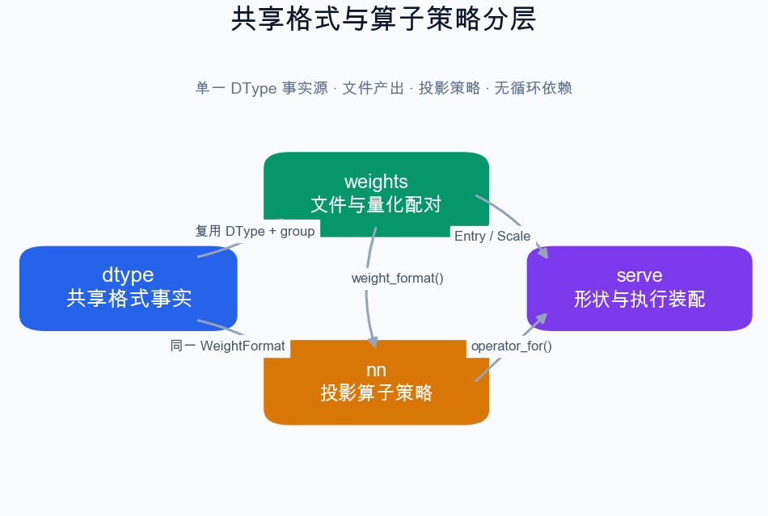
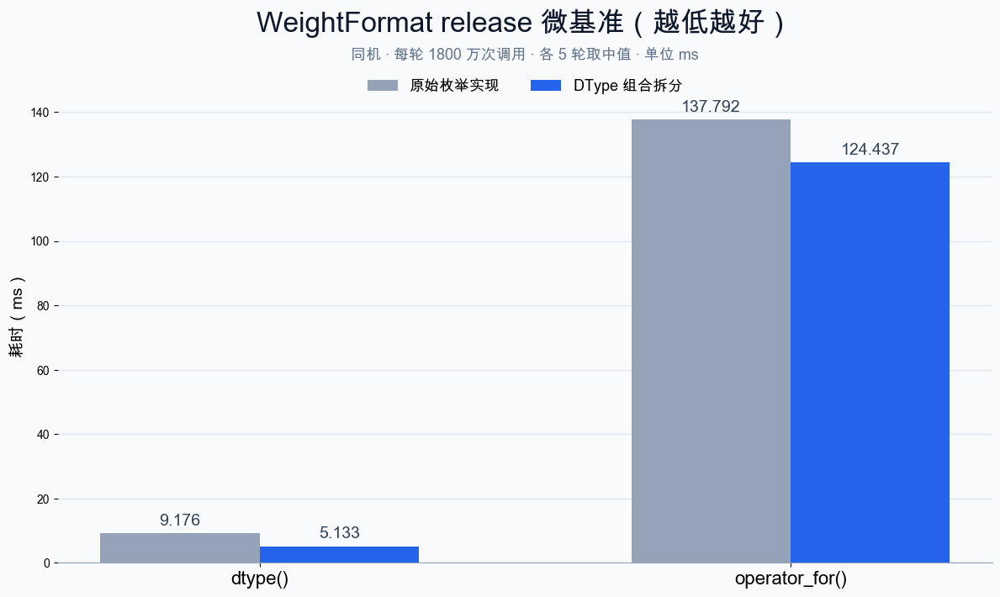

# 组合式权重格式架构：调研、实施与验证报告

## 执行摘要

本次调研与实施回答的不是“`weight.rs` 应该搬到哪个目录”，而是“元素类型、量化分组、文件推断和投影算子分别应该由谁拥有”。对 Burn、PyTorch、AMD Quark、Candle、GGML、ONNX 与 safetensors 的官方实现进行交叉核对后，可以确认一条稳定结论：基础数据类型与量化参数适合组合成共享值对象，文件层负责从真实条目推导量化事实，具体算子是否支持该事实则属于执行层的能力协商。Burn 的 `DType::QFloat(QuantScheme)` 直接体现了这种组合方式，PyTorch 也把 `dtype`、`qscheme`、scale/zero-point 与算子支持范围分开处理。[^1^][^3^]

项目最终采用 `dtype::WeightFormat = DType + group + quantized`，保持 16 字节值布局；`weights::Quantized::weight_format()` 直接产出该共享类型；`nn::Linear::operator_for()` 独占 `gemv` 名称和注册表分组校验；`serve` 继续通过 `dtype().bits()` 推导打包密度。该结构没有 newtype、动态分发或跨层重复转换，且新增的 `nn → dtype` 边指向叶层，不构成 `nn ↔ weights` 循环。共享 Serde 仍使用既有可选 feature，默认 `no_std` 构建不增加依赖。

功能回归、架构门、全仓 Clippy、Ruff、静态复杂度门和重复率检查均通过。最新同机 release 微基准显示，`dtype()` 从 9.176 ms 降至 5.133 ms，`operator_for()` 从 137.792 ms 降至 124.437 ms，分别约为原来的 1.79 倍和 1.11 倍速度；类型大小保持 16 字节。该结果只覆盖每种操作每轮 1800 万次调用的微基准，不能外推为端到端推理加速。

不过，**“大量减少代码”尚未成立**。核心与相关测试按统一口径从 3017 行增至 3198 行，净增 181 行，约 6.0%。主要增量来自 `no_std` 兼容的 Serde 适配、共享转换入口和按所有权拆分的验证代码。`format.rs` 等多个存量文件仍超过 300 行硬门，统一 CI 仍因缺少 `cloc` 中止，GitHub CI 未执行。因此，本报告将架构复用和微基准改进视为已实现结果，将代码净减量和完整验收明确列为未完成。

## 1. 评估口径与现状诊断

### 1.1 判断标准

本次评估使用五个按优先级排列的判据。首先是正确性：同一物理类型必须允许“文件合法但内核不支持”，不能为了复用而把分组缺省成某个内核默认值。其次是职责内聚：`DType` 的位宽和名称只定义一次，文件配对规则只定义一次，`gemv` 选择也只定义一次。再次是依赖方向：共享能力只能向叶层下沉，不能让 `weights` 反向认识 `nn::Linear` 或 `nn::registry`。最后是实际性能与代码密度：减少分支和重复映射必须有 release 对照，代码行数必须按最终格式化结果统计，不能用文件移动代替减量。

原始 `nn::weight.rs` 同时包含格式值、稳定配置名、Serde、显示、量化位宽转换、算子名称和注册表诊断。随着 `DType` 组合结构形成，继续把整个文件留在 `nn` 会浪费其纯数据部分；把它整体搬入 `weights` 又会把 `Linear` 和注册表一并拖入文件层。真正需要拆开的不是代码行，而是“存储事实”“文件推断”和“执行策略”三种变化原因。它们分别随精度标准、文件格式和内核能力变化，强行合并只会让任一侧变化都扩散到另外两层。

### 1.2 候选方案比较

| 方案 | 复用能力 | 依赖与语义 | 性能与代码风险 | 结论 |
|---|---|---|---|---|
| 整文件留在 `nn` | `weights` 不能直接复用纯格式 | 无循环，但共享数据被层策略包住 | 重复描述和转换容易增长 | 只适合作为过渡 |
| 整文件移入 `weights` | 文件侧方便，算子侧反向依赖 | `weights → nn` 与现有 `nn → weights` 冲突 | 会形成循环依赖 | 排除 |
| 共享数据放 `weights` | 两侧可使用同一值 | 无循环，但通用格式绑定文件 crate | 配置与非文件消费者被迫依赖文件层 | 可行但非最优 |
| **共享数据放 `dtype`** | `weights`、`nn`、`serve` 共用同一值 | `weights → dtype`、`nn → dtype`，均向下 | 无包装、无重复转换，保留直接字段访问 | **采纳** |
| newtype 包装共享值 | 可保留部分旧 API | 需要转换层与额外公共类型 | Rust 虽可零成本消除包装，但代码与调用更复杂 | 不采纳 |

Rust 的 newtype 在运行时可以零成本消除，但这并不意味着它没有工程成本：公共构造、转换、文档和调用点都会增加。[^10^] 本项目的 `Linear` 已拥有 `DENSE / I2 / OP / I8` 常量，直接提供 `Linear::operator_for(format)` 比为外部格式再包一层类型更简洁，也更容易维持“格式身份”和“投影策略”各自单一事实源。

## 2. 业界实现的证据

### 2.1 Burn：基础类型与量化方案组合

Burn 的 `DType` 包含 `QFloat(QuantScheme)`，而不是为每一种量化分组复制一套浮点或整数类型。其 `QuantScheme` 进一步区分逻辑值类型、物理存储类型、量化模式和可选的 per-tensor/per-block scale 层级。这个结构说明“类型身份”与“量化参数”可以组合而不失去清晰度，也证明逻辑值与物理存储并不是同一个维度。[^1^][^2^]

本项目没有复制 Burn 的全部字段，因为当前闭集只需要 `DType`、分组和是否量化三项。照搬 `value/store/mode`、多级 scale 和块排列会引入没有消费者的状态，并破坏现有 16 字节布局。合理借鉴的是组合原则：基础类型只保留一份，量化差异通过参数表达，执行后端不进入该值对象。

### 2.2 PyTorch 与 Quark：量化参数和算子支持分离

PyTorch 的量化 API 将 `dtype`、`qscheme`、scale 和 zero-point 分开描述，并明确指出不同算子只支持特定的量化方式。即使一个张量的量化声明完全合法，也不意味着任意 linear 或 conv 实现都能直接消费它。这与本仓“格式可以声明，但无法推出下界”的三态设计一致：文件合法、层可声明和内核可执行不是同一件事。[^3^]

AMD Quark 的 `QuantizationSpec` 则把 `dtype`、`qscheme`、`ch_axis` 和 `group_size` 放在同一配置对象中，导出 GGUF 和实际执行是后续阶段。它直接支持把 `group_size` 作为量化规格字段，而不是编码进另一套类型名或写死到内核中。本项目的 `weights::Quantized` 已能从权重与 scale 条目推出该分组，因此最合适的方向就是让推断结果直接转成共享格式。[^4^]

### 2.3 Candle 与 GGML：格式对象、执行对象和描述表

Candle 的 `QTensor` 持有量化存储和形状，`QMatMul` 独立决定执行路径。其 `GgmlDType` 负责格式，`QMatMul::forward` 负责矩阵计算，说明格式对象与执行对象应当分离。与此同时，Candle 在不同后端中重复出现格式匹配，提示一个反例：若每种消费方都重新写格式分派，代码会快速膨胀。本项目应保留其职责分离，但集中转换入口，而不是复制其多后端分派方式。[^5^]

GGML 的 `type_traits[]` 将类型名、块大小、存储大小、量化标记、转换函数和 `vec_dot` 集中定义，体现了表驱动对消除映射漂移的价值。不同之处在于，GGML 的执行函数与格式同表是它自身执行层的合理选择；本项目的 `dtype` 是跨文件和跨算子的叶层，不能照搬这种依赖。最终采用“`dtype` 格式描述表 + `nn` 投影策略唯一入口”，而不是建立一张包含所有设备与业务名称的全局大表。[^6^]

### 2.4 ONNX 与 safetensors：图语义和文件语义的边界

ONNX 同时支持算子导向的量化表达和张量导向的 QDQ 表达，不同执行提供方对量化算子的支持范围也不一致。量化格式因此是图和数据的描述，而不是某个后端一定可执行的保证。将该结论应用到本项目，就是 `weights` 可以产出合法量化事实，`nn` 再根据注册表拒绝或接受，`serve` 再做形状和参数装配，三者不能互相替代。[^7^]

safetensors 的 `TensorInfo` 仅包含 `dtype`、`shape` 和 `data_offsets`，其 `View` trait 让不同张量实现复用文件序列化逻辑。这印证了文件格式应保持中立：基础文件契约不需要知道 `gemv`，量化 scale 的配对和推导应由 `weights` 完成。共享格式类型则从该推导结果生成，而不是让 `nn` 再写一套文件命名和 scale 形状规则。[^8^]

### 2.5 Rust 类型布局、孤儿规则与 Cargo feature

Rust 官方文档确认 `Option<NonZeroUsize>` 与 `usize` 同尺寸，但本项目已有 `group = 0` 的声明语义：它可以被构造，随后因分组不匹配而不可计价。直接改为 `NonZeroUsize` 会把这种输入提前拒绝，属于行为变化，不能为了布局优化偷改契约。因此保留 `DType + usize + bool` 的 16 字节结构更合适，既避免 `Option<usize>` 的额外布局，也不改变零分组输入路径。[^9^]

Cargo feature 的加法组合原则则要求 `serde` 只是可选能力，不能让默认 `no_std` 消费者承担额外依赖。共享格式的 Serde 因此放在 `dtype/serde` 下，`nn` 显式启用，`weights` 的默认使用不需要开启。反序列化借用输入 `&str`，避免为了格式转换引入 `String` 和堆分配；这与 `no_std` 和减少临时分配的要求一致。[^11^]

## 3. 目标架构与实施结果

### 3.1 依赖方向与公共 API

最终依赖为 `weights → dtype` 和 `nn → dtype`，同时保留 `nn → weights` 的既有文件消费关系。`nn` 新增的是指向叶层的内部依赖，不是反向依赖。架构文档已将 `WeightFormat` 的唯一所有者登记为 `dtype`，并把 `Linear::operator_for` 登记为格式到投影算子的唯一入口，避免源码、crate 头注释和架构表分别维护不同说法。

| 能力 | 唯一入口 | 不承担什么 |
|---|---|---|
| 元素类型、位宽、规范名 | `dtype::DType` | 不知道文件、层和算子 |
| 共享格式值与量化分组 | `dtype::WeightFormat` | 不知道 `gemv`、设备或后端 |
| 文件量化配对与逻辑位宽 | `weights::Quantized` | 不判断上层算子能力 |
| 文件到共享格式转换 | `Quantized::weight_format()` | 不复制 `nn` 的注册表逻辑 |
| 格式到投影算子 | `Linear::operator_for()` | 不读取文件或字节区间 |
| 无法计价原因 | `Linear::unpriced_reason_for()` | 不把合法文件误判为损坏 |
| 打包密度与执行形状 | `serve` 中的 `8 / dtype.bits()` | 不重复 I2/I4/I8 分派 |

`nn::WeightFormat` 只是 `dtype::WeightFormat` 的再导出，保留大多数构造器和配置调用。算子调用则从 `format.operator()` 改为 `Linear::operator_for(format)`，使“谁拥有算子常量，谁就拥有算子选择”成为显式 API，而不是依靠一个类型看似全能的方法。`weights::Quantized::weight_format()` 复用 `WeightFormat::from_quantized()`，因此 2/4/8 位映射只需一张描述表；未知位宽返回 `None`，不会静默回退到 int4。

### 3.2 `no_std`、Serde 与命名

共享核心使用 `core::fmt`，`DType`、描述表和构造器都不需要标准库。Serde 通过 `#[cfg(feature = "serde")]` 隔离，反序列化的临时结构借用输入文本，并继续拒绝未知字段、缺失分组和无分组格式上多余的 `group`。全特性与默认构建分别验证，确保可选 feature 不会把 `no_std` 变成一句只写在文档里的承诺。

命名统一为 `BF16 / PACKED2 / PACKED4 / INT2 / INT4 / INT8`，避免关联常量同时出现枚举变体风格和常量风格。`operator_for` 与 `unpriced_reason_for` 明确表达“为某个格式求投影策略”，`weight_format` 则表达“从文件量化事实产出共享格式”。这些名称刻意避开 `util`、`helper`、`process` 等无法说明所有权的兜底词。

## 4. 性能与质量验证

### 4.1 Release 微基准

性能探针在同一机器、同一 release profile 下运行，每种操作每轮覆盖 1800 万次调用，基线和最终各执行 5 轮并取中值。`dtype()` 从 9.175834 ms 降至 5.133459 ms，约为 1.79 倍速度；`operator_for()` 从 137.791791 ms 降至 124.437250 ms，约为 1.11 倍速度。`size_of::<WeightFormat>()` 在基线和最终均为 16 字节，没有通过扩大值对象换取查表或减少分支。

| 指标 | 原始枚举实现 | 最终组合拆分 | 比值 |
|---|---:|---:|---:|
| `dtype()` 中值 | 9.176 ms | 5.133 ms | 约 1.79× |
| `operator_for()` 中值 | 137.792 ms | 124.437 ms | 约 1.11× |
| 类型大小 | 16 B | 16 B | 不变 |
| 调用次数 | 每轮 1800 万 | 每轮 1800 万 | 相同 |
| 构建方式 | release | release | 相同 |

这些数字证明的是直接字段访问和集中策略在该微基准中的收益，不是文件 I/O、模型加载或端到端 token 吞吐提升。`operator_for()` 仍包含注册表查询，不能把它解释成整个 GEMV 执行的加速。若后续需要声明端到端性能提升，必须补充固定模型、固定形状、固定线程数和固定硬件上的完整推理对照。

### 4.2 正确性与质量门禁

| 验证项 | 最终结果 |
|---|---|
| `dtype` 全特性 | 29 + 10 + 7 通过 |
| `dtype` 默认构建 | 28 + 8 + 7 通过 |
| `nn` | 562 通过、4 忽略，另有 2 个文档测试通过 |
| `weights` | 261 + 3 + 16 + 3 通过、8 忽略 |
| `serve` | 198 + 4 + 3 通过、0 忽略 |
| 架构门 | 117/117 通过 |
| 静态质量门 | 13/13 通过 |
| 全工作区 Clippy | 通过 |
| Ruff | 通过 |
| `jscpd` | 0.00%，未发现重复 |
| 统一 `scripts/ci.sh` | rustfmt、Clippy、Ruff 通过后，因缺少 `cloc` 中止 |

测试覆盖了所有格式与 `DType` 的往返、逻辑量化位宽、零分组、未知位宽、16 字节布局、TOML 全格式往返、缺失或多余分组拒绝、`weights::Quantized` 到共享格式的产出、投影算子选择、int2/int4/int8 的端到端装配以及错误诊断。`weights` 文档另发现一处既存 `ledger.rs` 私有文档链接警告，该问题没有被本次修改掩盖或计为通过。

## 5. 代码密度、剩余风险与未完成项

### 5.1 真实代码账

| 文件 | 原始行数 | 最终行数 | 净变化 |
|---|---:|---:|---:|
| `dtype/src/format.rs` | 244 | 485 | +241 |
| `nn/src/weight.rs` | 205 | 87 | −118 |
| `dtype/tests/weight_tests.rs` | 0 | 99 | +99 |
| `nn/tests/format_tests.rs` | 178 | 113 | −65 |
| `weights/src/quant.rs` | 867 | 874 | +7 |
| `weights/tests/quant.rs` | 291 | 320 | +29 |
| `nn/src/stack.rs` | 743 | 736 | −7 |
| `serve/src/plan.rs` | 489 | 484 | −5 |
| **合计** | **3017** | **3198** | **+181（约 6.0%）** |

这次改造确实消除了平行格式类型、重复位宽分派和跨层 Serde 依赖，但总行数仍然增加。增量主要来自 `no_std` 下的完整 Serde 适配、共享 `from_quantized` 转换以及按所有权拆分的独立测试。`dtype/src/format.rs` 承载了原有通用格式 trait 与新的共享格式模块，因此文件本身也超过 300 行硬门。不能用“代码被移动了”或“公共类型复用了”来宣称“代码大量减少”。

### 5.2 尚未闭合的约束

当前最重要的未完成项有三类。其一，代码净减量为 +181 行而非负数，后续若要兑现减量，必须优先研究如何复用通用 Serde 机制或简化兼容层，不能删除有效测试、诊断和注释凑指标。其二，`format.rs`、`quant.rs`、`stack.rs`、`plan.rs` 等存量文件仍超过 300 行，虽然静态门通过，但仓库规定的文件长度目标尚未满足。其三，统一 CI 因本机缺少 `cloc` 中止，后续 nextest、依赖卫生和完整工作流未执行，GitHub 托管 CI 也未运行。

性能证据同样需要继续补强。当前微基准只比较格式访问和算子选择，不含分配计数、模型加载、真实权重反量化或端到端推理。任何“全面提升性能”的进一步主张都必须补充相同模型、形状、线程和硬件下的 release 对照，并说明波动区间。将微基准直接写成推理加速会超出证据范围。

## 6. 结论

最优架构不是选择 `nn` 或 `weights` 中的一个目录，而是让三种变化原因各自归位：`dtype` 拥有共享格式身份和量化分组，`weights` 拥有文件条目与量化配对，`nn::Linear` 拥有投影算子和注册表兼容性。该方案得到 Burn、PyTorch、Quark、Candle、GGML、ONNX 和 safetensors 的共同支持，也符合 Rust 的依赖、类型布局和 feature 规则。实施后的公共 API 没有 newtype 和额外转发层，`weights` 已能直接产出共享格式，文件与算子之间不再互相反向调用。

从结果看，**复用、命名、正确性、架构方向和微基准性能均已改善，但代码净减量和完整验收尚未完成**。后续最有价值的工作不是继续移动文件，而是在保持这些收益的前提下收敛 Serde 兼容层和超大文件，并补齐 `cloc` 环境及完整 CI。只有这些约束同时闭合，才能把本次改造称为全面达标，而不是一次有明确收益但仍留有账目的架构迭代。
